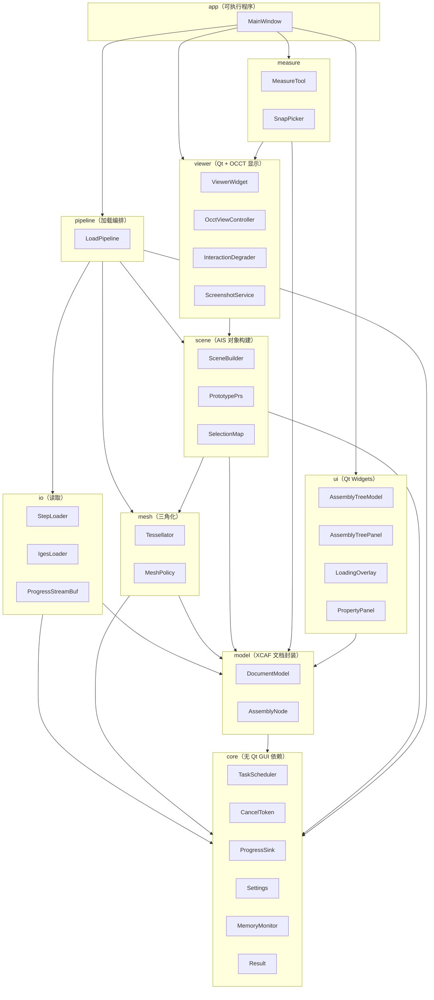
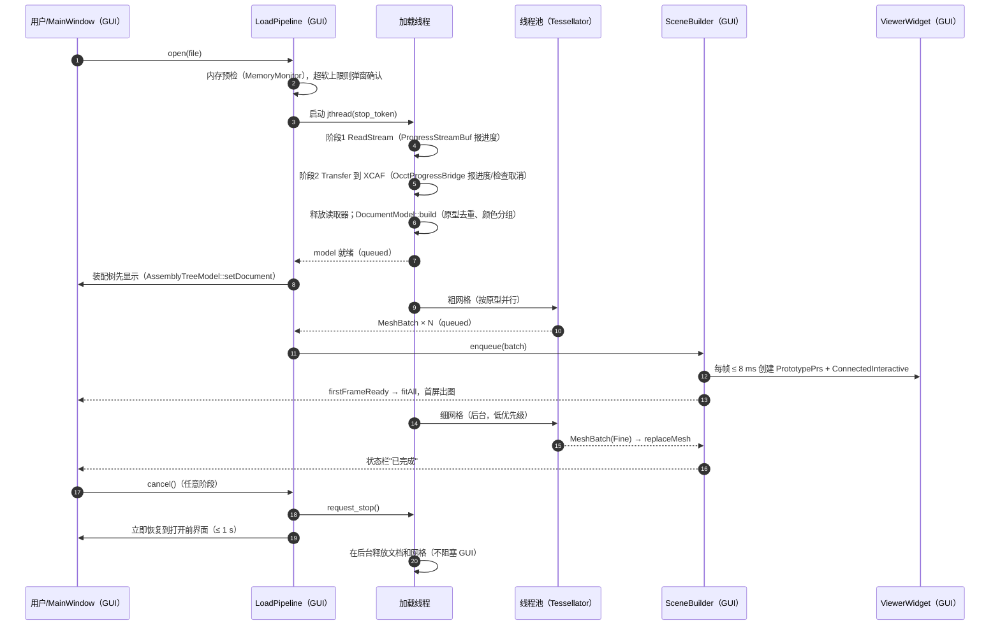
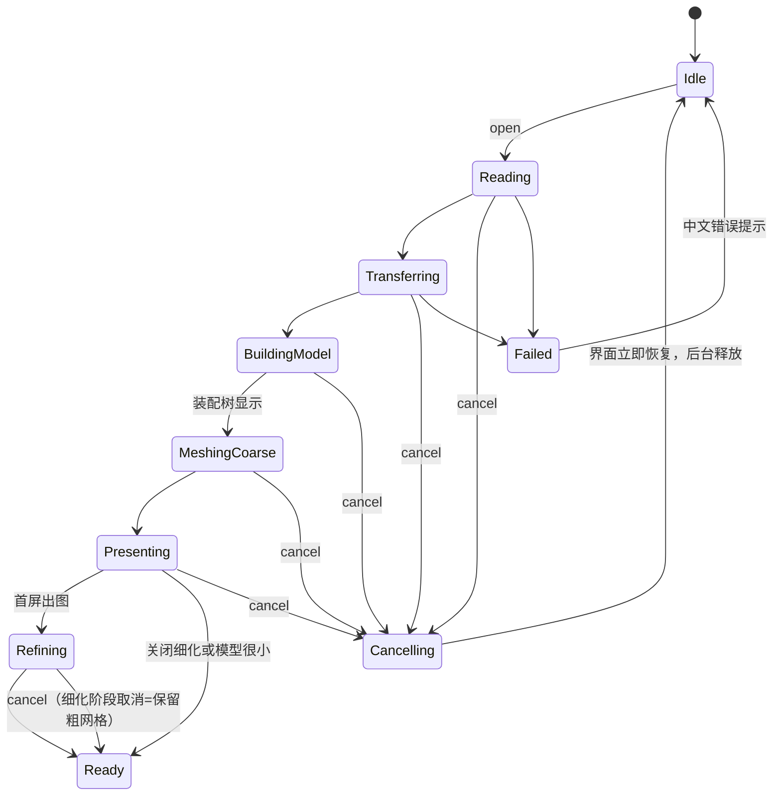
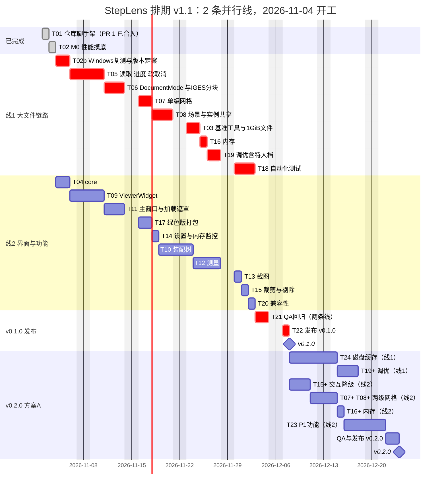

# StepLens 架构设计文档（STEP/IGES 轻量查看器 MVP）

| 项目 | 内容 |
|---|---|
| 文档版本 | **v1.1（2026-11-04，按 M0 摸底实测修订）**；v1.0（2026-11-03，初稿） |
| 编写 | 资深架构师（虚拟开发团队） |
| **依据的 PRD 版本** | **PRD v0.2**（`/workspace/prd/step-viewer-mvp-prd.md`，标题为 v0.2，状态"老板已确认 v0.1 问题，待架构师评估性能指标"）。同目录的 `step-viewer-mvp-prd-v0.1.md` 是旧版，本文不以它为准 |
| 配套附件 | 样例清单 `/workspace/prd/samples.md`（PRD v0.2 第 7 节附件）；本文的样例扫描脚本和结果放在 `/workspace/design/data/`（`scan_step.py`、`step-scan.json`） |
| 项目名 / 仓库 | **StepLens**，私有仓库 https://github.com/gdTang123/StepLens （默认分支 `main`；脚手架 PR #1 已合入；PRD 和本文以后放进仓库 `docs/`。本次修订未查看或改动仓库） |
| 配套实测 | M0 摸底报告 `/workspace/bench/spike-m0.md`（原始输出 `/workspace/bench/results/`），v1.1 中的实测数字均以它为准 |
| 读者 | 开发、测试、老板（第 1、10、15 节是给老板看的结论） |

> 说明：版本号在 2026-11-03 核实过（来源见附录 A）。v1.1 起，性能和内存数字分三类并逐项标注：**【实测】**（摸底报告，Linux 云虚拟机、单次运行）、**【外推】**（按实测吞吐率推算）、**【目标】**（留余量后的建议值）。没有实测依据的地方仍标"需确认"或"未测"。

### 修订记录

| 版本 | 日期 | 修订内容 |
|---|---|---|
| **v1.1** | **2026-11-04** | 按 M0 摸底报告（`spike-m0.md`）和老板新确认的事项修订：① 第 6 节性能目标按实测重定，新增 400 MiB–1 GiB"特大"档（外推）、软取消定义与指标、进度条分配、基准机改为带独显的团队台式机（待确认）及换算方法；② OCCT 版本改为 v0.1 用 7.9.3（8.0.1 读超大 IGES 崩溃），句柄写法改为 `opencascade::handle`；③ 按 2 条并行开发线、2026-11-04 开工重排，T01/T02 已完成，方案 B 12-07、方案 A 12-23；④ 第 5 节内存表、取消、进度、IGES 用实测替换估算；⑤ 风险表、不确定点、CI 额度（只在 PR 和 main 推送时运行）更新；⑥ 新增 7.5（生成 1 GiB 测试文件）、第 14 节（下一批开工任务）、第 15 节（需要老板拍板的事项）；⑦ 修正 3.6 中的乱码字符 |
| v1.0 | 2026-11-03 | 初稿：技术选型、模块与接口、大文件方案、四档目标、风险、任务与 A/B 方案 |

---

## 目录

1. [结论摘要（给老板）](#1-结论摘要给老板)
2. [需求要点与约束](#2-需求要点与约束)
3. [技术选型和版本](#3-技术选型和版本)
4. [模块划分、核心接口与线程模型](#4-模块划分核心接口与线程模型)
5. [大文件方案（重点）](#5-大文件方案重点)
6. [性能目标（五档）](#6-性能目标五档v11-按-m0-实测重定)
7. [测试样例与基准测试](#7-测试样例与基准测试)
8. [主要风险和应对](#8-主要风险和应对v11-按摸底结果更新)
9. [任务拆分、关键路径与里程碑](#9-任务拆分关键路径与里程碑v11-按-2-条并行线重排)
10. [工期结论：方案 B 先交付，再补方案 A](#10-工期结论方案-b-先交付再补方案-av11-按-2-条并行线和实测修订)
11. [代码仓库结构与编码规范](#11-代码仓库结构与编码规范)
12. [不确定点与待确认清单](#12-不确定点与待确认清单v11-更新)
13. [附录](#13-附录)
14. [下一批开工任务](#14-下一批开工任务2-条线2026-11-04-起)
15. [需要老板拍板的事项](#15-需要老板拍板的事项)

---

## 1. 结论摘要（给老板）

| 问题 | 结论（v1.1，已按 M0 摸底实测修订） |
|---|---|
| 用什么做 | C++20 + **Qt 6.12 LTS**（6.12.0）+ **OCCT：v0.1 用 7.9.3，同一份代码保持能用 8.0.1 编译**（见 3.3；以 Windows 复测 T02b 结果为准）+ CMake 4.x（最低 3.25）+ MSVC 2022 x64。OCCT/FreeType 用 vcpkg 清单模式，基线 2026.10.16 不变，用 `overrides` 锁定 OCCT 版本；Qt 用官方预编译包。 |
| 怎么显示 | Qt `QOpenGLWidget` + OCCT `AIS_ViewController`，原生窗口句柄方案作后备（GPU 相关项摸底时没有显卡，尚未实测）。 |
| 摸底实测（T02，Linux 云虚拟机，单次） | 5 个 225–357 MiB 的超大 STEP **全部能打开**，读取 + 转换 + 网格全流程 **56–72 s**，峰值内存 **1.3–1.9 GB**；**转换占 60–82% 时间**，三角化只要 2.6–5.5 s。大档的 L-03（167 MiB）反而最慢（87 s），说明耗时与文件大小不是线性关系。 |
| 阻断问题 | **超大 IGES（X-07）在 OCCT 8.0.1 转换阶段段错误（5 次全崩）**，7.9.3 正常。IGES 在 PRD v0.2 中是 P0，而且绿色版里崩溃就是整个程序闪退，所以 v0.1 不能用"会崩溃的 8.0.1"。 |
| 老板的真实文件 500 MB–1 GB | 没有这么大的样例，按实测吞吐率**外推**：1 GiB 文件首次打开约 **3–6 分钟**（个别"慢型"文件可能 9–10 分钟），峰值内存约 **5–9 GB**。v0.1 能打开、不崩溃、可取消，但**首次打开慢是 OCCT 单线程转换决定的**，只有 v0.2 的磁盘缓存能解决"重复打开慢"。 |
| 取消 | 采用**软取消**：点取消后界面 ≤ 1 s 恢复；后台在 OCCT 下一个检查点退出并释放。实测最坏检查点空档 13.7 s（L-03），1 GiB 文件外推后台最长约 60 s 才释放完。 |
| 工期（开发并行线 ≤ 2 条，2026-11-04 开工） | **方案 B（v0.1.0）剩余 46 人天，预计 2026-12-07（周一）交付**，最晚 12-11；**方案 A（v0.2.0）再加 17 人天 + P1 4 人天，预计 2026-12-23 交付**。2 条并行线是工期的主要约束。 |
| 推荐 | 按老板已确认的顺序：先 B 后 A。v0.2 的重点从"粗细两级网格"改为**磁盘缓存（重复打开快）+ 交互降级**，因为实测三角化只占几秒，先粗后细对首屏帮助很小。需要老板拍板的 5 件事见第 15 节。 |

## 2. 需求要点与约束

### 2.1 来自 PRD v0.2 的硬约束

| 类别 | 约束 | 对架构的影响 |
|---|---|---|
| 平台 | Windows 10/11 x64，不支持 Win7/8 | 只编 x64；Qt 6.12 官方支持 Windows 10（1809+）和 11，且官方注明 6.12 是最后一个支持 Windows 10 的 Qt 版本（见附录 A），正好覆盖本项目 |
| 发布 | 绿色版 zip，解压即用，无安装程序、无管理员权限、不写注册表、无代码签名 | 设置不能用 `QSettings` 默认的注册表后端（必须 `IniFormat`）；VC++ 运行库放在程序目录（app-local）；文件关联（P1-7）只写 HKCU 且默认不执行 |
| 用户 | 老板和内部工程团队，仅内部使用 | 界面按熟悉 CAD 的工程人员设计；许可证按"内部分发"处理（仍保留许可证文本） |
| 格式 | STEP（AP203/AP214/AP242 几何部分）和 IGES，都是 P0 | 加载器抽象成 `ILoader`，STEP 和 IGES 两个实现 |
| 核心场景 | S4：200 MB 以上大装配后台加载、进度可见、可取消，加载后流畅浏览、内存不爆（P0-11） | 第 5 节整体设计 |
| 鼠标 | 左键旋转、中键平移、滚轮以光标为中心缩放（定稿） | `AIS_ViewController` 的鼠标手势映射表直接配置 |
| 测量 | 距离（点/边/面组合）、角度，误差 ≤ 0.001 mm / 0.01° | 测量必须基于 B-Rep 精确几何（`BRepExtrema_DistShapeShape` 等），不能基于网格；所以**不能为了省内存丢弃 B-Rep** |
| 截图 | PNG/JPG，含测量标注、不含工具栏，P1 有 2×/4× | 用 `V3d_View::ToPixMap` 离屏渲染，转 `QImage` 保存，不需要 FreeImage |
| 界面 | 中文，单文档 | 字符串统一走 `tr()`，为 P2 英文留口子 |

### 2.2 v0.1 → v0.2 对架构影响最大的变化

1. "取消"从 P1 提升为 P0，且要求"取消后回到打开前的状态、内存释放"。→ 必须设计贯穿所有阶段的取消机制（5.3 节）。
2. 200 MB 以上从"只保证能打开"升级为"流畅可用"（P0-11）。→ 必须做实例共享、粗细两级网格、交互降级、内存控制（第 5 节），工期受影响（第 10 节）。
3. 性能指标分四档，数值由架构定。→ 第 6 节（v1.1 按老板日常 500 MB–1 GB 文件增加"特大"档，共五档）。

---

## 3. 技术选型和版本

### 3.1 版本总表（2026-11-03 核实）

| 组件 | 选定版本 | 核实情况 | 备选 / 说明 |
|---|---|---|---|
| Qt | **6.12.x LTS**（当前 6.12.0，2026-09-30 发布） | Qt 官方 "Qt Releases" 页面列出 Qt 6.12（6.12.0）为当前版本，并说明"从 6.8 LTS 起每第四个小版本为 LTS"（即 6.12）；endoflife.date 标注 6.12 为 LTS。开源版对 6.12 的补丁支持到 2027-04-01 左右（下一个小版本发布时），商业版 LTS 到 2031 | 6.11.3（2026-10-26，6.11 系列最后一个补丁）；6.8 LTS 的后续补丁（6.8.8）只给商业用户，开源用户拿不到，**不选** |
| OCCT | **v0.1 用 7.9.3**（2025-12-06 发布）；代码保持兼容 **8.0.1**（2026-07-30 发布） | GitHub Releases：V8.0.1、V7_9_3；vcpkg 基线 2026.10.16 内为 8.0.1，版本库中有 7.9.3（port-version 0、1），用 `overrides` 锁定 | 选 7.9.3 的原因：摸底中 8.0.1 读超大 IGES（X-07）必崩，见 3.3；T02b 在 Windows 复测后定稿 |
| CMake | 最低 **3.25**，推荐 **4.4.x**（cmake.org 当前稳定版 4.4.5，另有 3.31.12 和 4.5.0-rc2） | cmake.org/download | 最低 3.25 的理由：CMakePresets schema v6（workflow presets）需要 3.25；OCCT 7.9.3 和 8.0.1 自身都要求 ≥ 3.10，不构成限制 |
| 编译器 | **MSVC 2022（v143）x64**，用 VS 2022 最新 17.x 补丁 | Qt 6.12 支持平台页列出 Windows 10/11 x86_64 使用 MSVC 2022 | 不用 MinGW（OCCT/vcpkg/调试工具链在 MSVC 下更成熟） |
| vcpkg | 基线锁定到发布标签 **2026.10.16**（2026-10-20 发布） | GitHub API | 每个里程碑评估一次是否升级基线 |
| oneTBB | vcpkg `tbb` 2023.1.0（仅在 spike 证明有收益时启用） | vcpkg 端口文件 | 默认不启用，见 3.7 |
| FreeType | vcpkg `freetype` 2.14.3（OCCT 文字渲染需要，测量标注、坐标轴字母要用） | vcpkg 端口文件 | 必需 |
| FreeImage | **不使用** | — | 截图用 Qt 的 `QImage` 保存，省掉一个依赖和一个许可证问题 |
| 单元测试 | GoogleTest（核心库）+ Qt Test（界面） | — | 见 11.6 |

### 3.2 Qt 版本取舍

- **选 Qt 6.12 的理由**：① 是 Qt 6.8 之后的下一个 LTS，2026-09-30 刚发布，生命周期最长；② 官方明确支持 Windows 10/11 + MSVC 2022；③ 6.12 是最后一个支持 Windows 10 的版本，本项目必须支持 Win10，选它可以"锁住"一段时间不被迫升级。
- **代价**：① 开源用户拿不到 LTS 补丁，6.12.x 的开源补丁只会持续到 6.13 发布（约 2027 年 4 月）；内部工具问题不大，后续按需升级；② 6.12.0 是 .0 版本，可能有新 bug——M0 的 spike 会用到 `QOpenGLWidget`，如果发现阻塞问题，退回 6.11.3（同样官方支持 MSVC 2022）。
- **不选 vcpkg 编 Qt**：vcpkg 最新发布标签里 `qtbase` 还是 6.11.2（master 为 6.11.3），没有 6.12；而且 vcpkg 从源码编 Qt 需要很长时间（CI 和新人环境都慢）。Qt 用官方在线安装器（开发机）和 aqtinstall / `install-qt-action`（CI）安装官方预编译的 `msvc2022_64` 包。**CI 工具对 6.12 的支持需确认**。
- 用到的 Qt 模块：Core、Gui、Widgets、OpenGL、OpenGLWidgets、Concurrent（可选）、Test（测试）、LinguistTools（构建期）。不用 QML、WebEngine，体积最小。

### 3.3 OCCT 版本取舍（v1.1 按摸底结果重新决策）

**摸底事实（以 `/workspace/bench/spike-m0.md` 原文和 `results/` 原始输出为准）**：
- STEP：L-03、X-01～X-05 在 **8.0.1** 上全部成功（Linux + gcc + conda-forge 构建）。**报告没有在 7.9.3 上测 STEP**，所以"两个版本在 STEP 上的速度/内存差异"**目前没有数据**。
- IGES：X-07（254 MiB）在 **8.0.1** 上 5 次运行全部在 `IGESCAFControl_Reader::Transfer` 内段错误（正常参数、不挂进度、关颜色名称、栈不限、gdb 各一次）；在 **7.9.3** 上成功（读 4.2 s + 转换 64.4 s，峰值 1.5 GB）。
- 两个版本用同一份原型代码都能编译通过，原型统一写的是 `opencascade::handle<T>`（不是 `occ::handle<T>`）。
- 崩溃是在 Linux/conda-forge 构建上复现的，**Windows + MSVC + vcpkg 构建是否也崩溃还没测**；也没有调试符号，根因未知。

**PRD 约束**：IGES 是 P0（P0-2：样例集中全部 IGES 都要正确显示；P0-11：用 X-01～X-08 验收，其中 X-06～X-08 是超大 IGES）。绿色版是单进程程序，读取库崩溃 = 程序闪退，直接违反 P0-11 ⑥"不崩溃"。

**候选方案对比**：

| 方案 | 做法 | 优点 | 缺点 / 代价 |
|---|---|---|---|
| ① 全部 8.0.1 | 维持现状，等 OCCT 修复 | 脚手架不用改；拿到 8.0 的 STEP 改进（但没有实测数据证明） | **超大 IGES 必崩，P0-2/P0-11 不达标**；修复时间不可控 |
| **② 全部 7.9.3（推荐用于 v0.1）** | `vcpkg.json` 的 `overrides` 改为 `{"name":"opencascade","version":"7.9.3","port-version":1}`，基线 2026.10.16 不变 | X-07 实测成功；改动最小（1 行配置 + 重新编一次 OCCT）；单进程、单份 DLL，绿色版体积和打包都不变；源码按 `opencascade::handle` 写，两个版本都能编译，以后升级 8.x 只需改回 1 行 | 拿不到 8.0 的修复（其中有"`STEPCAFControl_Reader` 挂死修复""并发 STEP 读取修复""错误处理栈 `thread_local`（并行三角化时少一次全局锁）"）；`Standard_Failure` 不继承 `std::exception`，异常要单独捕获（4.3.2 已处理）；**STEP 在 7.9.3 上的速度和稳定性需要补测**（T02b）；7.9.3 端口在新基线下能否顺利编译需验证（vcpkg 版本库里有 7.9.3 port-version 0 和 1，OCCT 7.9.3 的 `cmake_minimum_required` 为 3.10，与 CMake 4 兼容） |
| ③ 主程序 8.0.1 + IGES 走独立进程（进程内用 7.9.3） | 主程序用 8.0.1 读 STEP；IGES 由一个用 7.9.3 编译的 `steplens-iges.exe` 读取，结果写成 BRep/XBF 文件交回主程序 | STEP 用新版、IGES 用好版；IGES 崩溃不拖垮主程序 | 要编两套 OCCT（vcpkg 同一基线下不能同时装两个版本，需第二个 vcpkg 实例或 overlay port）；绿色版要带两套 TK*.dll（同名，需分目录），zip 体积可能超过 150 MB；要做进程间传输格式和进度/取消协议；**约 5–7 人天**，B 方案工期放不下 |
| ④ 主程序 8.0.1 + IGES 在独立进程（也用 8.0.1），只隔离崩溃 | 同上但只有一套 OCCT | 崩溃时主程序能给中文提示而不闪退 | **X-07 仍然打不开**，P0-2 还是不达标；只是"崩得体面" |
| ⑤ 8.0.1 + 改用 `IGESControl_Reader`（非 CAF 读取器）绕开崩溃点 | 崩溃栈顶在 `IGESCAFControl_Reader::Transfer`，可试试不用 CAF 版读取器、自己建 XCAF 文档 | 如果有效，改动小 | **完全未验证**；可能丢失颜色/名称；崩溃点也可能在更底层（没有符号无法判断） |

**决策：v0.1（方案 B）整体使用 OCCT 7.9.3（方案②）。** 理由：
1. IGES 是 P0，而 8.0.1 在超大 IGES 上实测必崩，单进程绿色版无法接受闪退；
2. 方案②是唯一"已有实测证据能读通 X-07、且改动只有 1 行配置"的方案；③ 的工期（5–7 人天）在 2 条并行线下会让 v0.1 推迟一周以上；
3. 8.0.1 在 STEP 上的优势**没有实测数据支撑**，不能拿来抵消 IGES 的崩溃风险；
4. 脚手架（PR #1）已合入，切 7.9.3 只改 `vcpkg.json` 一处；只要源码统一写 `opencascade::handle<T>`（摸底原型已验证两版都能编译），以后切回 8.x 也只改这一处。

**前提与回退（T02b，开工第 1–2 天完成）**：
- 在团队 Windows 电脑上用 vcpkg 分别编 7.9.3 和 8.0.1，复测 X-07（两版）和 X-02、L-03、X-01（两版）。
- 若 **7.9.3 的 STEP 比 8.0.1 慢 > 20% 或出现新的崩溃** → 改走"8.0.1 + 方案⑤ 试 0.5 天"，失败再评估方案③是否放进 v0.2。
- 若 **Windows 上 8.0.1 读 X-07 不崩溃** → 说明是 conda-forge 构建问题，可以保持 8.0.1，但仍需在 X-06、X-08 上各测一次。
- 无论哪种结果，都把崩溃样例和复现步骤整理好，**向 OCCT 提 issue 需要你确认后再发**（属于对外发帖，本文不代为提交）。
- v0.2 再评估升级到 8.0.x 最新维护版（如 OCCT 修复了这个崩溃）。

> 编码约定随之调整（见 11.4）：OCCT 句柄统一写 `opencascade::handle<T>`（8.x 新增的 `occ::handle` 是它的别名，7.9.3 没有 `occ::handle`），不写 `Handle(T)` 宏；不使用 8.0 新增的 API。原 v1.0 中"写 `opencascade::handle` + 兼容头"的方案作废。
> 接口兼容性：摸底原型 `spike.cpp` 用到的 `STEPCAFControl_Reader::ReadStream`、带进度的 `Transfer` 和 `UserBreak`、`IGESCAFControl_Reader`、`IMeshTools_Parameters`、`BRepMesh_IncrementalMesh` 已在 7.9.3 和 8.0.1 下用同一份源码编译通过；第 4、5 节引用的其余接口是在 8.0.1 源码中核实的，7.9.3 下由 T02b/T05 编译确认。
>
> 工具包名：STEP 为 `TKDESTEP`，IGES 为 `TKDEIGES`（摸底在 8.0.1 中确认了 `libTKDEIGES.so.8.0`；7.9.3 的名称以安装目录为准）。

### 3.4 Qt 与 OCCT 显示的集成方式

| 方案 | 做法 | 优点 | 缺点 |
|---|---|---|---|
| **A. QOpenGLWidget + AIS_ViewController（推荐）** | Qt 创建 OpenGL 上下文和 FBO；OCCT 用 `Aspect_NeutralWindow` + `OpenGl_Context::Init()` 绑定当前上下文，把 Qt 的 FBO 用 `OpenGl_FrameBuffer::InitWrapper()` 包装成 OCCT 的默认帧缓冲；鼠标/滚轮事件转给 `AIS_ViewController::UpdateMouseButtons/UpdateMousePosition/UpdateZoom`，在 `paintGL()` 里调用 `FlushViewEvents()` | 是 OCCT 社区推荐的集成方式（参考 OCCT 可视化开发者 gkv311 维护的 Qt 示例 `gkv311/occt-samples-qt`，见附录 A）；与 Qt 布局、停靠面板、浮动窗口、半透明加载遮罩完全兼容；高 DPI 由 Qt 统一处理；窗口停靠/浮动时不会出现原生窗口句柄重建的问题 | 多一次 FBO 到窗口的合成（对帧率影响小，需 spike 测量）；需要处理 Qt 与 OCCT 共用一个 GL 上下文时的状态恢复；MSAA 需要在 FBO 上配置 |
| B. 原生窗口句柄（`WId` → `WNT_Window`） | `QWidget` 设 `WA_PaintOnScreen`/`WA_NativeWindow`，把 `winId()` 交给 OCCT，OCCT 自己建上下文 | 最直接，OCCT 完全掌控渲染，帧率最好；老示例多 | 不能在 3D 视图上叠加 Qt 控件（加载进度遮罩要另起顶层窗口）；面板停靠/浮动时句柄可能重建，需要重新绑定；Qt 6 对这种用法支持一般，常见闪烁问题 |

**决策：采用方案 A**，并把渲染宿主抽象成 `IViewHost` 接口，方案 B 作为后备（如果 T02b/T09 发现方案 A 在团队电脑的显卡上合成开销明显，或者远程桌面下有问题，可以切换，不影响上层模块）。

### 3.5 构建系统：CMake + Presets + MSVC 2022

- `cmake_minimum_required(VERSION 3.25)`；工程全局 `CMAKE_CXX_STANDARD 20`、`CMAKE_CXX_STANDARD_REQUIRED ON`、`CMAKE_CXX_EXTENSIONS OFF`。
- 生成器：`Ninja Multi-Config`（构建快，CI 与本地一致）；VS 用户也可以直接打开文件夹使用 Presets。
- MSVC 关键开关：`/permissive- /Zc:__cplusplus /utf-8 /W4 /EHsc /MP`；只对本项目代码开 `/WX`（第三方头文件用 `/external:anglebrackets /external:W0` 屏蔽）。`/utf-8` 必须开，否则源码里的中文字符串会乱码。
- 只编 64 位（`x64-windows` triplet），32 位进程 2–4 GB 地址空间无法承载超大档。
- `CMakePresets.json` 规划：

```json
{
  "version": 6,
  "cmakeMinimumRequired": { "major": 3, "minor": 25, "patch": 0 },
  "configurePresets": [
    {
      "name": "base", "hidden": true,
      "generator": "Ninja Multi-Config",
      "binaryDir": "${sourceDir}/build/${presetName}",
      "toolchainFile": "$env{VCPKG_ROOT}/scripts/buildsystems/vcpkg.cmake",
      "cacheVariables": {
        "VCPKG_TARGET_TRIPLET": "x64-windows",
        "VCPKG_MANIFEST_FEATURES": "",
        "CMAKE_PREFIX_PATH": "$env{QTDIR}"
      }
    },
    { "name": "msvc",      "inherits": "base", "displayName": "MSVC 2022 x64" },
    { "name": "msvc-asan", "inherits": "base", "cacheVariables": { "STEPLENS_ASAN": "ON" } },
    { "name": "msvc-tbb",  "inherits": "base", "cacheVariables": { "VCPKG_MANIFEST_FEATURES": "tbb" } }
  ],
  "buildPresets": [
    { "name": "debug",   "configurePreset": "msvc", "configuration": "Debug" },
    { "name": "release", "configurePreset": "msvc", "configuration": "RelWithDebInfo" }
  ],
  "testPresets": [
    { "name": "unit", "configurePreset": "msvc", "configuration": "RelWithDebInfo",
      "filter": { "exclude": { "label": "bench|large" } }, "output": { "outputOnFailure": true } }
  ],
  "workflowPresets": [
    { "name": "ci", "steps": [
      { "type": "configure", "name": "msvc" },
      { "type": "build", "name": "release" },
      { "type": "test", "name": "unit" } ] }
  ]
}
```

- 发布版本用 `RelWithDebInfo`（`/O2` + PDB），PDB 不放进 zip，单独归档，用于分析崩溃转储。

### 3.6 依赖获取：vcpkg 还是自编译 OCCT（重点对比）

| 维度 | vcpkg 清单模式（`vcpkg.json` + 锁定基线） | 自编译 OCCT（CMake 源码构建） | OCCT 官方预编译包（Release 附件） |
|---|---|---|---|
| 版本可重复 | 好：`builtin-baseline` + `overrides` 锁定到具体版本 | 好：锁定 git tag | 好：固定 zip |
| 上手速度 | 新人一条命令 `cmake --preset msvc`；首次编 OCCT 需要较长时间，配合二进制缓存后很快 | 慢：要手动配 FreeType/TBB 路径，写文档 | 最快：V8.0.1 附件里有 `opencascade-release-no-pch.zip`（51.7 MB）和 `3rdparty-vc14-64.zip`（180.1 MB） |
| TBB / FreeType / FreeImage | vcpkg 端口提供 `tbb`、`freetype`、`freeimage` 等 feature，按需开关；FreeType 为默认 feature | 手动下载或也用 vcpkg 提供 | 3rdparty 包里一次性提供（体积大，含很多我们不需要的库） |
| 定制编译选项 | 只能用端口暴露的 feature；端口固定关闭 Draw 模块（对我们无影响）；其他选项（如 `USE_MMGR_TYPE` 内存管理器）需要 overlay port | 完全可控：可选内存管理器（`NATIVE/FLEXIBLE/TBB/JEMALLOC`）、只编需要的模块、打补丁 | 不可定制 |
| 打补丁（遇到 OCCT bug 时） | 用 overlay port 加 patch 文件，可控 | 直接改 | 不能 |
| 绿色版打包 | DLL 都在 `vcpkg_installed/x64-windows/bin`，打包脚本统一收集 | 自己收集 | 自己收集，需要剔除多余 DLL |
| CI | 配合二进制缓存，增量构建快 | 要自己做缓存 | 下载 zip 即可 |
| 许可证 | 每个端口在 `share/<port>/copyright` 里带许可证文本，打包时可自动汇总 | 手动整理 | 手动整理 |

**决策：OCCT、FreeType、（可选）TBB 用 vcpkg 清单模式**，基线锁定 `2026.10.16`，OCCT 版本 v0.1 用 7.9.3（v1.1 修订，见 3.3）；需要改编译选项或打补丁时用仓库内的 overlay port（`cmake/vcpkg-ports/opencascade/`），不需要切换到完全自编译。理由：① 可重复、新人和 CI 一键构建；② 第三方许可证文本能自动收集，便于 LGPL 合规；③ overlay port 保留了自编译的灵活性。M0 摸底实际用的是 conda-forge 的 Linux 预编译包；T02b 在 Windows 上改用 vcpkg 构建复测。

`vcpkg.json` 规划：

```json
{
  "name": "steplens",
  "version-semver": "0.1.0",
  "builtin-baseline": "<2026.10.16 标签对应的 commit SHA，创建仓库时填写>",
  "dependencies": [
    { "name": "opencascade", "default-features": false, "features": [ "freetype" ] },
    "gtest"
  ],
  "features": {
    "tbb": { "description": "OCCT 使用 oneTBB 作为并行后端",
             "dependencies": [ { "name": "opencascade", "features": [ "tbb" ] } ] }
  },
  "overrides": [ { "name": "opencascade", "version": "7.9.3", "port-version": 1 } ]
}
```

（v1.1：v0.1 用 7.9.3。vcpkg 版本库中 7.9.3 有 port-version 0 和 1，取最新的 1；基线不变、不需要 overlay port，除非 T02b 发现 7.9.3 端口在新基线下编译失败。以后切回 8.x 只需把这一行改成 `"version": "8.0.1"` 或删除 `overrides`。）

### 3.7 第三方依赖逐个评估

| 依赖 | 用途 | 决策 | 理由 |
|---|---|---|---|
| FreeType | OCCT 文字渲染（测量标注数字、坐标轴 X/Y/Z 字母、`AIS_ViewCube` 文字） | **必须** | 没有它 OCCT 不能画文字；许可证 FTL 或 GPL-2.0 二选一，按 FTL 使用，需在"关于"和许可证目录里声明 |
| oneTBB | OCCT 的 `OSD_Parallel` 并行后端 | **默认不启用**，spike 对比后再定 | OCCT 不编 TBB 时 `OSD_Parallel` 使用自带线程池（`OSD_Parallel::ToUseOcctThreads()`），功能足够；我们自己的任务调度用 C++20 `std::jthread` 线程池，不依赖 TBB。不启用可以少 2–3 个 DLL、少一份许可证（Apache-2.0）。保留 `msvc-tbb` 预设用于 spike 对比三角化吞吐 |
| FreeImage | OCCT 图片读写 | **不启用** | 截图用 `V3d_View::ToPixMap()` 得到 `Image_PixMap`，复制到 `QImage` 后由 Qt 保存 PNG/JPG；纹理贴图不在 MVP 范围 |
| RapidJSON / VTK / Draw | glTF、VTK 集成、Draw 测试工具 | **不启用** | 用不到 |
| GoogleTest | 单元测试 | 仅开发期 | 不进发布包 |

### 3.8 绿色版打包

1. `cmake --install` 把 `StepLens.exe` 安装到 `dist/StepLens/`。
2. 运行 `windeployqt --release --no-translations --no-system-d3d-compiler --no-opengl-sw --no-compiler-runtime StepLens.exe`，复制 Qt DLL 和 `platforms/qwindows.dll`、`styles/` 等插件；中文翻译 `.qm` 由我们自己放。
   - `--no-opengl-sw`：Qt 的 `opengl32sw.dll`（Mesa 软件渲染）只对 Qt 自己的 GL 函数生效，OCCT 直接调用系统 `opengl32.dll`，两者不在同一套函数上，带上它没有意义（远程桌面方案见 8 节风险 R7）。**这个判断需 spike 验证**。
3. 打包脚本 `scripts/package.py`（Python）用 `dumpbin /dependents` 递归收集 OCCT 和 FreeType 的 DLL（只收实际依赖的工具包，不整目录复制），复制到 exe 同级目录。
4. VC++ 运行库：把 `msvcp140.dll`、`vcruntime140.dll`、`vcruntime140_1.dll` 等从 VS 安装目录的 `VC\Redist\MSVC\<版本>\x64\Microsoft.VC143.CRT` 复制到程序目录（微软允许 app-local 部署），**不要求用户安装 VC Redist**。
5. 写 `qt.conf`（指定插件目录为相对路径），保证解压到任何目录都能运行。
6. `licenses/` 目录：Qt（LGPLv3 文本 + 获取源码方式说明）、OCCT（`LICENSE_LGPL_21.txt` + `OCCT_LGPL_EXCEPTION.txt`）、FreeType（FTL）、（如启用）oneTBB（Apache-2.0）、MSVC 运行库说明。
7. 设置文件：`QSettings(QSettings::IniFormat, ...)`，优先写程序目录下 `StepLens.ini`；程序目录不可写（如放在 `C:\Program Files`）时写 `%APPDATA%\StepLens\StepLens.ini`。**全程不写注册表**（P1-7 文件关联脚本除外，且只写 HKCU、默认不执行）。
8. 冒烟验证：在一台没有装过 VS / Qt 的干净 Windows 10 和 Windows 11 虚拟机上解压、打开 S-01、M-04、X-02，作为 T17 的验收标准。
9. 体积估计：Qt 6 Widgets 相关 DLL + OCCT 所需工具包 + FreeType，解压后估计 150–250 MB，zip 估计 60–100 MB（**估计，T17 实测**），满足 PRD"≤ 150 MB"的参考值。

### 3.9 许可证合规（LGPL）

- **Qt 6 开源版（LGPLv3）**：只动态链接，不改 Qt 源码；随包附 LGPLv3 文本，在"关于"对话框说明使用了 Qt 及其许可证；用户可以替换 Qt DLL（绿色版天然满足）；保存所用 Qt 版本号，按需提供 Qt 源码获取方式（官方下载地址）。不使用只有 GPL 许可的 Qt 模块（我们用到的 Core/Gui/Widgets/OpenGL/OpenGLWidgets 都是 LGPLv3）。
- **OCCT（LGPL-2.1 + OCCT 例外）**：动态链接；如果我们给 OCCT 打了补丁（overlay port），被修改的 OCCT 源码需要能够提供（内部使用场景下，在仓库里保留补丁即可）。
- **内部使用**：PRD 已确认只在团队内部分发、不对外销售，合规风险低；但仍按"对外分发"的标准附带许可证文本，以后如果对外发布不用返工。
- **样例文件**：GrabCAD 来源、Twin Disc 来源的样例**不能提交到仓库**，只通过 `scripts/fetch_samples.py` 按 `samples.md` 下载到本地（详见 7 节）。

---

## 4. 模块划分、核心接口与线程模型

### 4.1 模块图



依赖规则：箭头只能向下；`core`、`io`、`model`、`mesh` 不依赖 Qt GUI（只允许 QtCore 以外的零依赖，便于做纯 GoogleTest 单元测试和命令行基准工具）；只有 `scene`、`viewer`、`measure` 接触 AIS/V3d；`ui` 不直接接触 OCCT 显示类。

### 4.2 模块职责

| 模块 | 职责 | 主要类 | 运行线程 |
|---|---|---|---|
| core | 通用基础：结果类型、错误码、取消令牌、进度汇报、线程池、设置、内存监控、日志 | `Result<T>`、`Error`、`CancelToken`、`ProgressSink`、`TaskScheduler`、`Settings`、`MemoryMonitor` | 任意 |
| io | 把文件读成 XCAF 文档：分阶段、带进度、可取消；读完释放读取器 | `ILoader`、`StepLoader`、`IgesLoader`、`ProgressStreamBuf`、`OcctProgressBridge` | 加载线程 |
| model | 封装 XCAF 文档：装配树、原型（定义）与实例（引用）、名称、颜色、单位、包围盒；对外只读 | `DocumentModel`、`AssemblyNode`、`PrototypeInfo`、`NodeId`、`PrototypeId` | 加载线程构建，之后只读，任意线程读 |
| mesh | 按原型去重并行三角化；粗、细两级；统计三角形数和内存；构建显示用的顶点数组 | `Tessellator`、`MeshPolicy`、`MeshBatch` | 线程池 |
| scene | 把原型和实例变成 AIS 对象：原型共享一份显示数据，实例用变换引用；颜色分组；节点与 AIS 对象双向映射 | `SceneBuilder`、`PrototypePrs`、`SelectionMap` | **只在 GUI 线程** |
| viewer | 3D 视图宿主、鼠标映射、标准视图、坐标轴、交互降级、截图 | `ViewerWidget`、`OcctViewController`、`InteractionDegrader`、`ScreenshotService` | GUI 线程 |
| measure | 测量模式、捕捉、距离/角度计算（基于 B-Rep）、标注 | `MeasureTool`、`SnapPicker`、`DistanceMeasure`、`AngleMeasure` | 计算可放线程池，显示在 GUI 线程 |
| ui | 装配树模型和面板、加载遮罩（进度+取消）、属性面板 | `AssemblyTreeModel`（`QAbstractItemModel`）、`AssemblyTreePanel`、`LoadingOverlay` | GUI 线程 |
| pipeline | 加载编排：状态机、阶段推进、取消、失败回滚、批量向 GUI 提交 | `LoadPipeline` | 自身在 GUI 线程，工作分派到后台 |
| app | 主窗口、菜单、工具栏、状态栏、命令行和拖拽打开 | `MainWindow` | GUI 线程 |

### 4.3 核心类与接口（C++20 代码片段）

> 以下是接口草案，实际签名在实现中可以微调，但**线程归属、所有权和取消语义不能改**。OCCT 句柄统一写 `opencascade::handle<T>`（v1.1：7.9.3 / 8.0.1 都能编译）。

#### 4.3.1 core：结果、取消、进度、线程池

```cpp
// core/Result.h —— MSVC 的 /std:c++20 没有 std::expected（C++23），先用自己的轻量实现，
// 以后切到 C++23 时替换成 std::expected，调用方式保持一致。
namespace steplens {

enum class ErrorCode { Ok, FileNotFound, UnsupportedFormat, ParseFailed, TransferFailed,
                       Cancelled, OutOfMemory, MeshFailed, Internal };

struct Error {
    ErrorCode   code = ErrorCode::Internal;
    std::string message;      // 英文技术信息，写日志
    std::string userMessage;  // 中文提示，给界面（UTF-8）
};

template <class T>
class Result {
public:
    Result(T value) : m_v(std::move(value)) {}
    Result(Error err) : m_v(std::move(err)) {}
    [[nodiscard]] bool ok() const noexcept { return std::holds_alternative<T>(m_v); }
    [[nodiscard]] T&       value()       { return std::get<T>(m_v); }
    [[nodiscard]] const Error& error() const { return std::get<Error>(m_v); }
private:
    std::variant<T, Error> m_v;
};

// core/CancelToken.h —— 基于 C++20 std::stop_token，便于和 std::jthread 配合。
class CancelToken {
public:
    explicit CancelToken(std::stop_token st) : m_st(std::move(st)) {}
    [[nodiscard]] bool isCancelled() const noexcept { return m_st.stop_requested(); }
    void throwIfCancelled() const { if (isCancelled()) throw CancelledException{}; }
private:
    std::stop_token m_st;
};

// core/ProgressSink.h —— 工作线程只写原子量，GUI 线程用 QTimer（约 10 Hz）轮询，
// 不发高频信号，避免事件队列被进度消息塞满。
enum class LoadStage : std::uint8_t { Idle, Reading, Transferring, BuildingModel,
                                      MeshingCoarse, Presenting, Refining, Ready, Cancelling, Failed };

class ProgressSink {
public:
    void setStage(LoadStage s) noexcept               { m_stage.store(s, std::memory_order_relaxed); }
    void setFraction(float f) noexcept                { m_fraction.store(std::clamp(f, 0.f, 1.f)); }
    void setIndeterminate(bool b) noexcept            { m_indeterminate.store(b); }
    [[nodiscard]] LoadStage stage() const noexcept    { return m_stage.load(); }
    [[nodiscard]] float     fraction() const noexcept { return m_fraction.load(); }
    [[nodiscard]] bool      indeterminate() const noexcept { return m_indeterminate.load(); }
private:
    std::atomic<LoadStage> m_stage{LoadStage::Idle};
    std::atomic<float>     m_fraction{0.f};
    std::atomic<bool>      m_indeterminate{false};
};

// core/TaskScheduler.h —— 固定大小的工作线程池（默认 硬件线程数 - 1，至少 2），
// 给三角化、数组构建、测量计算用；加载主流程单独用一个 std::jthread。
class TaskScheduler {
public:
    explicit TaskScheduler(unsigned threads = defaultThreadCount());
    ~TaskScheduler();                          // 请求停止并 join
    template <class F> auto submit(F&& f) -> std::future<std::invoke_result_t<F>>;
    // 并行 for：按块分配，任一任务抛异常时其余任务尽快退出，异常重新抛给调用者
    void parallelFor(std::size_t n, const std::function<void(std::size_t)>& body,
                     const CancelToken& cancel);
    [[nodiscard]] unsigned threadCount() const noexcept;
    static unsigned defaultThreadCount() noexcept;
};

} // namespace steplens
```

#### 4.3.2 io：加载器与 OCCT 进度桥

```cpp
// io/ILoader.h
namespace steplens::io {

struct LoadOptions {
    bool readColors = true, readNames = true;
    bool readLayers = false;   // MVP 不显示图层，关掉省时间和内存
    bool readProps  = false;   // 校验属性（validation properties）不用
    bool readGdt    = false;   // PMI 是 P2；只要求不因 PMI 报错
    bool readMaterials = false, readViews = false;
    bool readShuo   = true;    // 实例级颜色覆盖（SHUO），默认读，spike 评估耗时
};

struct LoadedDocument {                      // 加载线程产出，交给 model 模块
    opencascade::handle<TDocStd_Document> doc;       // XCAF 文档（拥有 B-Rep、名称、颜色）
    double lengthUnitToMm = 1.0;             // 文件单位换算到 mm 的系数
    std::uint64_t fileBytes = 0;
    std::string   schema;                    // 如 "AUTOMOTIVE_DESIGN"（AP214）
};

class ILoader {
public:
    virtual ~ILoader() = default;
    [[nodiscard]] virtual Result<LoadedDocument> load(const std::filesystem::path& file,
                                                      const LoadOptions& opt,
                                                      ProgressSink& progress,
                                                      const CancelToken& cancel) = 0;
};

// 根据扩展名和文件头魔数选择加载器（.stp/.step → STEP，.igs/.iges → IGES）
std::unique_ptr<ILoader> makeLoader(const std::filesystem::path& file);

// io/OcctProgressBridge.h —— 把 OCCT 的进度/取消接到我们的 ProgressSink/CancelToken
class OcctProgressBridge final : public Message_ProgressIndicator {
public:
    OcctProgressBridge(ProgressSink& sink, const CancelToken& cancel, float from, float to);
    bool UserBreak() override { return m_cancel.isCancelled(); }   // OCCT 在检查点调用
protected:
    void Show(const Message_ProgressScope&, bool /*isForce*/) override {
        m_sink.setFraction(m_from + float(GetPosition()) * (m_to - m_from)); // 只写原子量
    }
private:
    ProgressSink& m_sink; CancelToken m_cancel; float m_from, m_to;
};

// io/ProgressStreamBuf.h —— 关键技巧：ReadFile() 没有进度参数，但 ReadStream() 接受 std::istream。
// 我们用一个包装 std::filebuf 的 streambuf 统计已读字节数得到"读取文件"阶段的进度；
// 取消时让 underflow() 返回 EOF，使解析提前结束，然后丢弃结果。
// （OCCT 解析器对提前 EOF 的处理是否干净，需 M0 spike 验证；见 5.3）
class ProgressStreamBuf final : public std::streambuf {
public:
    ProgressStreamBuf(const std::filesystem::path& file, std::uint64_t totalBytes,
                      ProgressSink& sink, const CancelToken& cancel, float from, float to);
protected:
    int_type underflow() override;   // 每次读 1 MiB 块；检查取消；更新进度
private:
    std::ifstream m_in; std::vector<char> m_buf; std::uint64_t m_read = 0, m_total;
    ProgressSink& m_sink; CancelToken m_cancel; float m_from, m_to;
};

class StepLoader final : public ILoader {
public:
    Result<LoadedDocument> load(const std::filesystem::path&, const LoadOptions&,
                                ProgressSink&, const CancelToken&) override;
};
class IgesLoader final : public ILoader { /* 同上；IGES 读取不保证并发安全，内部串行化 */ };

} // namespace steplens::io
```

`StepLoader::load()` 的实现骨架（阶段划分是大文件方案的核心）：

```cpp
Result<LoadedDocument> StepLoader::load(const fs::path& file, const LoadOptions& opt,
                                        ProgressSink& progress, const CancelToken& cancel) {
    OSD::SetThreadLocalSignal(OSD_SignalMode_Set, false);  // 本线程把访问违例转成 OCCT 异常
    try {
        auto reader = std::make_unique<STEPCAFControl_Reader>();
        reader->SetColorMode(opt.readColors);  reader->SetNameMode(opt.readNames);
        reader->SetLayerMode(opt.readLayers);  reader->SetPropsMode(opt.readProps);
        reader->SetGDTMode(opt.readGdt);       reader->SetMatMode(opt.readMaterials);
        reader->SetViewMode(opt.readViews);    reader->SetSHUOMode(opt.readShuo);

        // 阶段 1：读取 + 解析（0%–45%，比例由 spike 实测后校准）
        progress.setStage(LoadStage::Reading);
        ProgressStreamBuf sb(file, fs::file_size(file), progress, cancel, 0.00f, 0.45f);
        std::istream in(&sb);
        const auto name = file.filename().u8string();
        if (reader->ReadStream(reinterpret_cast<const char*>(name.c_str()), in) != IFSelect_RetDone) {
            if (cancel.isCancelled()) return Error{ErrorCode::Cancelled, "cancelled", "已取消"};
            return Error{ErrorCode::ParseFailed, "ReadStream failed", "文件损坏或不是有效的 STEP 文件"};
        }
        cancel.throwIfCancelled();

        // 阶段 2：转换为 XCAF 文档（45%–85%），OCCT 在内部检查点调用 UserBreak()
        progress.setStage(LoadStage::Transferring);
        opencascade::handle<TDocStd_Document> doc;
        XCAFApp_Application::GetApplication()->NewDocument("BinXCAF", doc);
        opencascade::handle<OcctProgressBridge> bridge = new OcctProgressBridge(progress, cancel, 0.45f, 0.85f);
        if (!reader->Transfer(doc, bridge->Start())) { /* 区分取消与失败，同上 */ }

        // 阶段 3：立刻释放读取器（STEP 实体模型、转换映射表占内存最大，见 5.6）
        LoadedDocument out{doc, readLengthUnit(doc), fs::file_size(file), readSchema(*reader)};
        reader.reset();
        releaseFreedHeap();   // Windows: _heapmin()，把空闲堆还给系统（效果需 spike 测量）
        return out;
    } catch (const CancelledException&) {
        return Error{ErrorCode::Cancelled, "cancelled", "已取消"};
    } catch (const std::bad_alloc&) {
        return Error{ErrorCode::OutOfMemory, "bad_alloc", "内存不足，无法打开该文件"};
    } catch (const Standard_Failure& e) {    // v1.1：7.9.3 中 Standard_Failure 不继承 std::exception，必须单独捕获
        return Error{ErrorCode::TransferFailed, e.GetMessageString(), "读取 STEP 文件时出错"};
    } catch (const std::exception& e) {
        return Error{ErrorCode::TransferFailed, e.what(), "读取 STEP 文件时出错"};
    }
}
```

#### 4.3.3 model：DocumentModel（XCAF 封装）

```cpp
// model/DocumentModel.h
namespace steplens::model {

using NodeId      = std::uint32_t;   // 装配树节点（实例出现）编号，0 为根
using PrototypeId = std::uint32_t;   // 原型（零件定义，XCAF 中被引用的 shape label）编号

struct AssemblyNode {
    NodeId        id;
    NodeId        parent;
    std::vector<NodeId> children;
    std::u16string name;               // 无名称时由 UI 显示"未命名-序号"
    bool          isAssembly = false;
    PrototypeId   prototype = kNoPrototype;  // 叶子节点引用的原型
    TopLoc_Location worldLocation;     // 累乘到根的变换
    std::optional<Quantity_ColorRGBA> instanceColor;  // 实例级颜色覆盖（如果有）
    Bnd_Box       worldBox;            // 世界坐标包围盒（用于适应窗口、剔除、内存预估）
};

struct PrototypeInfo {
    PrototypeId   id;
    TDF_Label     label;               // XCAF 原型 label
    TopoDS_Shape  shape;               // 原型形状（无位置）；三角化写入它的 TFace
    std::uint32_t faceCount = 0;
    std::uint32_t instanceCount = 0;   // 被多少个实例引用（决定共享收益）
    Bnd_Box       localBox;
    // 按颜色分组的面（同一颜色的面合并成一个绘制批次，见 5.5.3）
    std::vector<std::pair<Quantity_ColorRGBA, TopoDS_Compound>> colorGroups;
};

class DocumentModel {
public:
    // 在加载线程调用：遍历 XCAF（XCAFDoc_ShapeTool / XCAFPrs_DocumentExplorer）建立树和原型表
    static Result<std::shared_ptr<const DocumentModel>>
        build(io::LoadedDocument doc, ProgressSink&, const CancelToken&);

    [[nodiscard]] const AssemblyNode&  node(NodeId) const;
    [[nodiscard]] std::size_t          nodeCount() const noexcept;
    [[nodiscard]] const PrototypeInfo& prototype(PrototypeId) const;
    [[nodiscard]] std::span<const PrototypeInfo> prototypes() const noexcept;
    [[nodiscard]] std::span<const NodeId> leafNodesOf(PrototypeId) const;  // 某原型的所有实例
    [[nodiscard]] const Bnd_Box& worldBox() const noexcept;
    [[nodiscard]] double lengthUnitToMm() const noexcept;
    [[nodiscard]] TopoDS_Shape worldShapeOf(NodeId) const;  // 测量用：原型形状 + 世界变换
private:
    opencascade::handle<TDocStd_Document> m_doc;   // 持有文档，保证 label/shape 生命周期
    std::vector<AssemblyNode>  m_nodes;
    std::vector<PrototypeInfo> m_prototypes;
};

} // namespace steplens::model
```

设计取舍：`DocumentModel` 构建完成后**不可变**（`shared_ptr<const>`），多个线程可以安全读取；唯一的"写"是三角化往原型形状的面上写网格，由 `Tessellator` 按原型独占执行（见 4.4 线程安全约定）。不对外暴露 `TDF_Label`，上层只看到 `NodeId`/`PrototypeId`，以后换数据源（如二期的缓存文件）时上层不用改。

#### 4.3.4 mesh：Tessellator

```cpp
// mesh/MeshPolicy.h
namespace steplens::mesh {

enum class MeshLevel : std::uint8_t { Coarse, Fine };

struct MeshParams {          // 映射到 IMeshTools_Parameters
    double deflection;       // 绝对弦高（模型单位）
    double angleRad;         // 角度偏差
    bool   inParallel;       // 单个原型内部是否按面并行（大原型才开）
};

class MeshPolicy {
public:
    // 弦高 = clamp(局部系数 × 原型包围盒对角线, 最小绝对值, 全局系数 × 整个模型对角线)
    // 默认值见 5.5.1，可在 Settings 中调整
    [[nodiscard]] MeshParams paramsFor(const model::PrototypeInfo&, const Bnd_Box& world,
                                       MeshLevel) const;
};

// mesh/MeshBatch.h —— 工作线程产出、GUI 线程消费的"显示数据包"，不含任何 AIS 对象
struct ColorGroupArrays {
    Quantity_ColorRGBA color;
    opencascade::handle<Graphic3d_ArrayOfTriangles> triangles;   // StdPrs_ShadedShape::FillTriangles
    opencascade::handle<Graphic3d_ArrayOfSegments>  edges;       // StdPrs_ShadedShape::FillFaceBoundaries
};
struct MeshBatch {
    model::PrototypeId id;
    MeshLevel level;
    std::vector<ColorGroupArrays> groups;
    std::uint64_t triangleCount = 0, approxBytes = 0;
};

class Tessellator {
public:
    Tessellator(TaskScheduler&, MeshPolicy);
    // 对所有原型做一遍（粗或细），每完成一个原型就把 MeshBatch 交给回调（回调在工作线程中调用，
    // 由 LoadPipeline 负责线程切换）。按"面数 × 实例数"从大到小排序，大的先做，负载更均衡。
    Result<MeshStats> run(const model::DocumentModel&, MeshLevel,
                          std::function<void(MeshBatch&&)> onBatch,
                          ProgressSink&, const CancelToken&);
};

} // namespace steplens::mesh
```

#### 4.3.5 scene：SceneBuilder 与共享显示的原型对象

```cpp
// scene/PrototypePrs.h —— 自定义 AIS 对象：Compute() 只把预先在工作线程算好的数组挂到 Group 上，
// 所以在 GUI 线程上非常快。原型对象本身不显示，实例通过 AIS_ConnectedInteractive 引用它，
// 一个原型的显存只占一份。
class PrototypePrs final : public AIS_InteractiveObject {
    DEFINE_STANDARD_RTTI_INLINE(PrototypePrs, AIS_InteractiveObject)
public:
    enum Mode { Shaded = 0, ShadedWithEdges = 1, Wireframe = 2 };
    explicit PrototypePrs(mesh::MeshBatch batch);
    void replaceMesh(mesh::MeshBatch&& finer);        // 细化完成后替换数组并 SetToUpdate()
    void setEdgesVisible(bool on);                    // 交互降级：切换边线 Group 可见性，不重算
    const TopoDS_Shape& shape() const;                // 选择与测量用
protected:
    void Compute(const opencascade::handle<PrsMgr_PresentationManager>&,
                 const opencascade::handle<Prs3d_Presentation>&, int mode) override;
    void ComputeSelection(const opencascade::handle<SelectMgr_Selection>&, int mode) override;
    // 选择模式 0：整体（用三角网格做敏感体，便宜）；1/2/4：顶点/边/面，仅测量模式按需激活
};

// scene/SceneBuilder.h
class SceneBuilder : public QObject {
    Q_OBJECT
public:
    SceneBuilder(opencascade::handle<AIS_InteractiveContext> ctx, QObject* parent = nullptr);
    void reset(std::shared_ptr<const model::DocumentModel>);   // 清空旧场景
    // 由 LoadPipeline 在 GUI 线程调用；内部有每帧时间预算（默认 8 ms），超出部分留到下一帧
    void enqueue(mesh::MeshBatch&& batch);
    void setNodeVisible(model::NodeId, bool visible);           // 递归处理子节点
    void highlightNode(model::NodeId);
    [[nodiscard]] std::optional<model::NodeId> nodeOf(const opencascade::handle<AIS_InteractiveObject>&) const;
signals:
    void firstFrameReady();             // 首屏：所有原型都有了粗网格
    void batchesPending(int count);
private:
    void pump();                        // QTimer(0) 驱动，按时间预算消费队列
    opencascade::handle<AIS_InteractiveContext> m_ctx;
    std::shared_ptr<const model::DocumentModel> m_model;
    std::vector<opencascade::handle<PrototypePrs>> m_protos;               // 下标 = PrototypeId
    std::vector<opencascade::handle<AIS_ConnectedInteractive>> m_instances; // 下标 = 叶子 NodeId 映射
    std::deque<mesh::MeshBatch> m_queue;
};
```

#### 4.3.6 viewer：ViewerWidget

```cpp
// viewer/ViewerWidget.h
class ViewerWidget final : public QOpenGLWidget, protected AIS_ViewController {
    Q_OBJECT
public:
    explicit ViewerWidget(QWidget* parent = nullptr);
    [[nodiscard]] const opencascade::handle<AIS_InteractiveContext>& context() const;
    [[nodiscard]] const opencascade::handle<V3d_View>& view() const;
    void fitAll();                                   // F 键
    void setStandardView(V3d_TypeOfOrientation);     // 7 个标准视图
    void setDisplayMode(PrototypePrs::Mode);         // P1-1
    QImage grabImage(int scale = 1, bool transparentBg = false);  // 截图（离屏 ToPixMap）
signals:
    void nodePicked(std::optional<model::NodeId>);
    void interactionStarted();                       // 交互降级开始
    void interactionFinished();                      // 停止 300 ms 后恢复
protected:
    void initializeGL() override;   // 包装 Qt 的 GL 上下文：OpenGl_Context::Init + Aspect_NeutralWindow
    void paintGL() override;        // 包装 Qt FBO（OpenGl_FrameBuffer::InitWrapper），FlushViewEvents()
    void resizeGL(int w, int h) override;
    void mousePressEvent(QMouseEvent*) override;     // → UpdateMouseButtons
    void mouseReleaseEvent(QMouseEvent*) override;
    void mouseMoveEvent(QMouseEvent*) override;      // → UpdateMousePosition
    void wheelEvent(QWheelEvent*) override;          // → UpdateZoom（以光标为中心）
    void handleViewRedraw(const opencascade::handle<AIS_InteractiveContext>&,
                          const opencascade::handle<V3d_View>&) override;  // 动画/持续重绘时请求 update()
private:
    void configureMouseGestures();  // 左键=旋转，中键=平移，滚轮=缩放（ChangeMouseGestureMap）
};
```

#### 4.3.7 ui：AssemblyTreeModel

```cpp
// ui/AssemblyTreeModel.h —— 直接基于 DocumentModel 的节点数组实现，
// internalId 就是 NodeId，不额外建 QStandardItem（几千节点时内存和速度都更好）。
class AssemblyTreeModel final : public QAbstractItemModel {
    Q_OBJECT
public:
    explicit AssemblyTreeModel(QObject* parent = nullptr);
    void setDocument(std::shared_ptr<const model::DocumentModel>);   // beginResetModel/endResetModel
    QModelIndex index(int row, int col, const QModelIndex& parent) const override;
    QModelIndex parent(const QModelIndex& child) const override;
    int rowCount(const QModelIndex& parent) const override;
    int columnCount(const QModelIndex&) const override { return 1; }
    QVariant data(const QModelIndex&, int role) const override;   // DisplayRole / CheckStateRole / DecorationRole
    bool setData(const QModelIndex&, const QVariant&, int role) override;  // 勾选显隐
    Qt::ItemFlags flags(const QModelIndex&) const override;
    QModelIndex indexOf(model::NodeId) const;                     // 3D 点选 → 树定位
signals:
    void visibilityChanged(model::NodeId, bool visible);
private:
    std::shared_ptr<const model::DocumentModel> m_model;
    std::vector<std::uint8_t> m_visible;     // 显隐状态放在 UI 层，DocumentModel 保持不可变
};
```

#### 4.3.8 Settings 与 MemoryMonitor

```cpp
// core/Settings.h —— 绿色版：IniFormat，程序目录优先，不可写时用 %APPDATA%\StepLens
struct ViewerSettings { int msaaSamples = 4; bool edgesByDefault = true; int degradeDelayMs = 300;
                        double smallObjectCullPx = 4.0; };
struct MeshSettings   { double coarseCoef = 0.004, fineCoef = 0.001;
                        double coarseAngleDeg = 30, fineAngleDeg = 20; bool refineAfterLoad = true; };
struct MemorySettings { double softLimitRatio = 0.60, hardLimitRatio = 0.80; };  // 占物理内存比例
class Settings {
public:
    static Settings& instance();
    ViewerSettings viewer() const; MeshSettings mesh() const; MemorySettings memory() const;
    QStringList recentFiles() const; void addRecentFile(const QString&);
private:
    std::unique_ptr<QSettings> m_ini;
};

// core/MemoryMonitor.h —— 后台每 500 ms 采样本进程提交内存（GetProcessMemoryInfo）
// 和系统可用物理内存（GlobalMemoryStatusEx）
class MemoryMonitor {
public:
    struct Sample { std::uint64_t processCommit, processPeak, systemAvailPhys, systemTotalPhys; };
    [[nodiscard]] Sample sample() const;
    // 打开文件前的预检：按文件大小 × 系数（spike 校准）估算峰值，超过软上限时提示用户
    [[nodiscard]] std::uint64_t estimatePeakBytes(std::uint64_t fileBytes, bool isStep) const;
};
```

### 4.4 线程模型

| 线程 | 数量 | 做什么 | 不允许做什么 |
|---|---|---|---|
| GUI 主线程 | 1 | Qt 事件、所有 `AIS_InteractiveContext`/`V3d_View` 调用、OpenGL 绘制、`SceneBuilder` 消费数据包、树模型 | 不调用任何耗时 OCCT 算法（读取、三角化、布尔、测量中的大计算） |
| 加载线程 | 1（`std::jthread`） | 读取、转换、构建 `DocumentModel`、编排三角化 | 不碰 AIS/V3d/Qt Widgets |
| 工作线程池 | 硬件线程数 − 1（至少 2） | 三角化、构建 `Graphic3d` 数组、测量计算 | 同上 |
| 内存监控 | 由 GUI 线程的 `QTimer` 驱动（采样调用本身很便宜） | 采样与告警 | — |

**线程安全约定（强制）**：

1. **AIS/V3d/OpenGL 只在 GUI 线程**。`AIS_InteractiveContext` 不是线程安全的。
2. `opencascade::handle` 的引用计数是原子的，可以跨线程传递；但**被指向的对象本身不保证线程安全**。跨线程传递的数据包（`MeshBatch`、`shared_ptr<const DocumentModel>`）在交出后，生产者不再修改。
3. `TopoDS_Shape` 在加载完成后视为只读。**唯一例外**：三角化会把 `Poly_Triangulation` 写进面的 `BRep_TFace`。规则是：同一个原型（同一个 `TShape`）同一时间只允许一个三角化任务；三角化进行中的原型，GUI 线程不得为它计算子形状选择（测量模式下点到这个原型时，提示"正在细化，请稍候"，或等它完成）。原型状态机：`NoMesh → Coarse → Refining → Fine`，用原子变量保存。
4. STEP 读取器每个线程一个（OCCT 8 发布说明的并发前提；v1.1 用 7.9.3 后不保证并发安全，MVP 一次只读一个文件，不受影响）；**IGES 读取不保证并发安全，全局互斥串行化**（同样来自 OCCT 8 发布说明）。MVP 一次只打开一个文件，实际上不会并发，但约定先写清楚。
5. 工作线程到 GUI 线程的数据传递统一走 `QMetaObject::invokeMethod(obj, lambda, Qt::QueuedConnection)`；进度只写原子量，由 GUI 定时器拉取。
6. 每个工作线程入口调用 `OSD::SetThreadLocalSignal(...)`，把访问违例等转成 OCCT 异常，防止坏文件直接让进程闪退（需要 `/EHa` 还是 `/EHsc` 配合，**需 spike 确认**；当前默认 `/EHsc`）。

### 4.5 数据流



### 4.6 加载状态机



取舍：**细化阶段的取消只停止细化、保留已经显示的粗网格**，因为此时用户已经能看模型了，回到空白反而不符合预期；其他阶段的取消一律回到打开前的状态（符合 P0-11 ③）。如果打开新文件时旧文件还在后台释放，新加载要等释放完成再开始读取（避免两份内存叠加），界面显示"正在释放上一个文件"。

---

## 5. 大文件方案（重点）

### 5.1 先看数据：样例扫描结果

为了不凭感觉设计，先用 Python 对本地全部 23 个 STEP 样例（dl 目录 20 个 + NIST 压缩包 3 个）做了一次**文本级粗略统计**（脚本 `/workspace/design/data/scan_step.py`，结果 `step-scan.json`；合计约 1.8 GiB，扫描用时约 12 秒）。统计方法：按正则数实体关键字，不是真正的 STEP 解析，数字只表示数量级。

| 编号 | 文件 | 大小（MiB） | AP（按 FILE_SCHEMA） | 实体数 | ADVANCED_FACE | B 样条曲面 | 实体/壳模型（MSB/SBSM） | PRODUCT/NAUO | STYLED_ITEM | 实体数/面 |
|---|---|---|---|---|---|---|---|---|---|---|
| S-01 | screw.step | 0.1 | AP214(CC1) | 1,240 | 10 | 0 | 1/0 | 1/0 | 0 | 124 |
| S-02 | linkrods.step | 1.7 | AP214(CC1) | 18,635 | 37 | 50 | 1/0 | 1/0 | 0 | 504 |
| S-03 | as1-ac-214.stp | 0.1 | AP214 | 1,855 | 53 | 0 | 5/0 | 9/13 | 5 | 35 |
| S-04 | Schenkel.stp | 0.6 | AP203 | 11,770 | 409 | 0 | 1/0 | 1/0 | 0 | 29 |
| S-05 | as1_pe.stp | 0.1 | AP203 | 1,901 | 53 | 0 | 5/0 | 7/9 | 0 | 36 |
| S-06 | moon_buggy_asm.stp | 0.3 | AP203 | 4,933 | 50 | 13 | 12/0 | 20/23 | 0 | 99 |
| S-07 | 123Block_Color.stp | 0.0 | AP203e2 | 189 | 6 | 0 | 1/0 | 1/0 | 1 | 32 |
| S-08 | nist_ctc_02_asme1_ap242-e2.stp | 1.9 | AP242 | 22,304 | 637 | 34 | 1/2 | 1/0 | 2,895 | 35 |
| S-09 | nist_ftc_09_asme1_ap242-e1.stp | 5.8 | AP242 | 11,662 | 163 | 0 | 1/5 | 4/0 | 925 | 72 |
| S-10 | nist_stc_10_asme1_ap242-e2.stp | 4.6 | AP242 | 12,321 | 256 | 3 | 1/0 | 1/0 | 19 | 48 |
| S-11 | ROTOR-201NAL-Z7.STEP | 6.6 | AP214 | 82,671 | 2,319 | 94 | 32/0 | 45/66 | 142 | 36 |
| M-01 | Rocky_House.stp | 17.4 | AP214 | 325,947 | 7,721 | 1,745 | 141/0 | 48/58 | 7,066 | 42 |
| M-02 | SO101_Assembly.step | 19.5 | AP214 | 336,042 | 8,297 | 962 | 86/1 | 214/387 | 667 | 41 |
| M-03 | YARR_assembly.STEP | 28.8 | AP214 | 385,196 | 14,584 | 161 | 98/1 | 551/319 | 264 | 26 |
| M-04 | Cruise_Assembly.stp | 40.0 | AP214 | 821,235 | 22,604 | 782 | 591/0 | 80/599 | 15,321 | 36 |
| L-01 | UMC-500_SS_Solid_Model_2019-06_r1.stp | 58.9 | AP214 | 706,267 | 17,960 | 1,570 | 215/2 | 182/290 | 6,654 | 39 |
| L-02 | Ai-14R.stp | 99.0 | AP203 | 1,339,330 | 18,066 | 1,644 | 221/3 | 251/1039 | 701 | 74 |
| L-03 | NissanGT-R.STEP | 166.7 | AP214 | 1,860,541 | 41,123 | 5,960 | 98/0 | 133/380 | 15,835 | 45 |
| X-01 | Scania-8x4.stp | 281.0 | AP203 | 3,689,124 | 56,899 | 18,187 | 831/44 | 225/470 | 41,544 | 65 |
| X-02 | Scania-Engine-V8-XT-Turbo.step | 357.0 | AP203 | 4,200,848 | 39,159 | 17,589 | 248/0 | 180/726 | 15,192 | 107 |
| X-03 | LUPA-A1000.STEP | 263.4 | AP214 | 2,763,071 | 56,782 | 6,570 | 411/3 | 185/468 | 18,680 | 49 |
| X-04 | 1026064M.STEP | 300.8 | AP214 | 2,869,980 | 37,151 | 10,726 | 0/1 | 1/0 | 37,599 | 77 |
| X-05 | 1027247E.STEP | 225.3 | AP214 | 2,695,748 | 40,087 | 2,426 | 0/1 | 1/0 | 40,088 | 67 |

**从数据得到的 5 个设计结论**：

1. **超大档的瓶颈在"读 + 转换"，不在显示。** 200 MB 以上的 5 个样例只有 3.7–5.7 万个面（比中档多不到 3 倍），但实体数是 270–420 万，平均每个面对应 50–110 个实体（大量 B 样条控制点）。而 STEP 解析和 XCAF 转换在 OCCT 中是单线程的。→ 读取阶段必须有可信的进度和可靠的取消；"首屏"不可能早于"转换完成"（5.2）；二期磁盘缓存的价值很大（5.7）。
2. **面数不多，三角化和显示的总量可控。** 5 万面级别、按经验每面几十到几百个三角形，总量在百万到千万级三角形（**估算**），集成显卡在关掉边线、开视锥剔除的情况下有希望达到交互帧率（6 节目标，需 spike 验证）。
3. **实例共享收益明显但不是全部。** X-02 有 180 个产品定义、726 次装配引用；L-02 有 251 个定义、1039 次引用。按原型三角化、按原型共享显存，可以把三角化和显存开销降到"按实例算"的一小部分（具体倍数取决于大零件是否被多次引用，需实测）。
4. **"每个面一个颜色"的文件必须做颜色分组。** X-04、X-05 的 STYLED_ITEM 数量和面数几乎相等（约 3.7–4 万），也就是几乎每个面单独带颜色。如果每个面一个绘制对象，就是 4 万个绘制批次，集成显卡肯定卡。→ 同一原型内相同颜色的面合并成一个三角形数组（5.5.3）。
> v1.1 补充：摸底实测证实了第 1 条（转换占 60–82%），第 2 条三角形数在目标内（4 节，方案 B 单级 0.63–4.19 百万），第 3 条 X-02 实例展开 1,170 个、按原型三角化 172 万三角形 → 按实例展开 419 万。另外 **IGES X-07 有 32,711 个顶层实体**，零件数对 IGES 是问题（见 5.8）。

5. **零件数不是瓶颈。** 公开样例最多约 1000 个实例（PRD 7.3 也指出这一点），装配树和 AIS 对象数量都在千级，正常设计即可；但要为"数千零件"预留（合成样例 T-1 验证）。

### 5.2 加载流水线总览

| 阶段 | 内容 | 线程 | 进度来源 | 可取消粒度 | 可否并行 |
|---|---|---|---|---|---|
| ① 读取解析 | `STEPCAFControl_Reader::ReadStream()` 把文本解析成 STEP 实体模型 | 加载线程 | 流读取段：已读字节；流读完后：按时间估算（6.5） | 流读取段每次 `underflow()` 检查（实测 23–72 ms 返回）；流读完后 6–11 s 无检查点 | 否（OCCT 单线程） |
| ② 转换 | `Transfer(doc, progress)` 生成 B-Rep、XCAF 装配、名称、颜色；含 Shape Healing | 加载线程 | `max(OCCT 进度, 按时间估算)`（OCCT 进度严重不线性） | `UserBreak()`；实测最长间隔超大档 1.1–2.6 s、L-03 13.7 s | 否 |
| ③ 释放读取器 | 销毁读取器（实体模型、转换映射表） | 加载线程 | 不确定进度 | 不需要 | — |
| ④ 建模型 | `DocumentModel::build`：遍历装配、原型去重、颜色分组、包围盒 | 加载线程 | 节点计数 | 每 N 个节点检查 | 包围盒计算可并行 |
| ⑤ 网格（B：单级；A：粗） | 每个原型三角化 + 构建显示数组 | 线程池 | 已完成原型面数 / 总面数 | 每个原型之间检查；大原型内部由 `BRepMesh` 的进度范围检查 | **是** |
| ⑥ 出图 | GUI 线程按帧预算创建 AIS 对象 → 适应窗口 | GUI | 已提交批次 | 可 | — |
| ⑦ 细化（仅方案 A） | 细网格替换粗网格（后台、低优先级） | 线程池 | 同 ⑤ | 可（保留粗网格） | **是** |

进度条的阶段文字（PRD P0-11 ② 要求）："读取文件 / 解析结构 / 转换几何 / 生成显示"。v1.0 中先拍的比例"45% / 40% / 15%"被摸底否定（实测读取 11–25%、转换 60–82%），**各阶段比例和驱动方式见 6.5 节**。阶段内进度超过 3 秒不变时，界面额外显示"仍在处理（已用时 mm:ss）"的忙碌提示（P0-11 ②）。

> 摸底实测补充（spike-m0.md 3.1、5.1、5.2）：① 读取阶段内部又分两段——"流读取"（streambuf 被调用，字节进度线性）只占读取时间的 29–45%，之后 OCCT 还要花 6.3–10.8 s 建实体模型，这段**没有任何回调**；② 转换阶段 OCCT 自己的进度位置**严重不线性**（X-03 前 32 s 一直是 0%，X-04 第 3–31 s 停在 3–4%），不能直接驱动进度条；③ 释放读取器 1.4–3.8 s、建模型 < 0.2 s、方案 B 网格 2.6–5.5 s（8 线程）。

### 5.3 后台加载、进度和取消（详细设计，v1.1 按实测修订）

**(1) 读取阶段用 `ReadStream` + 自定义 streambuf——已验证可用**：OCCT 的 `ReadFile()` 没有进度参数，`ReadStream(name, std::istream&)` 接受流。摸底实测（8.0.1）：
- `ReadStream` **不会**先把整个流读进内存，而是边读边解析（X-02 在 90% 处取消时读取峰值 1054 MB，完整读取 1876 MB）；
- 取消时让 `underflow()` 返回 EOF，`ReadStream` 返回 `IFSelect_RetError`，只打印 1 行"unexpected end of file"，不刷屏、不崩溃；X-02 在 10%/50%/90% 取消分别 23/44/72 ms 返回，M-04 随机位置取消 20 次全部正常（23–40 ms），释放后内存回到基线、无累积；
- **盲区**：流读完以后 OCCT 建实体模型的 6–11 s（225–357 MiB）里 streambuf 不再被调用，取消只能等它自己结束（这一段**没有专门测**，延迟上限按结构推断等于剩余时长；1 GiB 外推为 21–45 s）；
- 7.9.3 上的 `ReadStream` 行为**尚未实测**（摸底中 7.9.3 只测了 IGES），T02b 补测。
- 另一个好处：读文件用我们自己的 `std::ifstream`（宽字符路径），天然避开中文路径问题。

**(2) 转换阶段**：`Transfer(doc, progress)` + `OcctProgressBridge`（`UserBreak()` 返回取消标志）。实测：X-02 在转换的 20%/50%/80% 取消分别 3/10/17 ms 返回，`Transfer` 返回 false、无异常；取消后关闭文档 + 释放读取器 + 回收堆用 1.2–1.9 s，内存回到约 41 MB。**注意**：取消后 OCCT 进度会跳到 100%，界面必须忽略这次跳变。两次 `UserBreak()` 之间的最长间隔：X-01 1.85 s、X-02 1.13 s、X-03 2.63 s、X-04 1.18 s、X-05 1.45 s，**L-03 13.73 s**（转换开始后约 26–40 s，进度停在 12.6%）——这是目前实测的最坏取消延迟。

**(3) 软取消（MVP 的取消语义，定义与指标见 6.6 节）**：用户点"取消"后——
1. GUI 线程**立即**（同一事件循环内）：请求停止（`std::stop_source::request_stop()`）、断开 `SceneBuilder` 队列、`ctx->RemoveAll(false)`、清空树模型、恢复到打开前的界面；状态栏显示"正在后台释放上一个文件…"；
2. 加载线程在**下一个检查点**退出（流读取中：下一次 `underflow()`；转换中：下一次 `UserBreak()`；网格中：下一个原型任务或 `BRepMesh` 进度检查）；若处在无检查点的盲区，就等这段跑完；
3. 退出后，加载线程负责**丢弃全部结果**（文档、网格），释放内存并回收堆；
4. 后台释放期间用户可以选择新文件，新加载**排队等释放完成**再开始（避免两份内存叠加）；
5. 用户在后台释放期间**退出程序**：不等待，直接结束进程（我们只读文件、不写任何数据，进程结束时由操作系统回收内存，安全）；
6. 细化阶段（v0.2 才有）的取消只停止细化、保留已显示的网格。

**(4) 硬取消（v0.2/v0.3 选项）**：把读取和转换放进子进程，取消 = 结束子进程，能消除盲区和 13.7 s 空档，也能隔离 IGES 这类读取库崩溃；代价是进程间传输格式（BRep/XBF 文件）和进度协议，约 4–5 人天，与 5.7 磁盘缓存共用格式，**建议与缓存一起做**。

**(5) 超时与"未响应"保护**：GUI 线程上任何一次 OCCT 调用都有耗时预算（`SceneBuilder` 每帧 ≤ 8 ms），Debug 版超过 50 ms 写警告日志，避免 Windows 判定"未响应"。

### 5.4 多线程三角化

**并行粒度决策：按原型并行为主，大原型内部按面并行为辅。**

| 方案 | 做法 | 优点 | 缺点 |
|---|---|---|---|
| A. 整体一次 `BRepMesh_IncrementalMesh(compound, InParallel=true)` | 把所有原型放进一个复合体，交给 OCCT 按面并行 | 代码最少，负载均衡由 OCCT 做 | 进度和取消只能整体控制；无法"做完一个原型就显示一个"；粗细两级要整体做两次 |
| **B. 我们的线程池按原型分任务（推荐）** | 每个原型一个任务，`InParallel=false`；面数超过阈值（如 2000 面，spike 校准）的大原型单独 `InParallel=true` | 做完一个就能交给显示（首屏更快、进度准确）；取消粒度细；可以按"面数 × 实例数"排优先级 | 线程池和 OCCT 内部线程池（`OSD_Parallel`）可能叠加超额订阅，需要限制：大原型任务运行时，我们的池让出相应线程（简单做法：大原型串行放在最后、独占全部线程） |

关键参数（映射到 `IMeshTools_Parameters`，字段名已在 OCCT 8.0.1 源码中核实）：

| 字段 | 粗网格 | 细网格 | 说明 |
|---|---|---|---|
| `Deflection` | 见 5.5.1 公式（系数 0.004） | 见公式（系数 0.001） | 绝对弦高，我们自己按包围盒算，不用 `Relative=true`（`Relative` 是相对边长，对超大面过粗、对小面过细，不好控制总量） |
| `Angle` | 30° ≈ 0.52 rad | 20° ≈ 0.35 rad | OCCT 默认 0.5 rad |
| `Relative` | false | false | 同上 |
| `InParallel` | 大原型 true，其余 false | 同左 | 见上 |
| `MinSize` | 弦高 × 0.1（OCCT 默认比例 `RelMinSize()=0.1`） | 同左 | 防止极小三角形 |
| `ControlSurfaceDeflection` | false | true | 粗网格不做曲面内部偏差控制，快很多；细网格打开保证质量（**影响需实测**） |
| `AllowQualityDecrease` | true | false | 粗网格允许质量下降以换速度（**语义需按 OCCT 文档再确认**） |
| `CleanModel` | true | false（细化时不清掉粗网格，直到新网格就绪） | 见 5.5.2 |

线程安全：不同原型是不同的 `TShape`，并发三角化互不影响；同一原型绝不并发（4.4 约定 3）。原型之间共享的子形状（极少见）由 `DocumentModel::build` 检测，有共享边的原型合并为同一个任务。

> v1.1 实测（8 线程，不带 TBB）：方案 B 单级网格 2.6–5.5 s，占全流程不到 10%；三角化不是瓶颈。单巨型原型（X-04、X-05）三角化时内存猛涨（5.6.1），T07 对这类原型限制并行度。

OCCT 的并行后端：默认不编 TBB，`OSD_Parallel` 使用 OCCT 自带线程池；M0 spike 用 `msvc-tbb` 预设对比一次大原型内部并行的吞吐，**如果 TBB 版快 20% 以上**再考虑启用（代价：多 DLL、多一份许可证）。

### 5.5 显示精度与 LOD

#### 5.5.1 弦高（deflection）取值公式

```
d_local  = c × diag(原型局部包围盒)
d_global = c_g × diag(整个模型包围盒)
deflection = clamp(d_local, d_min, d_global)
其中：粗网格 c = 0.004，细网格 c = 0.001（与 OCCT 显示默认的偏差系数同一量级）；
      c_g = 0.0005（粗）/ 0.0002（细）——上限，保证小零件不会被画得比整体需要的更细；
      d_min = 0.005 mm（下限，防止极小零件产生无意义的密网格）
角度偏差：粗 30°，细 20°
```

取舍：只按局部包围盒算，几千个螺钉每个都会被画得很细，三角形总量暴涨；只按全局包围盒算，大模型里的小零件（看起来很近时）会很粗糙。用全局值做上限、局部值做基准，是两者的折中。**以上系数是起始值**，T02/T19 用 X-01、X-02、L-03 调整，目标是：粗网格总三角形数 ≤ 300 万、细网格 ≤ 1000 万。**v1.1 实测**：粗网格 ≤ 295 万、细网格 ≤ 752 万、方案 B（c = 0.002）按实例展开 63–419 万，均在目标内；帧率未测。

#### 5.5.2 先粗后细

1. 粗网格：全部原型做完 → 首屏出图（`firstFrameReady`）。
2. 细网格：按"屏幕上看起来最大"的原型优先（包围盒投影面积 × 实例数），后台逐个细化；每完成一个，`PrototypePrs::replaceMesh()` 替换数组（GUI 线程，只换 Group 数据，很快）。
3. 细化时的线程优先级：工作线程设为 `THREAD_PRIORITY_BELOW_NORMAL`，保证用户在细化过程中旋转视图仍然流畅。
4. 方案 B（v0.1）中只做一级网格（c = 0.002），省掉替换逻辑。**v1.1**：实测三角化只要 2.6–5.5 s，先粗后细最多让首屏提前 1–3 s，所以两级网格在 v0.2 中降为次要项（第 10 节）。

取舍：OCCT 支持一个面挂多个三角网格（`BRep_TFace::Triangulations()` 列表 + 活动网格），但对我们来说意义不大：我们的显示数组是自己构建的，粗网格数组在细网格替换后即可释放，不需要在 B-Rep 上同时保留两份。

#### 5.5.3 实例共享网格与颜色分组

- **同一原型只三角化一次**：XCAF 中，装配引用（reference label）指向同一个原型形状，各实例只是 `TopLoc_Location` 不同。三角化写在原型形状的面上，所有实例天然共享。
- **同一原型只占一份显存**：原型 → 一个 `PrototypePrs`（不直接显示）；每个实例 → 一个 `AIS_ConnectedInteractive`，引用原型的显示数据并附加实例变换。OCCT 会复用被引用对象的显示结构，显存只占一份（**共享效果需在 spike 中用 GPU 内存统计确认**）。
- **例外**：实例带有自己的颜色覆盖（SHUO 或实例级样式）时，`ConnectedInteractive` 无法改颜色，退化为为该实例单独创建一个 `PrototypePrs`（数组仍可共享 `opencascade::handle`，只是 Group 的材质不同，**可行性需 spike 验证**）。
- **颜色分组**：`DocumentModel::build` 用 XCAF 的样式工具把原型内的面按颜色分组；`Tessellator` 对每个颜色组调用 `StdPrs_ShadedShape::FillTriangles()` 和 `FillFaceBoundaries()`（OCCT 8.0.1 中这两个是静态函数，可以在工作线程调用），每组一个三角形数组 + 一个边线数组。X-04/X-05 这种"每面一色"的文件，颜色种类远少于面数，绘制批次从数万降到几十（颜色种类数**需实测**）。

#### 5.5.4 视锥裁剪、小物体剔除、交互降级

| 手段 | 实现 | 默认 |
|---|---|---|
| 视锥裁剪 | OCCT `Graphic3d_RenderingParams::FrustumCulling` 默认开启（源码中默认 `FrustumCulling_On`）；保证每个实例是独立的 AIS 对象，裁剪才有粒度 | 开 |
| 小物体剔除 | `Graphic3d_ZLayerSettings::SetCullingSize(px)`：投影后包围盒对角线小于 N 像素的对象不画（OCCT 文档：按投影包围盒对角线像素长度判断，需要视锥裁剪开启） | 静止时 2 px，交互时 6 px（可配置） |
| 交互时隐藏边线 | 边线放在独立的 Group 中；`InteractionDegrader` 在鼠标按下/滚轮开始时把所有原型的边线 Group 设为不可见（`Graphic3d_Structure::SetVisible` 或 Group 级开关，**具体 API 需 spike 确认**），停止 300 ms 后恢复 | 开 |
| 交互时关 MSAA | `RenderingParams.NbMsaaSamples` 交互时 0、静止时 4 | 开 |
| 交互时提高剔除阈值 | 同"小物体剔除"两档 | 开 |
| 静止时补一帧高质量 | 停止 300 ms 后用完整设置重绘一帧 | 开 |

取舍：不做"网格简化（decimation）级别的 LOD"——需要额外的简化算法和更多内存，而 5.1 的数据表明三角形总量并不是最大问题；先用"隐藏边线 + 小物体剔除 + 关 MSAA"这三招便宜的手段，T19 基准测试达不到目标时再评估。

#### 5.5.5 选择（拾取）的开销控制

几千个对象 × 子形状选择（顶点/边/面）的敏感体构建非常耗时、耗内存。规则：
- 默认只激活"整体选择"模式（用原型三角网格做敏感体，一次构建所有实例共享）；
- 进入测量模式时，只对鼠标悬停/点击到的那个对象激活顶点、边、面选择模式；退出测量模式后停用；
- 敏感体构建在 GUI 线程，但单个对象的构建很快；首次激活大原型时显示忙碌光标。

### 5.6 内存控制

#### 5.6.1 内存量级（v1.1：用摸底实测替换 v1.0 的估算）

v1.0 估计超大档峰值 3–5 GB、出现在转换阶段。**摸底实测（Linux RSS，8.0.1，单次）推翻了这个估计**：

| 编号 | 大小 MiB | 读取峰值 | 转换峰值 | 释放读取器后 | 方案 B 网格峰值 | 全程峰值 | 峰值 / 文件大小 |
|---|---|---|---|---|---|---|---|
| L-03 | 166.7 | 853 MB | 914 MB | 360 MB | 1077 MB | **1077 MB** | 6.5× |
| X-01 | 281.0 | 1587 | 1470 | 519 | 1131 | **1587** | 5.6× |
| X-02 | 357.0 | 1876 | 1500 | 431 | 925 | **1876** | 5.3× |
| X-03 | 263.4 | 1318 | 1225 | 422 | 1109 | **1318** | 5.0× |
| X-04 | 300.8 | 1376 | 1171 | 338 | 1778 | **1778** | 5.9× |
| X-05 | 225.3 | 1196 | 1162 | 390 | 1926 | **1926** | 8.6× |
| X-07（IGES，7.9.3） | 254.2 | 882 | 1497 | 1169 | 1504 | **1504** | 5.9× |

（数据摘自 spike-m0.md 3.2；"释放后"为释放读取器 + `malloc_trim` 之后。）

结论：
1. 多数文件的峰值在**读取阶段**，约为文件大小的 5–6 倍；单个巨型原型的文件（X-04、X-05，整个文件只有 1 个原型、3.7–4 万面）峰值出现在**三角化阶段**（X-05 网格只有 63 万三角形，RSS 却涨到 1.9 GB，原因未定位；而且这个网格峰值是在先跑过粗、细两级之后测的，可能偏高）。
2. **释放读取器 + 回收堆非常有效**：STEP 的 RSS 降 58–70%（IGES 7.9.3 只从 1500 MB 降到 1169 MB）。
3. 打开前内存预估系数：**典型 6 × 文件大小，上限 9 ×**（摸底建议，5.0–8.6× 实测）。
4. **换算到 Windows 的不确定性**：实测是 Linux + glibc 的 RSS；Windows 上应看"提交内存（Commit）"和工作集，MSVC 的堆分配器行为不同。在 T02b 复测前，Windows 目标按 Linux 实测值 × 1.3 留余量（1.3 是**假设**，不是测出来的）。

#### 5.6.2 控制手段

1. **只编 64 位。**
2. **读完立刻释放读取器**（`StepLoader::load` 中 `reader.reset()`），这是峰值之后最大的一块可回收内存；释放后调用 `_heapmin()` 把空闲堆还给系统（Linux 上对应的 `malloc_trim` 实测让 RSS 降 58–70%；Windows `_heapmin` 效果 T16 实测）。
3. **关闭不用的读取内容**：图层、校验属性、PMI、材料、视图都关掉（`LoadOptions` 默认值），既省时间又省内存；名称、颜色、SHUO 保留。
4. **网格瘦身**：网格构建显示数组后，可以对 `Poly_Triangulation` 调用 `RemoveUVNodes()`、`SetDoublePrecision(false)`（OCCT 8.0.1 中存在这两个接口），把节点改为单精度、去掉 UV（**细化需要重新三角化，会重新生成，不受影响；对测量无影响，测量用 B-Rep**）。是否保留 `Poly_Triangulation` 本身：选择（拾取）需要它，所以保留。
5. **不丢 B-Rep**：测量要求 0.001 mm 精度，必须用精确几何，B-Rep 必须保留。
6. **内存上限与告警**（建议值，PRD 6.2 第 3 条）：
   - 打开前预检：`estimatePeakBytes(文件大小)`（v1.1：典型 6×、上限 9× 文件大小，T02b 后乘 Windows 内存比）> 可用物理内存 × 80% 时，弹窗"该文件预计需要约 X GB 内存，当前可用 Y GB，继续可能导致系统变慢"，用户可以取消；
   - 运行中：进程提交内存超过物理内存 60%（16 GB 机器约 9.6 GB）时状态栏黄色警告；超过 80% 且仍在增长时，自动停止细化（保留粗网格），并提示；
   - 内存分配失败（`std::bad_alloc` / OCCT 内存异常）在加载线程被捕获，转成中文错误"内存不足，无法打开该文件"，回到打开前状态（P0-11 ⑥）。
7. **内存管理器**：OCCT 默认使用系统 `malloc`（CMake 选项 `USE_MMGR_TYPE` 默认 `NATIVE`）。大量小对象反复分配释放可能导致碎片、内存不回落。二期可以评估用 overlay port 编 `USE_MMGR_TYPE=JEMALLOC` 或 `TBB` 的版本（这是选 vcpkg + overlay port 而不是完全锁死官方包的原因之一）。
8. **连续打开关闭不增长**（P0-10）：每次关闭文件后检查进程内存回落到基线 + 容差（如 300 MB）以内；GoogleTest 集成测试中对 S/M 档样例做 3 轮开关并断言。

### 5.7 磁盘缓存评估（建议放二期）

**设想**：第一次打开后，把结果写到 `%LOCALAPPDATA%\StepLens\cache\`，键为"文件大小 + 修改时间 + 前后各 1 MiB 的 xxHash"（不对整个 300 MB 文件求哈希，太慢），内容为：
- 方案 a：XCAF 文档的 OCAF 二进制格式（XBF，含 B-Rep、名称、颜色，可直接用于测量）；
- 方案 b：只存三角网格的自定义二进制格式（只能看，不能精确测量）。

| 评估项 | 结论 |
|---|---|
| 收益 | 5.1 的数据表明超大文件的主要时间在读取与转换（单线程），缓存可以跳过这两步；**对同一文件反复打开的场景收益很大**（倍数需实测） |
| 成本 | 缓存格式、失效策略、缓存目录大小管理、损坏处理，约 4–6 人天；XBF 读取速度本身也需要实测 |
| 风险 | 绿色版写缓存目录需要考虑用户磁盘空间（超大文件的缓存可能上 GB）；缓存与 OCCT 版本绑定，升级 OCCT 需整体失效 |
| MVP 是否做 | v0.1 **不做**；**v1.1：列为 v0.2 第一项（T24）**，因为老板日常文件 500 MB–1 GB，首开 3–6 分钟无法靠多线程解决。MVP 的 P0 是"第一次打开"就要能用，缓存解决不了首次打开；工期紧 |
| 二期建议 | 优先级高：**如果老板确认日常会反复打开同一批大文件**，二期第一项就做方案 a，并与 5.3(4) 的"子进程加载"合并设计 |

### 5.8 IGES 的差异（v1.1 按实测修订）

- 使用 `IGESCAFControl_Reader`，"读取 + 转换"两阶段。摸底中 IGES 用的是 `ReadFile()`（读取只要约 4 s，影响不大），**IGES 的流式读取和读取阶段取消没有测**；转换阶段（7.9.3）进度大致线性，`UserBreak` 最长间隔 0.59 s。
- **X-07 在 OCCT 8.0.1 转换阶段必崩，7.9.3 正常**（见 3.3）。X-06、X-08 还没下载、没测。
- **新发现：X-07 有 32,711 个顶层实体**（每个顶层面一个"原型"）。如果一个顶层实体对应一个 AIS 对象，就是 3.3 万个对象，绘制批次和选择结构都会很重。**设计调整**：IGES 的顶层实体在 `DocumentModel::build` 中按"颜色 + 空间网格（如 8×8×8 分块）"合并成几百个"虚拟原型"（复合体），装配树里仍显示单一根节点（PRD P0-6），测量时按子形状拾取不受影响。此项计入 T06（+0.5 人天）。
- OCCT 8 发布说明：IGES 读取不保证并发安全，读取过程全局加锁（7.9.3 同样按串行处理）。

### 5.9 支持的文件大小上限（v1.1 修订，PRD 6.2 第 4 条）

老板确认真实文件一般 500 MB–1 GB，因此上限上调：

| 区间 | 程序行为 |
|---|---|
| ≤ 400 MiB | 正式支持（实测样例最大 357 MiB） |
| 400 MiB – 1 GiB（特大档） | 正式支持，但目标值是**外推**的（见 6.3），用合成 1 GiB 文件（7.5）和老板的真实文件验证；打开前显示内存预估（6–9 × 文件大小），可用物理内存不足时提示 |
| > 1 GiB | 允许打开，提示"超出已验证范围，建议在 32 GB 内存的电脑上打开" |

---

## 6. 性能目标（五档，v1.1 按 M0 实测重定）

> **重要**：本节数字分三类，表中逐项标注：**【实测】** 来自 `spike-m0.md`（Linux 云虚拟机，单次运行）；**【外推】** 按实测吞吐率线性推算；**【目标】** 是在实测/外推基础上留出余量的目标建议。全部要在团队 Windows 电脑上复测（T02b、T19）后定稿写回 PRD。

### 6.1 基准机（v1.1 改为团队带独显的台式机）

老板确认团队电脑优于 i5 第 10 代 / 16 GB，且有独立显卡，因此验收基准机从"UHD 630 集成显卡"改为**团队台式机**。具体配置未知，先按下表假设：

| 项 | 基准机假设（**待确认**） | 摸底实测机（spike-m0.md 第 1 节） |
|---|---|---|
| CPU | 台式机 6–8 核 / 12–16 线程，2021 年以后的型号 | 云服务器 Intel Xeon，8 vCPU（8 核×1 线程），标称 2.4 GHz，睿频未知 |
| 内存 | **32 GB**（至少 16 GB） | 16 GB，测试时只有约 6.5 GB 可用 |
| 显卡 | 独立显卡，GTX 1650 / RTX 3050 级别或更好 | 无（Xvfb 虚拟屏，**帧率没有测**） |
| 磁盘 | NVMe SSD | 虚拟盘，样例很可能在页缓存中（热读） |
| 系统 / 编译 | Windows 10/11 x64，MSVC 2022 Release，vcpkg 构建的 OCCT | Debian 13，gcc 15.3 `-O3`，conda-forge 预编译的 OCCT 8.0.1 / 7.9.3 |
| 运行次数 | 每项 3 次取中位数 | 每项 1 次 |

**从实测机换算到基准机的依据**：

| 项目 | 换算方式 | 理由 |
|---|---|---|
| 读取 + 转换时间（单线程，占总时间 85% 以上） | **按 1.0 倍直接使用实测值**（不打折） | 台式机单核睿频通常高于 2.4 GHz 标称的服务器 vCPU，可能更快；但 Windows + MSVC 的 OCCT 和堆分配器行为不同，方向无法确定。保守起见不假设加速，T02b 实测 X-02、L-03 后得到真实系数 k，所有时间目标按 k 缩放 |
| 三角化时间（多线程） | 直接使用 8 线程实测值，作为上限 | 基准机线程数 ≥ 12，不会更慢 |
| 内存 | Linux RSS × **1.3**（**假设**）作为 Windows 提交内存的上限估计 | 分配器和统计口径不同；T02b 实测替换 |
| 冷盘读取 | 每 GiB 加约 1 s（NVMe 顺序读 ≥ 1 GB/s，**假设**） | 实测是热读；相对 1–6 分钟的总时间可以忽略 |
| 帧率 | **没有实测依据**，目标按独显设定 | 摸底机无 GPU |
| 单次运行的波动 | 按 ±15% 估计（**假设**） | 共享虚拟机、单次测量 |

### 6.2 分档文件大小区间（1 MB = 1024×1024 字节；v1.1 新增"特大"档）

| 档位 | 区间 | 实测依据 | 典型规模 |
|---|---|---|---|
| 小 | ≤ 10 MiB | 未做性能实测 | ≤ 2,500 面 |
| 中 | 10 – 50 MiB | 只测了 M-04 的读取取消（流读取 0.86 s） | 0.8–2.3 万面 |
| 大 | 50 – 200 MiB | L-03 实测 | 1.8–4.1 万面 |
| 超大 | 200 – 400 MiB | X-01～X-05（STEP）、X-07（IGES，7.9.3）实测 | 3.7–5.7 万面，270–420 万实体 |
| **特大** | **400 MiB – 1 GiB** | **无样例，全部外推**；用 7.5 节合成文件 + 老板真实文件验证 | 老板日常文件（500 MB–1 GB）落在此档 |

实测吞吐率（spike-m0.md 3.1，"全流程"= 读取 + 转换 + 释放读取器 + 建模型 + 方案 B 网格，不含包围盒计算 0.5–0.9 s 和 GUI 出图）：
- **典型文件** 0.160–0.275 s/MiB（X-01～X-05）；
- **慢型文件** 0.521 s/MiB（L-03，转换特别慢，原因未知）；
- IGES X-07（7.9.3）0.289 s/MiB。

### 6.3 分档目标值

**方案 B（v0.1.0）**——单级网格，首屏 = 完整加载：

| 档位 | 首屏 = 完整加载（典型 / 慢型） | 依据 | 交互帧率（独显） | 峰值内存 | 依据 |
|---|---|---|---|---|---|
| 小 | ≤ 3 s / ≤ 6 s | 【外推】10 MiB × 0.275 = 2.8 s；× 0.521 = 5.2 s | ≥ 60 FPS【目标】 | ≤ 0.5 GB | 【外推】10 MiB × 9 + 程序本身约 0.3 GB |
| 中 | ≤ 15 s / ≤ 30 s | 【外推】50 MiB × 0.275 = 13.8 s；× 0.521 = 26 s | ≥ 60 FPS【目标】 | ≤ 1 GB | 【外推】50 × 9 + 0.3 |
| 大 | ≤ 60 s / ≤ 110 s | 【外推】200 × 0.275 = 55 s；【实测】L-03 167 MiB 87 s；200 × 0.521 = 104 s | ≥ 30 FPS【目标】 | ≤ 2.5 GB | 【实测】L-03 1.08 GB；【外推】200 × 9 + 0.3 = 2.1 GB |
| 超大 | **≤ 120 s / ≤ 240 s** | 【实测】56–72 s（X 档），按摸底建议 ≤ 120 s 留 GUI 出图和 Windows 差异余量；慢型【外推】400 × 0.521 = 208 s | ≥ 30 FPS【目标】 | **≤ 4 GB** | 【实测】1.3–1.9 GB；【外推】400 × 9 + 0.3 = 3.9 GB（摸底建议 ≤ 3 GB 是按 ≤ 357 MiB 实测给的，本文按 400 MiB 上限和 9× 系数取 4 GB） |
| **特大 500 MiB** | **≤ 180 s / ≤ 300 s** | 【外推】500 × 0.160–0.275 = 80–138 s；× 0.521 = 260 s | ≥ 20 FPS【目标】 | **≤ 5 GB** | 【外推】500 × 5.0–8.6 = 2.4–4.2 GiB |
| **特大 1 GiB** | **≤ 360 s / ≤ 600 s** | 【外推】1024 × 0.160–0.275 = 164–282 s；× 0.521 = 533 s | ≥ 20 FPS【目标】 | **≤ 10 GB** | 【外推】1024 × 5.0–8.6 = 5.0–8.6 GiB；16 GB 电脑能开但余量小，**常开 1 GB 文件的电脑建议 32 GB** |

**方案 A（v0.2.0）在 B 的基础上的变化**：
- 首次打开时间**基本不变**：实测三角化只占 2.6–5.5 s，先粗后细最多让首屏提前 1–3 s；首次打开慢的根源是单线程转换，A 也解决不了。
- **重复打开**：v0.2 做磁盘缓存（5.7），目标暂定"缓存命中时 ≤ 首次打开时间的 30%"——**这个数没有任何实测依据**，要先测 XCAF 二进制格式（XBF）的读取速度后再定。
- 帧率：超大、特大档 ≥ 30 FPS（交互降级开启）。
- 内存：不高于 B。

**调整规则**：T02b 在团队电脑上测出 X-02 的实际时间 t_win 后，所有时间目标乘以 k = t_win / 57.1 s（57.1 s 为 X-02 在摸底机上的全流程时间）；k < 1 时目标不放宽，只记录余量。

### 6.4 通用指标

| 指标 | 目标建议 | 说明 |
|---|---|---|
| 冷启动到可操作 | ≤ 2 s | 未实测 |
| 加载期间界面响应 | 主线程单次阻塞 ≤ 50 ms，不出现"未响应" | P0-11 ① |
| 进度刷新 | ≥ 5 Hz；任何阶段 3 s 无变化时显示忙碌提示和已用时间 | P0-11 ②；比例和驱动方式见 6.5 |
| 装配树 | 2000 节点展开、点击高亮 ≤ 200 ms | 实测最多 1,170 个实例（X-02）；IGES 合并虚拟原型后仍显示单一根节点 |
| 3D 点选 → 树定位 | ≤ 200 ms | |
| 测量 | ≤ 500 ms（单体大曲面模型 ≤ 1 s） | 未实测 |
| 截图 1× | ≤ 2 s；4× ≤ 5 s | 未实测 |
| 绿色版 zip | ≤ 150 MB（估计 60–100 MB） | T17 实测；方案②单套 OCCT，体积不受影响 |
| 连续开关 3 轮 | 不崩溃；关闭后内存回到基线 + 300 MB 以内 | 摸底中 20 次读取取消后内存无累积增长【实测】 |
| 坏面 | 未生成网格的面 ≤ 0.5%，记日志、不中断加载 | 【实测】每个样例有 1–70 个面（< 0.2%）未生成网格 |

### 6.5 进度条各阶段比例与驱动方式

摸底实测：读取占 11–25%、转换占 60–82%、其余 7–14%；转换阶段 OCCT 进度严重不线性。因此按**时间估算**驱动进度条，OCCT 的进度位置只作为下限：

| 阶段 | 进度条区间 | 驱动方式 | 预估耗时公式（初值，来自实测） |
|---|---|---|---|
| 读取文件（流读取） | 0 – 8% | 已读字节 / 文件大小（实测线性） | — |
| 解析结构（流读完后，无回调） | 8 – 20% | 时间估算：已用时间 / 预估时间 | `t_parse ≈ 0.030 s/MiB × 文件大小`（实测 0.021–0.044 s/MiB） |
| 转换几何 | 20 – 90% | `max(OCCT 进度位置, 已用时间 / 预估时间)`，封顶 95%（相对本阶段） | `t_transfer ≈ 0.15 s/MiB × 文件大小`（X 档实测 0.11–0.18 s/MiB；L-03 为 0.43 s/MiB） |
| 生成显示（释放读取器 + 建模型 + 网格 + 出图） | 90 – 100% | 已完成原型的面数 / 总面数 | — |

规则：
1. 预估时间超时后，本阶段停在 95% 不动，界面显示"比预计时间长，仍在处理（已用 mm:ss）"，不倒退、不假装完成；
2. 取消后 OCCT 进度会跳到 100%，进度条忽略这次跳变；
3. **本机自校准**：每次加载完成后，用实测时间更新 `0.030` 和 `0.15` 两个系数（指数滑动平均，存到 `StepLens.ini`），使进度条逐渐贴合用户自己的电脑；
4. 不显示"预计剩余时间"（慢型文件会让它严重失准），只显示已用时间。

### 6.6 软取消：定义与指标

**定义**：用户点击"取消"后，**界面立即回到打开前的状态并可继续操作**；后台加载线程在 OCCT 的**下一个检查点**退出（无检查点的阶段就等该阶段结束），然后**丢弃全部结果**并释放内存。用户感受到的是"马上取消了"，内存会在稍后释放完。退出程序时不等待后台释放，直接结束进程。详细流程见 5.3(3)。

| 指标 | 定义 | 目标 | 实测 / 外推依据 |
|---|---|---|---|
| T_ui 界面恢复 | 点击取消 → 界面回到打开前状态、可操作 | **≤ 1 s**（期望 ≤ 0.3 s） | 纯 GUI 操作，未实测（需在 T11 中测几千个对象时 `RemoveAll` 的耗时） |
| T_stop 后台退出（流读取中） | 请求 → 加载线程返回 | ≤ 0.2 s | 【实测】23–72 ms（X-02），M-04 20 次 23–40 ms |
| T_stop（解析结构盲区） | 同上 | ≤ 该段剩余时长 | 【实测】该段长 6.3–10.8 s（≤ 357 MiB）；【外推】1 GiB 21–45 s；**此段取消未专门测** |
| T_stop（转换中） | 同上 | ≤ 15 s（≤ 400 MiB） | 【实测】X 档最长检查点间隔 1.1–2.6 s，L-03 13.7 s；X-02 实际取消 3–17 ms；**1 GiB 无数据，不外推**，用合成文件实测 |
| T_stop（网格中） | 同上 | ≤ 1 s（多原型）；单巨型原型 ≤ 6 s | 按原型粒度检查；单原型文件（X-04/X-05）网格总时长 4–5 s【实测】，网格中取消未测 |
| T_release 释放 | 后台退出 → 内存回到基线 + 100 MB | ≤ 3 s | 【实测】X-02 转换中取消后释放 1.2–1.9 s，内存回到约 41 MB（起始 26 MB） |
| T_bg 后台总时长 | T_stop + T_release | **≤ 20 s（≤ 400 MiB）；≤ 60 s（1 GiB，外推）** | 摸底建议值 |
| 取消后内存残留 | 释放完成后进程内存 − 打开前 | ≤ 100 MB | 【实测】M-04 20 次取消无累积 |
| 稳定性 | 每档主样例在 4 个阶段各取消 3 次 | 0 崩溃 | 【实测】23 次读取取消 + 3 次转换取消 0 崩溃（8.0.1） |

**硬保证**（取消后 ≤ 2 s 内存一定释放）只能靠子进程加载（5.3(4)），放到 v0.2/v0.3。

---

## 7. 测试样例与基准测试

### 7.1 样例来源

样例来源不再另行搜寻，**统一引用 PRD v0.2 第 7 节和 `/workspace/prd/samples.md`**（36 个样例，链接和大小已由产品经理核验）。本机实际文件（`ls -la /workspace/samples/ /workspace/samples/dl/`，2026-11-03）：

- `/workspace/samples/dl/`：**22 个样例文件**（20 个 STEP + 2 个 IGES，另有 `dl.log`、`urls.txt` 两个下载记录），合计 1,960,307,963 字节（约 1.83 GiB）；
- `/workspace/samples/NIST-PMI-STEP-Files.zip`（13,976,599 字节），内含 S-08～S-10（以及其他 NIST 测试文件）。

> 注：需求说明写"已下载 23 个"，实际本地可直接使用的是 dl 目录 22 个 + NIST 压缩包内 3 个 = 25 个；其中 STEP 共 23 个（即 5.1 扫描的 23 个），数字差异可能是统计口径不同（只数 STEP），不影响本文。最大文件为 X-02 Scania-Engine-V8-XT-Turbo.step，374,345,560 字节（357.0 MiB）。S-14、M-05～M-07、L-04～L-07、X-06、X-08（Twin Disc 的 IGES）未下载；**X-07 PX13226.IGS 已由摸底下载**（266,541,902 字节，254.2 MiB）。

### 7.2 按档位归类（仅列本地已有文件，大小为 `ls -la` 实际字节数）

| 档位 | 本地样例（编号：字节数） | 数量 |
|---|---|---|
| 小（≤ 10 MiB） | S-01 screw.step：88,552；S-02 linkrods.step：1,793,282；S-03 as1-ac-214.stp：83,424；S-04 Schenkel.stp：590,055；S-05 as1_pe.stp：78,666；S-06 moon_buggy_asm.stp：322,217；S-07 123Block_Color.stp：9,756；S-08～S-10（NIST 压缩包内）：1,981,342 / 6,109,836 / 4,875,056；S-11 ROTOR-201NAL-Z7.STEP：6,947,174；S-12 bearing.iges：1,284,903；S-13 hammer.iges：1,038,825 | 13（STEP 11，IGES 2） |
| 中（10–50 MiB） | M-01 Rocky_House.stp：18,205,387；M-02 SO101_Assembly.step：20,496,014；M-03 YARR_assembly.STEP：30,215,028；M-04 Cruise_Assembly.stp：41,900,470 | 4（全 STEP） |
| 大（50–200 MiB） | L-01 UMC-500_SS_Solid_Model_2019-06_r1.stp：61,791,813；L-02 Ai-14R.stp：103,810,142；L-03 NissanGT-R.STEP：174,757,885 | 3（全 STEP） |
| 超大（> 200 MiB） | X-01 Scania-8x4.stp：294,668,730；X-02 Scania-Engine-V8-XT-Turbo.step：374,345,560；X-03 LUPA-A1000.STEP：276,203,264；X-04 1026064M.STEP：315,405,258；X-05 1027247E.STEP：236,271,558；X-07 PX13226.IGS：266,541,902（摸底时下载） | 6（STEP 5，IGES 1） |
| 特大（400 MiB – 1 GiB，v1.1 新增） | 无本地样例；用 7.5 节的合成文件和老板真实文件 | 0 |

> 本地文件名 `SO101_Assembly.step` 与 PRD 表中的 `SO101 Assembly.step`（含空格）不同，是下载时改的名，内容同一文件（字节数一致）。

### 7.3 每档指定的基准测试样例

| 档位 | 主基准样例 | 辅助样例 | 选择理由 |
|---|---|---|---|
| 小 | **S-11 ROTOR-201NAL-Z7.STEP**（6.6 MiB，45 个定义 / 66 个实例，含颜色） | S-03（装配 + 颜色，正确性）、S-12（IGES） | 小档里唯一"像真实装配"的文件，接近 10 MiB 上限 |
| 中 | **M-04 Cruise_Assembly.stp**（40.0 MiB，599 个实例，2.26 万面，大量透明） | M-03（551 个产品定义，测装配树）、M-02 | 中档最大、实例最多，透明材质对渲染是额外压力 |
| 大 | **L-03 NissanGT-R.STEP**（166.7 MiB，4.1 万面，1.58 万个样式） | L-02 Ai-14R（1039 个实例，测实例共享；AP203 声明但用新实体，测兼容） | L-03 面数已接近超大档，是大档最重的几何负载 |
| 超大 | **X-02 Scania-Engine-V8-XT-Turbo.step**（357.0 MiB，420 万实体，样例最大） | **X-01 Scania-8x4.stp**（面数最多 5.69 万、831 个实体）；**X-04 1026064M.STEP**（单体曲面模型、每面一色，测颜色分组）；X-07 PX13226.IGS（超大 IGES，已下载；8.0.1 崩溃、7.9.3 正常） | X-02 考验读取/转换（单线程瓶颈），X-01 考验三角化与显示，X-04 考验颜色分组和单体大模型；**v1.1 补充：L-03（大档）是实测最慢的文件（0.521 s/MiB）和最长取消空档（13.7 s），超大档调优也要带上它** |
| 特大（v1.1） | **合成 1 GiB 文件**（7.5 办法一：X-02 + X-01 + X-04 拼接约 939 MiB，或 3 × X-02 约 1,071 MiB） | 合成 500 MiB 文件；老板真实文件（第 15 节） | 唯一能验证特大档外推的办法 |

### 7.4 基准测试方法

- **`steplens-bench`**（T03，命令行，不带界面）：`steplens-bench --file X-02 --stages all --repeat 3 --json out.json`，输出每阶段耗时、峰值内存（`PeakWorkingSetSize` 和提交内存）、原型数、实例数、面数、粗/细三角形数、颜色组数。
- **帧率测试**：程序内隐藏命令 `--bench-orbit`，加载完成后自动绕模型旋转 360°（固定 600 帧），记录平均 FPS 和 1% 低帧，写入 JSON。
- **大文件基准（v1.1：取消定时运行）**：GitHub 托管 runner 没有 GPU，下载 2 GB 样例也不现实，而且要控制额度，所以超大/特大档基准**在团队基准机上手动运行**（样例预先放在本地），每项 3 次取中位数，结果 JSON 提交到 `docs/bench/`。
- **合成样例（PRD 待办 T-1）**（v1.1：v0.1 先用 7.5 办法一的拼接脚本，`stepgen` 推迟到 v0.2）：`tools/stepgen`（C++，基于 OCCT XCAF + `STEPCAFControl_Writer`）两种模式：`--instanced N`（同一原型 N 个实例，测实例共享和零件数）、`--unique N`（深拷贝几何再变换，测纯几何量，生成 500 MB / 1 GB 文件）。用 OCCT 自己写，避免引入 pythonocc/CadQuery 的环境问题。

### 7.5 生成 1 GiB 测试文件（特大档验证用）

没有 400 MiB 以上的公开样例，特大档的目标全靠外推，必须用合成文件验证。两种办法，都放进 T03：

**办法一：文本拼接（快，0.5 人天，先做）**——`scripts/make_big_step.py`
1. 读入若干个现有样例，例如 X-02 + X-01 + X-04（357 + 281 + 301 = 939 MiB）或 3 × X-02（1,071 MiB）；
2. 取第一个文件的 HEADER；对每个文件的 DATA 段，把所有实体引用 `#数字` 加上一个偏移量（前面所有文件的最大实体号），保证编号不冲突；
3. 把各段 DATA 依次拼接，写出 `big-1g.step`。
- 结果是一个有多个顶层产品的 STEP 文件，实体数量和几何量是真实的，能准确考验读取、转换、内存和取消；
- 局限：各份几何在空间上重叠（不影响时间和内存测试，影响画面）；字符串里如果恰好有 `#数字` 会被误改（概率低）；OCCT 对多个顶层产品的读取需在 T03 中确认。

**办法二：OCCT 生成真实装配（1.5 人天，v0.2 做）**——`tools/stepgen`
1. 用 `STEPCAFControl_Reader` 读入 X-02 或 L-01；
2. 新建 XCAF 文档，创建顶层装配，用 `BRepBuilderAPI_Copy` 深拷贝几何 N 份、每份平移，作为不同零件加入装配；
3. 用 `STEPCAFControl_Writer` 写出，调整 N 直到文件大小达到 500 MiB / 1 GiB。
- 生成的是排布合理、可目测的真实装配，还能测"数千零件"；
- 注意：OCCT 写出的文件大小与原文件不同（8.0 的写出会去重），需要按实际大小调 N。

**办法三：老板的真实文件**（最有价值）：请老板提供 1–2 个 500 MB–1 GB 的真实文件，只放在基准机本地，不进仓库（见第 15 节）。

---

## 8. 主要风险和应对（v1.1 按摸底结果更新）

概率：高 / 中 / 低；影响：高 = 影响 P0 或工期一周以上。"状态"列标出 M0 摸底后的变化。

| 编号 | 风险 | 影响 | 概率 | 状态（v1.1） | 应对措施 |
|---|---|---|---|---|---|
| R1 | **读取 + 转换是 OCCT 单线程瓶颈**：老板日常的 500 MB–1 GB 文件首次打开要 3–6 分钟（外推），慢型文件可能 9–10 分钟 | 高："打开慢"是老板的第一印象 | **高（已证实）** | 实测转换占 60–82%；外推见 6.3 | ① 第 15 节请老板先接受首开时间；② 进度按时间估算（6.5），让等待可预期；③ T19 试关闭不需要的读取内容、试 Shape Healing 参数；④ **v0.2 第一项做磁盘缓存**（T24），解决重复打开；⑤ 用合成 1 GiB 文件和老板真实文件实测，替换外推 |
| R2 | **内存**：1 GiB 文件外推峰值 5–9 GB，16 GB 电脑余量小；单巨型原型三角化时内存猛涨（X-05：0.4 → 1.9 GB） | 高：违反 P0-11 ⑤⑥ | 中 | 实测 5.0–8.6× 文件大小；释放读取器有效（降 58–70%） | 打开前按 9× 预检并提示；读完立刻释放读取器 + 回收堆；巨型原型限制并行度或按面分块三角化（T16）；`bad_alloc` 统一转中文提示；建议常开 1 GB 文件的电脑配 32 GB |
| R3 | **取消有盲区**：流读完后 6–11 s（1 GiB 外推 21–45 s）无检查点；转换中最长检查点空档 13.7 s（L-03） | 中：后台释放慢，期间不能马上开下一个文件 | **高（已证实）** | 读取流段、转换段的取消本身已验证干净 | 采用软取消（6.6）：界面 ≤ 1 s 恢复，后台退出后再释放，新打开排队；退出程序不等待；v0.2/v0.3 用子进程加载做硬取消（T25） |
| R4 | **OCCT 8.0.1 读超大 IGES 崩溃**（X-07 5/5 段错误） | 高：IGES 是 P0，绿色版直接闪退 | **高（已证实，Linux 构建）** | 7.9.3 正常 | **v0.1 改用 7.9.3**（3.3）；T02b 在 Windows 复测两个版本；整理复现材料，经你确认后向 OCCT 提 issue |
| R4b | **切到 7.9.3 后 STEP 变慢或出新问题**（7.9.3 上没有测过 STEP） | 中：首开时间目标失效 | 中 | 新增 | T02b 对比 X-02、L-03、X-01 两个版本；慢 > 20% 或有新崩溃 → 按 3.3 的回退路径处理 |
| R5 | **Qt 6.12.0 是 .0 版本** | 低–中 | 中 | 未变（T01 脚手架已合入，未发现阻塞问题——**以脚手架实际情况为准，本文未查看仓库**） | 有阻塞问题退回 6.11.3 |
| R6 | **QOpenGLWidget 与 OCCT 共享上下文的集成**（FBO、高 DPI、MSAA） | 中 | 中 | **摸底没有 GPU，未验证** | T02b 在独显电脑上跑最小示例；T09 以 `gkv311/occt-samples-qt` 为蓝本；`IViewHost` 保留原生窗口方案 |
| R7 | **OpenGL 驱动 / 远程桌面兼容** | 中 | 中→低 | 团队电脑有独显，风险降低；远程桌面仍需测 | 启动时检测 OpenGL 版本并中文提示；T20 测远程桌面 |
| R8 | **绿色版依赖缺失** | 高 | 中 | 未变 | 打包脚本递归收集；干净虚拟机冒烟 |
| R9 | **许可证合规** | 低 | 低 | 未变 | 动态链接；附许可证文本 |
| R10 | **公开样例代表不了真实文件**：没有 400 MiB 以上样例，特大档全靠外推；L-03 说明耗时和大小不是线性关系 | 高：特大档目标可能偏差很大 | **高** | 新增"特大"档 | 7.5 合成 1 GiB 文件（T03）；请老板提供 1–2 个真实文件（第 15 节） |
| R11 | **帧率未知**：摸底机无 GPU，FPS、实例共享显存、颜色分组都没测 | 中 | 中 | 新增"未测" | T02b 在独显电脑上测 X-02；T08 实现后用 `--bench-orbit` 实测 |
| R12 | **坏面**：每个样例有 1–70 个面三角化失败 | 低 | **高（已证实）** | 失败面 < 0.2%，不影响整体 | 记日志、不中断；失败面多的原型用包围盒线框代替 |
| R13 | **中文路径/文件名** | 中 | 中 | 用自己的 `std::ifstream` 走 `ReadStream`，方案已验证可行 | 测试集放中文文件名样例 |
| R14 | **IGES 顶层实体太多**：X-07 有 32,711 个顶层实体，一对一建 AIS 对象会卡 | 中 | **高（已证实）** | 新增 | 按颜色 + 空间分块合并为几百个虚拟原型（5.8，T06） |
| R15 | **工期**：只能 2 条并行开发线，关键路径变长 | 高 | 高 | 方案 B 排到 12-07 | 第 9 节排期；第 15 节请老板确认是否接受；3 条线可提前约 1 周 |
| R16 | **测量精度** | 高 | 低 | 未变 | B-Rep 计算 + NIST 样例自动化断言 |
| R17 | **CI 额度**：私有仓库免费额度每月 $12（Windows 2 核约 1,200 分钟），首次编 OCCT 很耗时 | 中：额度用完后 CI 停跑 | 中 | 新增 | 11.7：vcpkg 二进制缓存、只在 PR 和 main 推送时跑、文档改动不触发、同分支新提交取消旧运行；基准测试不放托管 runner |
| R18 | **摸底数据代表性有限**：单次运行、共享云虚拟机、热缓存、Linux RSS | 中：目标可能偏松或偏紧 | 中 | 新增 | T02b 在团队电脑上每项 3 次取中位数，按 6.3 的系数 k 调整目标 |

---

## 9. 任务拆分、关键路径与里程碑（v1.1 按 2 条并行线重排）

### 9.1 团队与排期假设

| 项 | v1.1 假设 |
|---|---|
| 开发并行线 | **最多 2 条**（老板要求控制用量）。线 1 = 大文件链路（io / model / mesh / scene / 调优），线 2 = 界面与功能（core / viewer / app / 树 / 测量 / 打包） |
| 测试 | 不单设并行线；QA 回归（T21）由两条线一起做 2 天 |
| 开工日期 | **2026-11-04（周三）= D1**；只排工作日，期间无法定节假日 |
| 已完成 | **T01 仓库脚手架**（PR #1 已合入 `main`）；**T02 M0 性能摸底**（`/workspace/bench/spike-m0.md`，结论：方案 B 有条件可行） |
| 工时单位 | 人天，按整天排；1 条线 1 天 = 1 人天 |

### 9.2 任务表

"B 工时"为方案 B（v0.1.0）剩余工作量；"A 增量"为补齐方案 A（v0.2.0）的追加工作量。

| 编号 | 任务 | 线 | B 工时 | A 增量 | 依赖 | 验收标准 |
|---|---|---|---|---|---|---|
| T01 | 仓库脚手架 | — | **已完成** | — | — | PR #1 已合入 `main` |
| T02 | M0 性能摸底 | — | **已完成** | — | — | `spike-m0.md` |
| **T02b** | **Windows 复测 + OCCT 版本定案 + GPU 冒烟**：vcpkg 分别编 7.9.3 / 8.0.1；X-07 两版各读 1 次；X-02、L-03、X-01 两版各 3 次；最小 QOpenGLWidget + AIS 示例打开 X-02 测帧率；测 Windows 内存口径 | 1 | 2 | — | T01 | 输出 `docs/bench/spike-m0b.md`：版本结论（3.3 的条件）、系数 k、Windows/Linux 内存比、X-02 帧率；`vcpkg.json` 的 `overrides` 定稿 |
| T03 | 样例与基准工具：`fetch_samples.py`（sha256 校验）、`steplens-bench`（JSON 输出，3 次取中位数）、**`make_big_step.py` 生成 500 MiB / 1 GiB 文件**（7.5 办法一） | 1 | 2 | stepgen +1.5（并入 T24 前做） | T05 | 一条命令拉齐样例；bench 输出 JSON；1 GiB 合成文件能被读取 |
| T04 | core：`Result`/`Error`、`CancelToken`、`ProgressSink`、`TaskScheduler`、日志、崩溃转储 | 2 | 2 | — | T01 | 单元测试覆盖取消、异常传播、并行 for |
| T05 | io：`StepLoader`/`IgesLoader`、`ProgressStreamBuf`、`OcctProgressBridge`、**按时间估算的进度（6.5）**、软取消、读完释放、中文路径 | 1 | 3 | — | T02b、T04 | 全部样例可读；进度单调、不倒退；软取消指标（6.6）在 X-02 上达标；中文路径可读；坏文件中文报错不崩溃 |
| T06 | model：`DocumentModel`（XCAF 遍历、原型去重、实例表、颜色分组、单位、包围盒）+ **IGES 顶层实体分块合并（5.8）** | 1 | 3 | — | T05 | 树结构和实例数与统计一致；X-07 的 AIS 对象数 ≤ 1,000 |
| T07 | mesh：单级网格（c = 0.002）、按原型并行、颜色组数组、统计；巨型原型限并行度 | 1 | 2 | 粗细两级 +1（T07+） | T06 | 同一原型只三角化一次；X-02 三角形数 ≤ 500 万 |
| T08 | scene：`SceneBuilder`、`PrototypePrs`、`ConnectedInteractive`、每帧预算、节点↔对象映射 | 1 | 3 | `replaceMesh` +1（T08+） | T07、T09 | 主线程单次阻塞 ≤ 50 ms；实例共享生效；点选返回正确 NodeId |
| T09 | viewer：`ViewerWidget`、键位、7 个标准视图、坐标轴、适应窗口、空状态 | 2 | 3 | — | T04 | P0-4；高 DPI 正常；缩放/停靠不黑屏 |
| T10 | ui：装配树 + 双向选中 + 显隐 | 2 | 3 | — | T06、T08 | P0-6；2000 节点 ≤ 200 ms |
| T11 | app：主窗口、菜单、拖拽/命令行打开、**加载遮罩（阶段文字 + 进度 + 取消 + 已用时间 + "正在后台释放"）** | 2 | 3 | — | T04、T09 | P0-1/P0-2；P0-11 ①②③ 界面部分；T_ui ≤ 1 s |
| T12 | measure：距离、角度、捕捉、标注 | 2 | 4 | — | T08 | P0-7/P0-8；误差 ≤ 0.001 mm / 0.01° |
| T13 | 截图导出 | 2 | 1 | — | T09 | P0-9 |
| T14 | Settings + `MemoryMonitor`（按 6–9× 预检） | 2 | 1 | — | T04 | 不写注册表；预检弹窗 |
| T15 | 视锥裁剪 + 静态小物体剔除 | 2 | 1 | 交互降级 + 细化调度 +3（T15+） | T08 | 剔除生效；（A）超大/特大档 ≥ 30 FPS |
| T16 | 内存：释放读取器 + 回收堆、网格瘦身、连续开关不增长 | 1 | 1 | +1（T16+） | T07 | 6.3 内存目标；3 轮开关回到基线 + 300 MB |
| T17 | 绿色版打包 | 2 | 2 | — | T11 | 干净虚拟机解压即用；zip ≤ 150 MB |
| T18 | 自动化测试 | 1 | 3 | — | 各模块 | CI 运行；核心模块覆盖率 ≥ 60% |
| T19 | 大文件调优（含特大档：1 GiB 合成文件实测） | 1 | 2 | +3（T19+） | T08、T16、T03 | 6.3 方案 B 目标在主基准样例上达成或经老板确认修订 |
| T20 | 兼容性（远程桌面、驱动、高 DPI、Win10/11） | 2 | 1 | — | T17 | 兼容性报告 |
| T21 | QA 回归（两条线一起） | 1+2 | 4（2 天 × 2） | 4（v0.2） | T18、T20 | 无 P0 缺陷遗留 |
| T22 | 发布 v0.1.0 | 1 | 1 | — | T21 | Release 中有 zip 和 PDB |
| **T24** | **磁盘缓存**（XBF，键 = 大小 + 修改时间 + 首尾哈希；缓存目录管理、损坏处理） | 1 | — | 5 | T22 | 重复打开 X-02 时间实测并写入 6.3 |
| T25 | 子进程加载（硬取消 + 崩溃隔离），可选 | — | — | （4，v0.3） | T24 | 取消后 ≤ 2 s 释放；读取库崩溃时主程序不退出 |
| （T23） | P1 功能 | 2 | — | （4） | T10、T11 | PRD P1 验收；按 PRD Q11 可顺延 |

**合计**：方案 B 剩余 **47 人天**（线 1：21，线 2：21，QA 4，发布 1）；方案 A 增量 **18 人天**（开发 14 + QA 4），另有 P1 4 人天；可选 T25 4 人天。

### 9.3 关键路径（2 条线时由资源决定）

两条线各排满 21 个工作日，**关键路径是线 1 的大文件链路**：T02b（2）→ T05（3）→ T06（3）→ T07（2）→ T08（3）→ T03（2）→ T16（1）→ T19（2）→ T18（3）→ T21（2）→ T22（1）= 24 个工作日。线 2 中 T08 → T10/T12 的联调依赖线 1 第 13 天的产出，没有余量。

| 工作日 | 线 1（大文件链路） | 线 2（界面与功能） |
|---|---|---|
| D1–D2（11-04～11-05） | T02b Windows 复测 + 版本定案 | T04 core |
| D3–D5（11-06～11-10） | T05 io | T09 viewer |
| D6–D8（11-11～11-13） | T06 model | T11 app |
| D9–D10（11-16～11-17） | T07 mesh | T17 打包 |
| D11（11-18） | T08 scene | T14 设置/内存 |
| D12–D13（11-19～11-20） | T08 scene | T10 装配树 |
| D14（11-23） | T03 基准工具 + 1 GiB 文件 | T10 装配树 |
| D15（11-24） | T03 | T12 测量 |
| D16（11-25） | T16 内存 | T12 |
| D17–D18（11-26～11-27） | T19 调优（含特大档） | T12 |
| D19（11-30） | T18 自动化测试 | T13 截图 |
| D20（12-01） | T18 | T15 裁剪/剔除 |
| D21（12-02） | T18 | T20 兼容性 |
| D22–D23（12-03～12-04） | T21 QA | T21 QA |
| **D24（12-07）** | **T22 发布 v0.1.0** | — |

方案 A（v0.2.0）：

| 工作日 | 线 1 | 线 2 |
|---|---|---|
| D25–D29（12-08～12-14） | T24 磁盘缓存 | T15+ 交互降级（D25–27）→ T07+/T08+ 两级网格（D28–29） |
| D30–D32（12-15～12-17） | T19+ 调优 | T16+ 内存（D30）→ T23 P1（D31–34） |
| D33–D34（12-18～12-21） | — | T23 P1 |
| D35–D36（12-22～12-23） | QA + 发布 v0.2.0 | QA |



（T01、T02 的条形日期只表示"已完成"，不代表实际完成日期。）

### 9.4 里程碑

| 里程碑 | 工作日 | 日期 | 退出标准 |
|---|---|---|---|
| M0 摸底结论 | — | 已完成（2026-11-03） | `spike-m0.md`：方案 B 有条件 Go；IGES 在 8.0.1 上 No-Go |
| M0b 版本定案 | D2 | 2026-11-05 | `spike-m0b.md`；`vcpkg.json` 的 OCCT 版本定稿；X-02 在独显上出图 |
| M1 端到端打通 | D13 | 2026-11-20 | 打开 X-02：进度可见 → 可软取消 → 显示 → 旋转；CI 产出 zip |
| M3 性能达标 | D18 | 2026-11-27 | 6.3 方案 B 目标在主基准样例和 1 GiB 合成文件上达成（或修订后经老板确认） |
| M2 P0 功能完成 | D21 | 2026-12-02 | P0-1～P0-10 全部可用 |
| **M4 发布 v0.1.0（方案 B）** | **D24** | **2026-12-07（周一）** | 绿色版 zip；QA 报告无 P0 缺陷。缓冲：最晚 12-11（周五） |
| M5 发布 v0.2.0（方案 A） | D36 | **2026-12-23（周三）** | 磁盘缓存 + 交互降级 + 两级网格 + P1；不做 P1 时约 12-21 |

---

## 10. 工期结论：方案 B 先交付，再补方案 A（v1.1 按 2 条并行线和实测修订）

### 10.1 结论

- **老板已确认先交付方案 B，再补方案 A。** 按 2 条并行开发线、2026-11-04 开工：**方案 B（v0.1.0）2026-12-07 交付（24 个工作日，约 5 周）**，最晚 12-11；**方案 A（v0.2.0）2026-12-23 交付**（再加 12 个工作日）。
- 与 v1.0 相比，v0.1 从"3 周"变成"约 5 周"，原因是**并行线从 4 条开发减到 2 条**（总工作量反而从 50 人天降到 47 人天，因为 T01、T02 已完成）。如果放开到 3 条线，方案 B 约可提前 1 周（约 11-30），但用量相应增加（第 15 节第 3 项）。
- 摸底改变了方案 A 的内容：实测三角化只占 2.6–5.5 s，"先粗后细"对首屏几乎没有帮助；首开慢的根源是单线程转换，所以 **v0.2 的重点改为磁盘缓存（重复打开快）+ 交互降级**，两级网格降为次要项。

### 10.2 两个方案对比（v1.1）

| | 方案 B：v0.1.0（先交付） | 方案 A：v0.2.0（在 B 上补齐） |
|---|---|---|
| 范围 | 全部 P0 功能；P0-11 ①后台加载 ②进度（按时间估算）③软取消 ⑤内存不溢出 ⑥不崩溃完整做到；④"浏览流畅"做到可用：实例共享、颜色分组、视锥裁剪、静态小物体剔除；单级网格；IGES 用 OCCT 7.9.3；支持到 1 GiB | 磁盘缓存（重复打开快）；交互降级（旋转时隐藏边线、提高剔除阈值、关 MSAA）；两级网格；内存与调优完整版；P1 功能 |
| 目标 | 6.3 方案 B 列：超大档典型 ≤ 120 s、≥ 30 FPS、≤ 4 GB；1 GiB 典型 ≤ 360 s、≥ 20 FPS、≤ 10 GB（外推） | 首开时间不变；缓存命中目标待实测后定；超大/特大档 ≥ 30 FPS |
| 工作量 | 剩余 47 人天 | 增量 18 人天 + P1 4 人天 |
| 工期 | D1–D24：**2026-11-04 → 2026-12-07** | D25–D36：**2026-12-08 → 2026-12-23** |
| 主要风险 | ① T02b 发现 7.9.3 的 STEP 有问题（→ 3.3 回退，最多多花 1–2 天）；② 线 1 没有余量，任一大文件任务延期都直接推迟交付；③ 1 GiB 实测比外推慢很多（→ 修订目标，不改工期）；④ GPU 帧率完全未测 | ① 缓存格式（XBF）读取速度未知，收益可能不如预期；② 缓存与 OCCT 版本绑定，以后升级 8.x 需整体失效 |

### 10.3 推荐

1. **保持 2 条线，按 12-07 交付 v0.1.0**。关键路径在线 1 的大文件链路上，加第 3 条线主要缩短线 2 的功能部分，收益约 1 周。
2. **v0.2 先做磁盘缓存**：老板日常文件 500 MB–1 GB，首次打开 3–6 分钟无法靠多线程解决，只有"第二次打开快"能明显改善体验。
3. **T02b 是第一个决策点**（11-05）：OCCT 版本、系数 k、GPU 帧率都在这里定，然后把第 6 节目标乘以 k 写回 PRD。

---

## 11. 代码仓库结构与编码规范

### 11.1 仓库结构（https://github.com/gdTang123/StepLens ，私有，默认分支 `main`）

```
StepLens/
├─ .github/
│  ├─ workflows/
│  │  ├─ ci.yml                  # PR 与 main：构建 + 单元测试 + clang-format 检查 + 打包 zip（artifact）
│  │  ├─ bench-manual.yml        # 仅手动触发（workflow_dispatch），在自托管基准机上跑大/超大/特大档基准（v1.1：取消定时运行）
│  │  └─ release.yml             # 推送 v* 标签：构建发布 zip + PDB 归档，创建 GitHub Release
│  ├─ pull_request_template.md
│  └─ CODEOWNERS
├─ cmake/
│  ├─ StepLensOptions.cmake      # 编译选项、警告级别、/utf-8、ASan 开关
│  ├─ StepLensOcct.cmake         # 查找 OCCT，按模块列出需要的工具包
│  ├─ StepLensDeploy.cmake       # install 规则、windeployqt 调用
│  └─ vcpkg-ports/               # overlay ports（需要给 OCCT 打补丁或改编译选项时使用）
├─ docs/
│  ├─ prd/                       # step-viewer-mvp-prd.md（v0.2）、samples.md
│  ├─ design/                    # 本文 step-viewer-architecture.md
│  ├─ adr/                       # 架构决策记录（0001-occt-8.md、0002-qopenglwidget.md ...）
│  └─ bench/                     # spike-m0.md、基准结果 JSON 与趋势
├─ src/
│  ├─ core/                      # Result、CancelToken、ProgressSink、TaskScheduler、Settings、MemoryMonitor、Log
│  ├─ io/                        # ILoader、StepLoader、IgesLoader、ProgressStreamBuf、OcctProgressBridge
│  ├─ model/                     # DocumentModel、AssemblyNode、PrototypeInfo
│  ├─ mesh/                      # Tessellator、MeshPolicy、MeshBatch
│  ├─ scene/                     # SceneBuilder、PrototypePrs、SelectionMap
│  ├─ viewer/                    # ViewerWidget、OcctViewController、InteractionDegrader、ScreenshotService
│  ├─ measure/                   # MeasureTool、SnapPicker、DistanceMeasure、AngleMeasure
│  ├─ ui/                        # AssemblyTreeModel、AssemblyTreePanel、LoadingOverlay、PropertyPanel
│  ├─ pipeline/                  # LoadPipeline（状态机）
│  └─ app/                       # main.cpp、MainWindow、资源（图标、zh_CN.qm）
├─ tests/
│  ├─ unit/                      # GoogleTest：core/io/model/mesh/measure
│  ├─ integration/               # GoogleTest：按样例档位打标签（small/medium/large/xlarge）
│  ├─ ui/                        # Qt Test：树模型、主窗口冒烟
│  └─ data/                      # 只放许可证允许、体积小的样例（OCCT/FreeCAD 来源，LGPL）+ 坏文件、中文文件名样例
├─ tools/
│  ├─ bench/                     # steplens-bench 命令行
│  └─ stepgen/                   # 合成大文件工具（PRD 待办 T-1）
├─ scripts/
│  ├─ fetch_samples.py           # 按 docs/prd/samples.md 下载样例到 %STEPLENS_SAMPLES%（不进仓库）
│  ├─ scan_step.py               # 本文 5.1 的扫描脚本
│  ├─ package.py                 # 收集 DLL、许可证，生成 zip
│  └─ file-assoc/                # P1-7：register.ps1 / unregister.ps1（只写 HKCU）
├─ packaging/
│  ├─ qt.conf
│  ├─ README-使用说明.txt
│  └─ licenses/                  # Qt、OCCT、FreeType、MSVC 运行库许可证文本
├─ .clang-format
├─ .clang-tidy
├─ .editorconfig
├─ .gitattributes                # *.step/*.stp/*.igs 按二进制处理；行尾规则
├─ .gitignore                    # build/、vcpkg_installed/、samples/
├─ CMakeLists.txt
├─ CMakePresets.json
├─ vcpkg.json
├─ vcpkg-configuration.json
├─ LICENSE                       # 内部项目，写明"内部使用，保留所有权利"
└─ README.md
```

取舍：样例大文件**不进仓库**（GrabCAD、Twin Disc 的样例有版权和"不得转贴"条款，而且体积太大，也不用 Git LFS），由 `fetch_samples.py` 下载到本地目录，路径通过环境变量 `STEPLENS_SAMPLES` 传给测试和基准工具。

### 11.2 C++20 用法约定

- 用：`std::span`、`std::jthread`/`std::stop_token`、`std::atomic`、概念（`concept`，只用于模板接口约束）、指定初始化（designated initializers）、`[[nodiscard]]`、`std::format`（MSVC 2022 已支持）、`<numbers>`、`constexpr` 函数。
- 暂不用：C++20 模块（MSVC + CMake + Qt moc 的组合仍有坑，不值得）、协程（没有合适场景，线程池足够）、`std::ranges` 的复杂管道（编译慢、调试难，简单 `ranges::sort` 可以用）。
- `std::expected` 是 C++23，用自己的 `Result<T>`（4.3.1）。
- 字符串：内部 UTF-8 `std::string`；Qt 边界转 `QString::fromUtf8`；OCCT 的 `TCollection_ExtendedString` 名称在 model 层转成 `std::u16string`。

### 11.3 命名与格式

| 类别 | 规则 | 例子 |
|---|---|---|
| 命名空间 | 小写 | `steplens::mesh` |
| 类 / 结构体 / 枚举 | 大驼峰 | `DocumentModel`、`LoadStage` |
| 函数 / 方法 | 小驼峰（与 Qt 一致） | `buildArrays()`、`setNodeVisible()` |
| 成员变量 | `m_` 前缀 | `m_prototypes` |
| 常量 / 枚举值 | `k` 前缀 / 大驼峰 | `kNoPrototype`、`LoadStage::Reading` |
| 文件 | 与类同名，`.h` / `.cpp` | `DocumentModel.h` |
| OCCT 类型 | 保持 OCCT 原名，不加别名 | `TopoDS_Shape` |

`clang-format`：基于 LLVM 风格，4 空格缩进，列宽 110，指针靠左（`T* p`），include 分组顺序：本文件头 → 项目头 → Qt → OCCT → 标准库。`clang-tidy`：启用 `bugprone-*`、`performance-*`、`modernize-*`（关掉 `modernize-use-trailing-return-type`）、`cppcoreguidelines-*`（关掉与 Qt 父子所有权冲突的 `owning-memory`）、`readability-identifier-naming`（按上表配置）；CI 中对改动的文件运行。

### 11.4 Qt 与 OCCT Handle 混用规则

1. **OCCT 对象（派生自 `Standard_Transient`）一律用 `opencascade::handle<T>`**，绝不放进 `std::shared_ptr`/`std::unique_ptr`（会双重管理生命周期）。**v1.1**：不写 `occ::handle`（7.9.3 没有这个别名）和 `Handle(T)` 宏；不使用 OCCT 8.0 新增的 API，保证 7.9.3 / 8.0.1 都能编译。
2. **QObject 一律用 Qt 父子关系或 `std::unique_ptr` 管理**，绝不放进 `opencascade::handle`。
3. 非 Transient 的 OCCT 值类型（`TopoDS_Shape`、`gp_Trsf`、`Bnd_Box`）按值传递和保存。
4. 跨线程传 OCCT 对象：只传 `opencascade::handle` 或值类型，交出后生产者不再修改（4.4）。
5. OCCT 类型**不进** `QVariant`、不进信号参数（信号里传 `NodeId` 这类整数），避免 `qRegisterMetaType` 和跨线程复制的隐患。
6. AIS 对象的创建、修改、删除**只在 GUI 线程**；`SceneBuilder` 析构前先 `ctx->RemoveAll(false)`，再释放 handle。
7. `ViewerWidget` 析构时先释放 `AIS_InteractiveContext`、`V3d_View`，再让 Qt 销毁 GL 上下文（`makeCurrent()` 后释放 OCCT GL 资源），否则退出时可能崩溃。
8. 除 `scene/`、`viewer/`、`measure/` 外，其他模块的头文件**不得包含** AIS/V3d/OpenGl 头文件（CI 中用简单脚本检查 include）。

### 11.5 线程安全与错误处理约定

- 线程安全：见 4.4 的 6 条强制约定；所有跨线程共享的可变状态必须是 `std::atomic` 或由 `std::mutex` 保护，并在注释里写明"由哪个锁保护 / 哪个线程独占"。
- 错误处理：
  - 模块边界（加载、三角化任务、测量计算）**必须**捕获所有异常（`Standard_Failure`——v1.1：7.9.3 中它不是 `std::exception` 的子类，要先单独捕获；`std::exception`；`std::bad_alloc`），转成 `Result<T>` 返回；
  - 不允许异常穿过 Qt 事件循环（Qt 不保证异常安全）；
  - 每个工作线程入口调用 `OSD::SetThreadLocalSignal`；进程入口调用 `OSD::SetSignal(false)`，并安装 Windows 未处理异常过滤器写 MiniDump；
  - 用户可见的错误只用中文 `userMessage`；技术细节写日志（程序目录 `logs/` 或 `%LOCALAPPDATA%\StepLens\logs\`，滚动保留 5 个）；
  - 禁止在 GUI 线程弹出模态框时持有任何锁。

### 11.6 测试框架

| 层 | 框架 | 内容 |
|---|---|---|
| core/io/model/mesh/measure | **GoogleTest**（OCCT 8 自身也改用 GTest，生态一致） | 单元测试 + 基于小样例的集成测试；测量用已知尺寸的样例断言 0.001 mm |
| ui | **Qt Test** | `AssemblyTreeModel` 用 `QAbstractItemModelTester` 校验；主窗口冒烟（打开小样例、切换视图、截图） |
| 性能 | `steplens-bench` + JSON | 夜间在基准机上跑，阈值回退 > 10% 时报警 |

CTest 标签：`unit`、`small`、`medium`、`large`、`xlarge`、`bench`；PR 的 CI 只跑 `unit` + `small` + `medium`（中档样例由 CI 缓存下载），大/超大档只在夜间基准机上跑。

### 11.7 CI 建议（v1.1：按免费额度控制用量）

**额度**：GitHub Free 的私有仓库每月有 **$12 的免费托管 runner 额度**，Windows 2 核 runner 按 $0.010/分钟计费，即**约 1,200 Windows 分钟/月**；Artifacts 存储 500 MB，缓存每仓库 10 GB；自托管 runner 不计费（按 2026-11 核实的 GitHub 计费文档；以账号"Billing"页面显示为准）。老板要求 CI **只在 PR 和推送到 `main` 时运行**。

**估算**（**未实测，T01 已合入的脚手架上可看实际时长**）：vcpkg 首次从源码编 OCCT + FreeType 在 2 核 runner 上可能要 30–60 分钟；有二进制缓存后，一次"配置 + 编译 + 单元测试 + 打包"预计 10–20 分钟。按 15 分钟/次算，每月约能跑 **80 次**；2 条线、每天合计 3–4 次 PR 推送，刚好够用，余量不大。

**省额度的规则**：
1. vcpkg 二进制缓存（`actions/cache` 配合 vcpkg 的 `files` 源，键为 `vcpkg.json` + 基线 + triplet 的哈希）；OCCT 只在版本变化时重编；
2. `paths-ignore`：只改 `docs/**`、`*.md` 时不触发；
3. `concurrency: cancel-in-progress: true`：同一 PR 推新提交时取消旧运行；
4. PR 上只跑 Release 编译 + 单元测试 + 小档样例集成测试；**打包 zip 只在推送到 `main` 时做**，artifact 保留 3 天（单个 zip 60–100 MB，500 MB 存储放不下多份）；
5. clang-format 检查和 clang-tidy 只对改动文件运行；
6. **不在托管 runner 上跑大文件基准**：超大/特大档基准在团队基准机上手动运行 `steplens-bench`（或以后装自托管 runner 后用 `workflow_dispatch` 手动触发），结果 JSON 提交到 `docs/bench/`。v1.0 中的 `nightly-bench.yml`（定时运行）**取消**；
7. 每周看一次账号 Billing 页面的用量；超过 70% 时只在 `main` 推送时跑完整流程。

- 工具：`windows-2022`；Qt 用 `install-qt-action` 安装 `msvc2022_64`（6.12 的可用性以已合入的脚手架为准）。
- 流水线：clang-format 检查 → configure/build（workflow preset `ci`）→ ctest →（仅 `main`）`package.py` 生成 zip。

### 11.8 分支与 PR 流程

- `main` 受保护：禁止直接推送；合并前必须 CI 通过 + 至少 1 人审查（涉及 `io/`、`mesh/`、`scene/` 线程相关改动必须架构师审查，写进 `CODEOWNERS`）。
- 分支命名：`feat/T05-step-loader`、`fix/<问题号>-<简述>`、`spike/m0-perf`。
- 提交信息：Conventional Commits（`feat(io): ...`、`fix(mesh): ...`、`perf(scene): ...`），中英文均可，说明"为什么"。
- 合并方式：Squash merge，PR 标题即最终提交信息。
- PR 模板必填：关联任务编号、改动说明、测试方式、是否影响性能（影响时附 bench 前后对比）、截图（界面改动）。
- 版本：语义化版本，`v0.1.0`（方案 B）→ `v0.2.0`（补齐方案 A）；推送标签触发 `release.yml`。
- 设计变更：重要决策写 ADR（`docs/adr/`），本文变更后更新文档版本号。

---

## 12. 不确定点与待确认清单（v1.1 更新）

### 12.1 技术不确定点（M0 摸底后的状态）

| 编号 | 不确定点 | 状态（v1.1） | 下一步 |
|---|---|---|---|
| U1 | `ReadStream` + streambuf 的进度和取消 | **已验证（8.0.1）**：边读边解析；取消 23–72 ms、无崩溃无泄漏。遗留：流读完后 6–11 s 盲区；7.9.3 上未测 | T02b 在 7.9.3 上复测；T05 实测盲区内取消 |
| U2 | `Transfer` 检查点最长间隔 | **已测**：超大档 1.1–2.6 s，L-03 13.7 s；1 GiB 未知 | T19 用 1 GiB 合成文件测 |
| U3 | 各阶段耗时与内存 | **已测（Linux，单次）**，见 5.6.1、6.2 | T02b 在 Windows 上 3 次取中位数，得到系数 k 和内存比 |
| U4 | `AIS_ConnectedInteractive` 是否共享显存；实例级颜色覆盖 | **未测** | T08 |
| U5 | 交互时隐藏边线的 API | 未测 | T15+（v0.2） |
| U6 | `QOpenGLWidget` 合成开销、MSAA、远程桌面；帧率 | **未测（摸底机无 GPU）** | T02b 冒烟，T09/T20 |
| U7 | 网格参数影响 | **部分已测**：粗/B/细三角形数和时间（4 节） | T19 |
| U8 | TBB 收益 | 未测（摸底用的 OCCT 不带 TBB） | v0.2 再评估 |
| U9 | `/EHa` 与 `OSD::SetThreadLocalSignal` | 未测 | T04/T05 |
| U10 | 堆回收效果 | **Linux `malloc_trim` 已测有效（降 58–70%）**；Windows `_heapmin` 未测 | T16 |
| U11 | 超大 IGES | **X-07 已测**：8.0.1 崩溃、7.9.3 正常；X-06、X-08 未下载；IGES 流式读取未测 | T02b 下载 X-06/X-08 各测一次 |
| U12 | `opencascade::handle` 在两个版本下编译 | **已验证**（摸底原型同一份源码两版均可编译） | 无 |
| U13 | **新增**：7.9.3 与 8.0.1 在 STEP 上的速度/稳定性差异 | **无数据** | T02b |
| U14 | **新增**：X-05 单巨型原型三角化时内存猛涨的原因 | 未定位 | T16 |
| U15 | **新增**：OCCT 读取多根产品的拼接文件是否正常（7.5 办法一） | 未验证 | T03 |
| U16 | **新增**：XBF 缓存读取速度（决定 v0.2 缓存收益） | 未测 | T24 开始前 0.5 天测 |

### 12.2 需要确认的版本/工具信息

- `vcpkg.json` 中 7.9.3 的写法：`{"name":"opencascade","version":"7.9.3","port-version":1}`（vcpkg 版本库中 7.9.3 有 port-version 0 和 1），在基线 2026.10.16 下能否编译，T02b 确认。
- 脚手架（PR #1）中 OCCT 句柄的写法：若用了 `occ::handle`，切 7.9.3 时需改为 `opencascade::handle`（本文未查看仓库，T02b 时检查）。
- Qt 6.12 在 `install-qt-action` 中的可用性：以已合入的脚手架 CI 为准。
- OCCT 7.9.3 中 IGES 工具包的实际 DLL 名称（以安装目录为准，打包脚本按实际收集）。

### 12.3 需要老板确认的事项

见第 15 节（已压缩为 5 项）。另外两项作为背景假设，不需要拍板但请知悉：基准机配置按 6.1 的假设（**待确认**，请团队报一下实际 CPU、内存、显卡型号）；方案 B 期间 v1.0 中"集成显卡 UHD 630"的目标不再作为验收标准。

---

## 13. 附录

### 附录 A：已核实的版本信息与链接（2026-11-03）

| 内容 | 链接 | 核实方式与结果 |
|---|---|---|
| OCCT Releases（V8.0.1 2026-07-30、V8_0_0 2026-05-07、V7_9_3 2025-12-06 等） | https://github.com/Open-Cascade-SAS/OCCT/releases | GitHub API 列出标签和发布时间 |
| OCCT 8.0.1 发布说明 | https://github.com/Open-Cascade-SAS/OCCT/releases/tag/V8.0.1 | WebSearch + API；C++17 基线、Windows/TBB/FreeType 构建改进 |
| OCCT 8.0.0 发布说明（STEP 并发、`thread_local` 错误处理、`Standard_Failure` 继承 `std::exception`、IGES 非并发安全等） | https://github.com/Open-Cascade-SAS/OCCT/releases/tag/V8_0_0 | GitHub API 读取正文 |
| OCCT 8 升级指南（`occ::handle`、`Standard_*` 类型迁移） | https://dev.opencascade.org/doc/overview/html/occt__upgrade.html | curl 读取，HTTP 200 |
| OCCT 下载页（最新 8.0.1） | https://dev.opencascade.org/release | WebSearch |
| OCCT 8.0.1 源码中的接口（`STEPCAFControl_Reader::ReadFile/ReadStream/Transfer`、`IMeshTools_Parameters` 字段、`Graphic3d_ZLayerSettings::SetCullingSize`、`StdPrs_ShadedShape::FillTriangles`、`Poly_Triangulation::RemoveUVNodes/SetDoublePrecision`、`OSD::SetThreadLocalSignal`、`OpenGl_FrameBuffer::InitWrapper`、`V3d_View::ToPixMap`、`USE_MMGR_TYPE` 等） | https://github.com/Open-Cascade-SAS/OCCT/tree/V8.0.1/src | 在 V8.0.1 标签下用 raw.githubusercontent.com 读取头文件确认 |
| OCCT 许可证文件（`LICENSE_LGPL_21.txt`、`OCCT_LGPL_EXCEPTION.txt`） | https://github.com/Open-Cascade-SAS/OCCT/tree/V8.0.1 | GitHub API 列目录 |
| Qt 版本与支持期（6.12 当前、6.11.3、6.8 LTS 商业补丁 6.8.8） | https://doc.qt.io/qt-6/qt-releases.html | WebSearch 读取页面内容 |
| Qt 6.12 支持平台（Windows 10 1809+/11 + MSVC 2022；6.12 为最后支持 Windows 10 的版本） | https://doc.qt.io/qt-6/supported-platforms.html | curl 读取，HTTP 200 |
| Qt 生命周期（6.12 LTS 2026-09-30 发布） | https://endoflife.date/qt | WebSearch |
| Qt 6.11.3 发布（2026-10-26） | https://www.qt.io/blog/qt-6.11.3-released | WebSearch |
| Qt Windows 部署（windeployqt） | https://doc.qt.io/qt-6/windows-deployment.html | curl，HTTP 200 |
| Qt LGPL 义务说明 | https://www.qt.io/licensing/open-source-lgpl-obligations | curl，HTTP 200 |
| CMake 下载页（4.4.5、3.31.12、4.5.0-rc2） | https://cmake.org/download/ | curl 读取页面中的安装包文件名 |
| vcpkg 发布标签 2026.10.16（2026-10-20 发布） | https://github.com/microsoft/vcpkg/releases | GitHub API |
| vcpkg opencascade 端口（8.0.1，features：freeimage/freetype/rapidjson/tbb/vtk；关闭 Draw） | https://github.com/microsoft/vcpkg/tree/master/ports/opencascade | 读取 `vcpkg.json` 与 `portfile.cmake`；版本库含 7.9.3 |
| vcpkg qtbase（发布标签内 6.11.2，master 6.11.3）、tbb 2023.1.0、freetype 2.14.3 | https://github.com/microsoft/vcpkg/tree/master/ports | 读取各端口 `vcpkg.json` |
| gkv311 维护的 OCCT + Qt 集成示例（含 QOpenGLWidget） | https://github.com/gkv311/occt-samples-qt | GitHub API 与页面内容（原地址 occt-samples-qopenglwidget 已重定向到此） |
| OCCT 官方示例仓库 | https://github.com/Open-Cascade-SAS/OCCT-samples | curl，HTTP 200 |
| 样例来源 | 见 PRD v0.2 第 7 节与 `/workspace/prd/samples.md` | 由产品经理核验；本文只用 `ls -la` 核对了本地文件大小 |

### 附录 B：样例扫描脚本

- 脚本：`/workspace/design/data/scan_step.py`（以后放到仓库 `scripts/scan_step.py`）。
- 方法：读入整个文件，用正则统计 `ADVANCED_FACE`、`B_SPLINE_SURFACE`、`MANIFOLD_SOLID_BREP`、`SHELL_BASED_SURFACE_MODEL`、`PRODUCT`、`NEXT_ASSEMBLY_USAGE_OCCURRENCE`、`STYLED_ITEM`、`COLOUR_RGB` 等关键字出现次数，"实体数"按行首 `#` 的数量近似；从文件头读 `FILE_SCHEMA`。
- 局限：文本计数会把字符串里出现的关键字也算进去，`PRODUCT(` 计数含所有 `PRODUCT` 实体（不区分零件与装配）；只用于判断数量级。
- 结果：`/workspace/design/data/step-scan.json`。

### 附录 C：术语

| 术语 | 含义 |
|---|---|
| XCAF / XDE | OCCT 的扩展数据框架，保存装配结构、名称、颜色、图层等 |
| AIS | OCCT 的交互显示层（Application Interactive Services） |
| 原型（Prototype） | 装配中被引用的零件定义，同一原型可以有多个实例 |
| 实例（Instance） | 原型在装配中的一次出现，带有位置变换 |
| 弦高（Deflection） | 三角网格与真实曲面之间的最大距离，越小越精细 |
| LOD | 细节层次，按需要使用不同精细程度的显示数据 |
| 首屏出图 | 从选择文件到第一次在视图中看到模型（可以是粗网格） |
| 完整加载 | 所有原型都完成最终精度的网格并显示 |

---

## 14. 下一批开工任务（2 条线，2026-11-04 起）

| 线 | 编号 | 内容 | 工时 | 依赖 | 验收标准 | 为什么先做 |
|---|---|---|---|---|---|---|
| 线 1 | **T02b** | 在一台团队 Windows 电脑上：vcpkg（基线 2026.10.16）分别装 OCCT 7.9.3 和 8.0.1；把摸底原型（`/workspace/bench/src`）移到仓库 `tools/spike/` 并在 MSVC 下编译；X-07 两版各读 1 次；X-02、L-03、X-01 两版各跑 3 次（读取/转换/内存/取消）；最小 QOpenGLWidget + AIS 程序打开 X-02 测旋转帧率；顺便下载 X-06、X-08 用 7.9.3 各读 1 次 | 2 人天（D1–D2，11-04～11-05） | T01（已完成） | `docs/bench/spike-m0b.md` 写明：① 两版 X-07 是否崩溃；② 7.9.3 相对 8.0.1 的 STEP 时间差（%）；③ 系数 k；④ Windows/Linux 内存比；⑤ X-02 帧率；⑥ `vcpkg.json` 的 OCCT 版本定稿（按 3.3 的条件） | OCCT 版本决定之后所有读取代码用哪个库、打包带哪套 DLL；目标表（第 6 节）也要按 k 修正。不先定，T05 写完可能要返工 |
| 线 1 | T05（紧接） | io 模块：`StepLoader`/`IgesLoader`、streambuf、进度桥、6.5 进度分配、6.6 软取消 | 3 人天（D3–D5，11-06～11-10） | T02b、T04 | 见 9.2 | 大文件链路的起点，关键路径上 |
| 线 2 | **T04** | core 模块：`Result`/`Error`、`CancelToken`（`std::stop_token`）、`ProgressSink`（含阶段和时间估算接口）、`TaskScheduler`、日志、崩溃转储 | 2 人天（D1–D2） | T01（已完成） | 单元测试覆盖取消、异常传播、并行 for；人为崩溃能生成转储；CI 通过 | T05（io）和 T09/T11（界面）都依赖这些接口；它是两条线的公共基础，必须第一批完成 |
| 线 2 | T09（紧接） | viewer：`ViewerWidget`（QOpenGLWidget + AIS_ViewController）、键位、标准视图 | 3 人天（D3–D5） | T04 | 见 9.2 | GPU / OpenGL 集成是摸底完全没测的风险（R6、R11），越早暴露越好 |

---

## 15. 需要老板拍板的事项

（每项一句话，可直接转发微信。）

1. 1 GB 的 STEP 第一次打开预计要 3–6 分钟（按实测外推，个别文件可能到 10 分钟），v0.1 先接受、v0.2 用缓存让第二次打开变快，可以吗？——**建议：接受。**
2. OCCT 8.0.1 打开超大 IGES 会闪退（5 次全崩），v0.1 改用 7.9.3（11-05 在团队电脑上复测后定），同意吗？——**建议：同意。**
3. 按 2 条开发线，v0.1 在 12-07 交付、v0.2 在 12-23 交付；加到 3 条线可提前约 1 周但用量更多，选哪个？——**建议：保持 2 条线。**
4. 取消采用"界面 1 秒内恢复、后台最长约 1 分钟才把内存释放完（1 GB 文件）"的方式，可以接受吗？——**建议：接受，彻底的"立刻释放"放到 v0.3。**
5. 能否提供 1–2 个 500 MB–1 GB 的真实文件（只放在测试电脑本地，不上传仓库）用于验收？——**建议：提供，11-20 前给到。**

