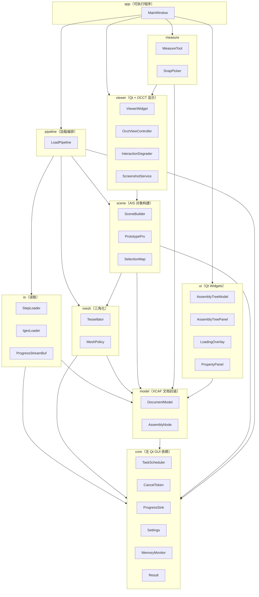
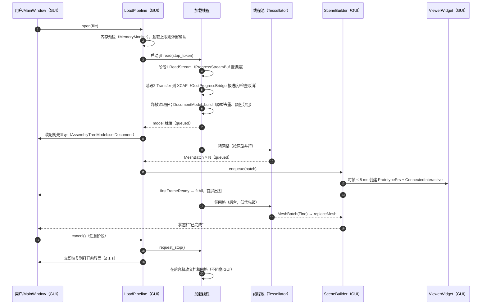
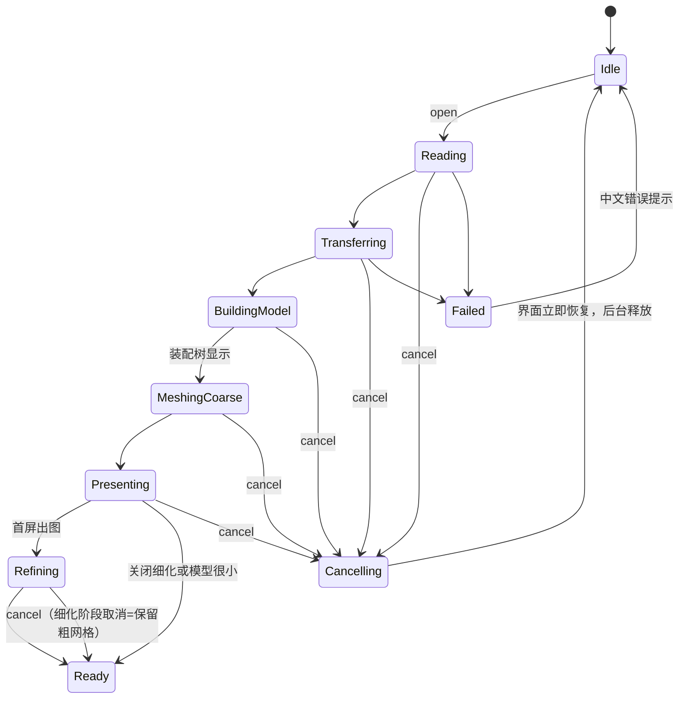
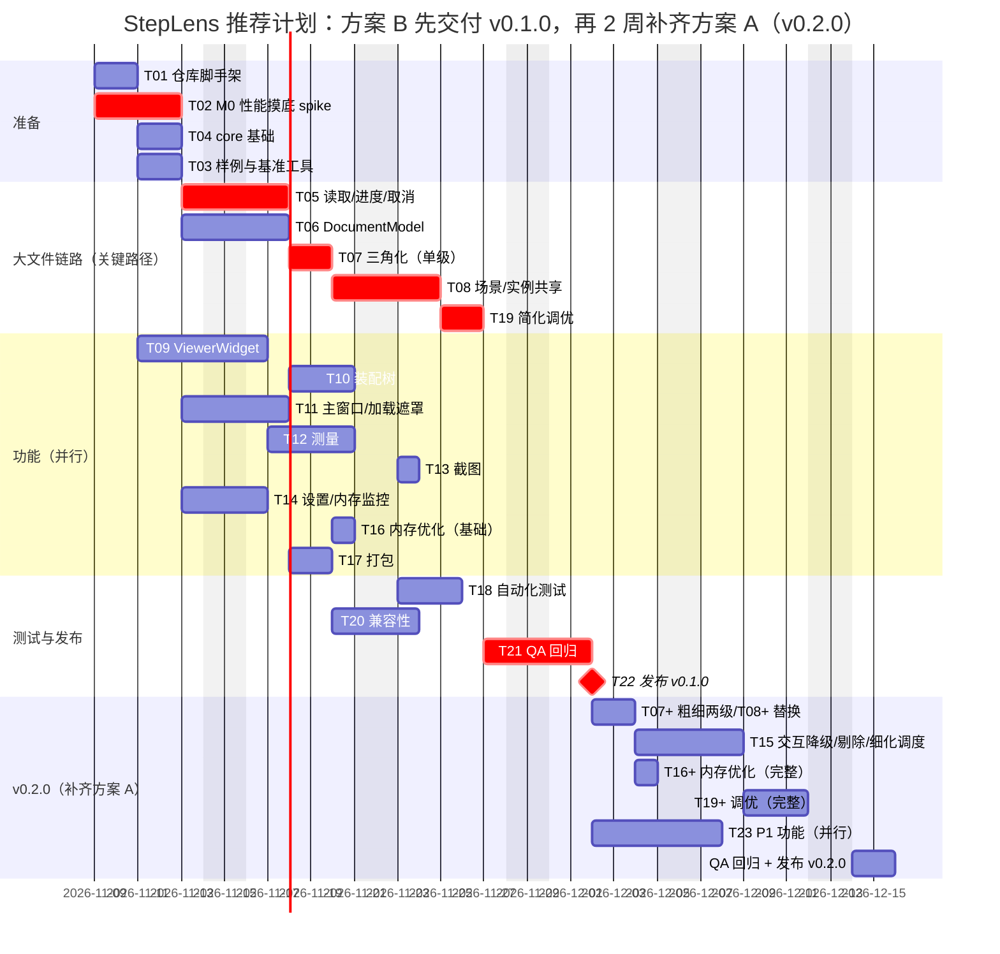

# StepLens 架构设计文档（STEP/IGES 轻量查看器 MVP）

| 项目 | 内容 |
|---|---|
| 文档版本 | v1.0（2026-11-03，初稿，待评审） |
| 编写 | 资深架构师（虚拟开发团队） |
| **依据的 PRD 版本** | **PRD v0.2**（`/workspace/prd/step-viewer-mvp-prd.md`，标题为 v0.2，状态"老板已确认 v0.1 问题，待架构师评估性能指标"）。同目录的 `step-viewer-mvp-prd-v0.1.md` 是旧版，本文不以它为准 |
| 配套附件 | 样例清单 `/workspace/prd/samples.md`（PRD v0.2 第 7 节附件）；本文的样例扫描脚本和结果放在 `/workspace/design/data/`（`scan_step.py`、`step-scan.json`） |
| 项目名 / 仓库 | **StepLens**，私有仓库 https://github.com/gdTang123/StepLens （目前为空仓库，默认分支 `main`；PRD 和本文以后放进仓库 `docs/`） |
| 读者 | 开发、测试、老板（第 1 节和第 9 节是给老板看的结论） |

> 说明：文中所有**版本号都在 2026-11-03 用 GitHub API、官方文档或 vcpkg 仓库核实过**（来源见附录 A）。所有**性能数字和内存数字都是目标建议或估算，不是实测**，必须用 M0 性能摸底（任务 T02）和后续基准测试验证；凡是没有核实的地方都标了"需确认"或"需 spike 验证"。

---

## 目录

1. [结论摘要（给老板）](#1-结论摘要给老板)
2. [需求要点与约束](#2-需求要点与约束)
3. [技术选型和版本](#3-技术选型和版本)
4. [模块划分、核心接口与线程模型](#4-模块划分核心接口与线程模型)
5. [大文件方案（重点）](#5-大文件方案重点)
6. [性能目标（四档）](#6-性能目标四档)
7. [测试样例与基准测试](#7-测试样例与基准测试)
8. [主要风险和应对](#8-主要风险和应对)
9. [任务拆分、关键路径与里程碑](#9-任务拆分关键路径与里程碑)
10. [工期结论：2–3 周能否完成 MVP（方案 A / 方案 B）](#10-工期结论23-周能否完成-mvp方案-a--方案-b)
11. [代码仓库结构与编码规范](#11-代码仓库结构与编码规范)
12. [不确定点与待确认清单](#12-不确定点与待确认清单)
13. [附录](#13-附录)

---

## 1. 结论摘要（给老板）

| 问题 | 结论 |
|---|---|
| 用什么做 | C++20 + **Qt 6.12 LTS**（6.12.0，2026-09-30 发布）+ **OCCT 8.0.1**（2026-07-30 发布，备选 7.9.3）+ CMake 4.x（最低 3.25）+ MSVC 2022 x64。OCCT 和 TBB/FreeType 用 **vcpkg 清单模式**获取并锁定版本，Qt 用官方预编译包。 |
| 怎么显示 | Qt 的 `QOpenGLWidget` + OCCT 的 `AIS_ViewController`（OCCT 官方推荐的 Qt 集成方式），原生窗口句柄方案作为后备。 |
| 200 MB 以上文件 | 后台线程分阶段加载（读文件 → 转换几何 → 生成网格 → 显示），全程有进度、可取消；相同零件只三角化一次、只占一份显存；先出粗网格再后台细化；旋转时自动隐藏边线和小零件；读完立刻释放 STEP 读取器的中间数据。 |
| 样例扫描发现 | 200 MB 以上的样例只有约 4–6 万个面，但有 270–420 万个 STEP 实体。也就是说**慢在"读文件和转换几何"（OCCT 单线程），不在显示**。显示和三角化可以靠多线程和实例共享解决；读文件这一段只能靠进度条、可取消和二期缓存来缓解。 |
| 性能目标（超大档，基准机，目标建议） | 首次看到模型 ≤ 120 秒，完整加载 ≤ 150 秒，旋转帧率 ≥ 25 FPS（交互降级下），峰值内存 ≤ 8 GB，点取消后 ≤ 1 秒界面恢复可用。**这些都是目标，不是实测**，M0 摸底（第 4 个工作日）后修订。 |
| **2–3 周能否完成** | **不能完整做到"大文件流畅"（方案 A）**：4 名开发 + 1 名测试并行，需要约 **4.5–5 周**。**方案 B（大文件能打开、不崩溃、可取消、实例共享，流畅度二期优化）可以在 3 周内完成**，但几乎没有余量。 |
| 推荐 | **推荐方案 B 先交付（第 3 周末），架构按方案 A 一次设计到位，紧接着用 2 周把流畅度做到方案 A 的水平（v0.2）。** 第 4 个工作日的性能摸底结果是决策点：如果 OCCT 读取 357 MB 样例本身就超过 3 分钟，需要和老板重新对齐"流畅"的含义（加载慢但浏览流畅），并把二期缓存提前。 |

---

## 2. 需求要点与约束

### 2.1 来自 PRD v0.2 的硬约束

| 类别 | 约束 | 对架构的影响 |
|---|---|---|
| 平台 | Windows 10/11 x64，不支持 Win7/8 | 只编 x64；Qt 6.12 官方支持 Windows 10（1809+）和 11，且官方注明 6.12 是最后一个支持 Windows 10 的 Qt 版本（见附录 A），正好覆盖本项目 |
| 发布 | 绿色版 zip，解压即用，无安装程序、无管理员权限、不写注册表、无代码签名 | 设置不能用 `QSettings` 默认的注册表后端（必须 `IniFormat`）；VC++ 运行库放在程序目录（app-local）；文件关联（P1-7）只写 HKCU 且默认不执行 |
| 用户 | 老板和内部工程团队，仅内部使用 | 界面按熟悉 CAD 的工程人员设计；许可证按"内部分发"处理（仍保留许可证文本） |
| 格式 | STEP（AP203/AP214/AP242 几何部分）和 IGES，都是 P0 | 加载器抽象成 `ILoader`，STEP 和 IGES 两个实现 |
| 核心场景 | S4：200 MB 以上大装配后台加载、进度可见、可取消，加载后流畅浏览、内存不爆（P0-11） | 第 5 节整体设计 |
| 鼠标 | 左键旋转、中键平移、滚轮以光标为中心缩放（定稿） | `AIS_ViewController` 的鼠标手势映射表直接配置 |
| 测量 | 距离（点/边/面组合）、角度，误差 ≤ 0.001 mm / 0.01° | 测量必须基于 B-Rep 精确几何（`BRepExtrema_DistShapeShape` 等），不能基于网格；所以**不能为了省内存丢弃 B-Rep** |
| 截图 | PNG/JPG，含测量标注、不含工具栏，P1 有 2×/4× | 用 `V3d_View::ToPixMap` 离屏渲染，转 `QImage` 保存，不需要 FreeImage |
| 界面 | 中文，单文档 | 字符串统一走 `tr()`，为 P2 英文留口子 |

### 2.2 v0.1 → v0.2 对架构影响最大的变化

1. "取消"从 P1 提升为 P0，且要求"取消后回到打开前的状态、内存释放"。→ 必须设计贯穿所有阶段的取消机制（5.3 节）。
2. 200 MB 以上从"只保证能打开"升级为"流畅可用"（P0-11）。→ 必须做实例共享、粗细两级网格、交互降级、内存控制（第 5 节），工期受影响（第 10 节）。
3. 性能指标分四档，数值由架构定。→ 第 6 节。

---

## 3. 技术选型和版本

### 3.1 版本总表（2026-11-03 核实）

| 组件 | 选定版本 | 核实情况 | 备选 / 说明 |
|---|---|---|---|
| Qt | **6.12.x LTS**（当前 6.12.0，2026-09-30 发布） | Qt 官方 "Qt Releases" 页面列出 Qt 6.12（6.12.0）为当前版本，并说明"从 6.8 LTS 起每第四个小版本为 LTS"（即 6.12）；endoflife.date 标注 6.12 为 LTS。开源版对 6.12 的补丁支持到 2027-04-01 左右（下一个小版本发布时），商业版 LTS 到 2031 | 6.11.3（2026-10-26，6.11 系列最后一个补丁）；6.8 LTS 的后续补丁（6.8.8）只给商业用户，开源用户拿不到，**不选** |
| OCCT | **8.0.1**（2026-07-30 发布） | GitHub Releases：V8.0.1；vcpkg `ports/opencascade/vcpkg.json` 为 8.0.1（vcpkg 2026.10.16 发布标签内即为 8.0.1） | **7.9.3**（2025-12-06）作为回退版本，vcpkg 版本库里有，可用 `overrides` 锁定 |
| CMake | 最低 **3.25**，推荐 **4.4.x**（cmake.org 当前稳定版 4.4.5，另有 3.31.12 和 4.5.0-rc2） | cmake.org/download | 最低 3.25 的理由：CMakePresets schema v6（workflow presets）需要 3.25；OCCT 8 自身要求 ≥ 3.10，不构成限制 |
| 编译器 | **MSVC 2022（v143）x64**，用 VS 2022 最新 17.x 补丁 | Qt 6.12 支持平台页列出 Windows 10/11 x86_64 使用 MSVC 2022 | 不用 MinGW（OCCT/vcpkg/调试工具链在 MSVC 下更成熟） |
| vcpkg | 基线锁定到发布标签 **2026.10.16**（2026-10-20 发布） | GitHub API | 每个里程碑评估一次是否升级基线 |
| oneTBB | vcpkg `tbb` 2023.1.0（仅在 spike 证明有收益时启用） | vcpkg 端口文件 | 默认不启用，见 3.7 |
| FreeType | vcpkg `freetype` 2.14.3（OCCT 文字渲染需要，测量标注、坐标轴字母要用） | vcpkg 端口文件 | 必需 |
| FreeImage | **不使用** | — | 截图用 Qt 的 `QImage` 保存，省掉一个依赖和一个许可证问题 |
| 单元测试 | GoogleTest（核心库）+ Qt Test（界面） | — | 见 11.6 |

### 3.2 Qt 版本取舍

- **选 Qt 6.12 的理由**：① 是 Qt 6.8 之后的下一个 LTS，2026-09-30 刚发布，生命周期最长；② 官方明确支持 Windows 10/11 + MSVC 2022；③ 6.12 是最后一个支持 Windows 10 的版本，本项目必须支持 Win10，选它可以"锁住"一段时间不被迫升级。
- **代价**：① 开源用户拿不到 LTS 补丁，6.12.x 的开源补丁只会持续到 6.13 发布（约 2027 年 4 月）；内部工具问题不大，后续按需升级；② 6.12.0 是 .0 版本，可能有新 bug——M0 的 spike 会用到 `QOpenGLWidget`，如果发现阻塞问题，退回 6.11.3（同样官方支持 MSVC 2022）。
- **不选 vcpkg 编 Qt**：vcpkg 最新发布标签里 `qtbase` 还是 6.11.2（master 为 6.11.3），没有 6.12；而且 vcpkg 从源码编 Qt 需要很长时间（CI 和新人环境都慢）。Qt 用官方在线安装器（开发机）和 aqtinstall / `install-qt-action`（CI）安装官方预编译的 `msvc2022_64` 包。**CI 工具对 6.12 的支持需确认**。
- 用到的 Qt 模块：Core、Gui、Widgets、OpenGL、OpenGLWidgets、Concurrent（可选）、Test（测试）、LinguistTools（构建期）。不用 QML、WebEngine，体积最小。

### 3.3 OCCT 版本取舍：8.0.1 还是 7.9.3

| 维度 | OCCT 8.0.1 | OCCT 7.9.3 |
|---|---|---|
| 发布时间 | 2026-07-30（8.0 系列第一个维护版） | 2025-12-06（7.9 系列最后一个补丁） |
| 与本项目相关的改进（来自官方发布说明） | STEP 读写在"每线程一个读取器"条件下线程安全，修复了并发读取的偶发崩溃；`STEPCAFControl_Reader` 修复挂死问题；STEP 实体类型识别和 `StepData_StepReaderData` 提速；错误处理栈改为 `thread_local`，多线程下异常处理不再抢全局锁（利于并行三角化）；`Standard_Failure` 继承 `std::exception`；周期曲面接缝处网格修复；导入 STEP 时显示边界曲线的崩溃修复；新增 GTest 测试 | 稳定，社区示例多 |
| 代价 | API 大改：`Handle(T)` → `occ::handle<T>`，`Standard_Real` → `double` 等（旧写法仍可编译，但不推荐）；网上多数示例还是旧写法；8.0 发布时间不长，未知 bug 风险高一些 | 拿不到 8.0 的修复和性能改进；新项目以后还得迁移一次 |
| vcpkg | 8.0.1 已在当前基线 | 版本库有 7.9.3，可用 `overrides` 锁定 |

**决策：选 OCCT 8.0.1。** 理由：新项目没有历史包袱，直接用 8.x 的写法可以省掉一次迁移；8.0 的 STEP 读取提速、并发修复、`thread_local` 错误处理都直接对应本项目的核心场景（大文件、多线程）。**回退条件**：M0 spike 中如果 8.0.1 在样例集上出现无法绕过的崩溃或明显的性能退化，改用 7.9.3（代码风格上我们要求统一写 `occ::handle`，7.9.3 回退时用一个兼容头 `occt_compat.h` 定义 `namespace occ { template<class T> using handle = opencascade::handle<T>; }`，**此写法需在 spike 中实际编译验证**）。

> OCCT 8 的工具包名：STEP 读写在 `TKDESTEP`（源码路径 `src/DataExchange/TKDESTEP/`，已在 V8.0.1 标签下核实），IGES 在 `TKDEIGES`（**名称需在打包脚本里按实际安装目录确认**）。

### 3.4 Qt 与 OCCT 显示的集成方式

| 方案 | 做法 | 优点 | 缺点 |
|---|---|---|---|
| **A. QOpenGLWidget + AIS_ViewController（推荐）** | Qt 创建 OpenGL 上下文和 FBO；OCCT 用 `Aspect_NeutralWindow` + `OpenGl_Context::Init()` 绑定当前上下文，把 Qt 的 FBO 用 `OpenGl_FrameBuffer::InitWrapper()` 包装成 OCCT 的默认帧缓冲；鼠标/滚轮事件转给 `AIS_ViewController::UpdateMouseButtons/UpdateMousePosition/UpdateZoom`，在 `paintGL()` 里调用 `FlushViewEvents()` | 是 OCCT 社区推荐的集成方式（参考 OCCT 可视化开发者 gkv311 维护的 Qt 示例 `gkv311/occt-samples-qt`，见附录 A）；与 Qt 布局、停靠面板、浮动窗口、半透明加载遮罩完全兼容；高 DPI 由 Qt 统一处理；窗口停靠/浮动时不会出现原生窗口句柄重建的问题 | 多一次 FBO 到窗口的合成（对帧率影响小，需 spike 测量）；需要处理 Qt 与 OCCT 共用一个 GL 上下文时的状态恢复；MSAA 需要在 FBO 上配置 |
| B. 原生窗口句柄（`WId` → `WNT_Window`） | `QWidget` 设 `WA_PaintOnScreen`/`WA_NativeWindow`，把 `winId()` 交给 OCCT，OCCT 自己建上下文 | 最直接，OCCT 完全掌控渲染，帧率最好；老示例多 | 不能在 3D 视图上叠加 Qt 控件（加载进度遮罩要另起顶层窗口）；面板停靠/浮动时句柄可能重建，需要重新绑定；Qt 6 对这种用法支持一般，常见闪烁问题 |

**决策：采用方案 A**，并把渲染宿主抽象成 `IViewHost` 接口，方案 B 作为后备（如果 spike 发现方案 A 在 UHD 630 上合成开销明显，或者远程桌面下有问题，可以切换，不影响上层模块）。

### 3.5 构建系统：CMake + Presets + MSVC 2022

- `cmake_minimum_required(VERSION 3.25)`；工程全局 `CMAKE_CXX_STANDARD 20`、`CMAKE_CXX_STANDARD_REQUIRED ON`、`CMAKE_CXX_EXTENSIONS OFF`。
- 生成器：`Ninja Multi-Config`（构建快，CI 与本地一致）；VS 用户也可以直接打开文件夹使用 Presets。
- MSVC 关键开关：`/permissive- /Zc:__cplusplus /utf-8 /W4 /EHsc /MP`；只对本项目代码开 `/WX`（第三方头文件用 `/external:anglebrackets /external:W0` 屏蔽）。`/utf-8` 必须开，否则源码里的中文字符串会乱码。
- 只编 64 位（`x64-windows` triplet），32 位进程 2–4 GB 地址空间无法承载超大档。
- `CMakePresets.json` 规划：

```json
{
  "version": 6,
  "cmakeMinimumRequired": { "major": 3, "minor": 25, "patch": 0 },
  "configurePresets": [
    {
      "name": "base", "hidden": true,
      "generator": "Ninja Multi-Config",
      "binaryDir": "${sourceDir}/build/${presetName}",
      "toolchainFile": "$env{VCPKG_ROOT}/scripts/buildsystems/vcpkg.cmake",
      "cacheVariables": {
        "VCPKG_TARGET_TRIPLET": "x64-windows",
        "VCPKG_MANIFEST_FEATURES": "",
        "CMAKE_PREFIX_PATH": "$env{QTDIR}"
      }
    },
    { "name": "msvc",      "inherits": "base", "displayName": "MSVC 2022 x64" },
    { "name": "msvc-asan", "inherits": "base", "cacheVariables": { "STEPLENS_ASAN": "ON" } },
    { "name": "msvc-tbb",  "inherits": "base", "cacheVariables": { "VCPKG_MANIFEST_FEATURES": "tbb" } }
  ],
  "buildPresets": [
    { "name": "debug",   "configurePreset": "msvc", "configuration": "Debug" },
    { "name": "release", "configurePreset": "msvc", "configuration": "RelWithDebInfo" }
  ],
  "testPresets": [
    { "name": "unit", "configurePreset": "msvc", "configuration": "RelWithDebInfo",
      "filter": { "exclude": { "label": "bench|large" } }, "output": { "outputOnFailure": true } }
  ],
  "workflowPresets": [
    { "name": "ci", "steps": [
      { "type": "configure", "name": "msvc" },
      { "type": "build", "name": "release" },
      { "type": "test", "name": "unit" } ] }
  ]
}
```

- 发布版本用 `RelWithDebInfo`（`/O2` + PDB），PDB 不放进 zip，单独归档，用于分析崩溃转储。

### 3.6 依赖获取：vcpkg 还是自编译 OCCT（重点对比）

| 维度 | vcpkg 清单模式（`vcpkg.json` + 锁定基线） | 自编译 OCCT（CMake 源码构建） | OCCT 官方预编译包（Release 附件） |
|---|---|---|---|
| 版本可重复 | 好：`builtin-baseline` + `overrides` 锁定到具体版本 | 好：锁定 git tag | 好：固定 zip |
| 上手速度 | 新人一条命令 `cmake --preset msvc`；首次编 OCCT 需要较长时间，配合二进制缓存后很快 | 慢：要手动配 FreeType/TBB 路径，写文档 | 最快：V8.0.1 附件里有 `opencascade-release-no-pch.zip`（51.7 MB）和 `3rdparty-vc14-64.zip`（180.1 MB） |
| TBB / FreeType / FreeImage | vcpkg 端口提供 `tbb`、`freetype`、`freeimage` 等 feature，按需开关；FreeType 为默认 feature | 手动下载或也用 vcpkg 提供 | 3rdparty 包里一次性提供（体积大，含很多我们不需要的库） |
| 定制编译选项 | 只能用端口暴露的 feature；端口固定关闭 Draw 模块（对我们无影响）；其他选项（如 `USE_MMGR_TYPE` 内存管理器）需要 overlay port | 完全可控：可选内存管理器（`NATIVE/FLEXIBLE/TBB/JEMALLOC`）、只编需要的模块、打补丁 | 不可定制 |
| 打补丁（遇到 OCCT bug 时） | 用 overlay port 加 patch 文件，可控 | 直接改 | 不能 |
| 绿色版打包 | DLL 都在 `vcpkg_installed/x64-windows/bin`，打包脚本统一收集 | 自己收集 | 自己收集，需要剔除多余 DLL |
| CI | 配合二进制缓存，增量构建快 | 要自己做缓存 | 下载 zip 即可 |
| 许可证 | 每个端口在 `share/<port>/copyright` 里带许可证文本，打包时可自动汇总 | 手动整理 | 手动整理 |

**决策：OCCT、FreeType、（可选）TBB 用 vcpkg 清单模式**，基线锁定 `2026.10.16`，OCCT 版本 8.0.1；需要改编译选项或打补丁时用仓库内的 overlay port（`cmake/vcpkg-ports/opencascade/`），不需要切换到完全自编译。理由：① 可重复、新人和 CI 一键构建；② 第三方许可证文本能自动收集，便于 LGPL 合规；③ overlay port 保留了自编译的灵活性。**M0 spike 允许直接用官方预编译包**（下载即用，不等 vcpkg 首次编译），spike 结束后统一切到 vcpkg。

`vcpkg.json` 规划：

```json
{
  "name": "steplens",
  "version-semver": "0.1.0",
  "builtin-baseline": "<2026.10.16 标签对应的 commit SHA，创建仓库时填写>",
  "dependencies": [
    { "name": "opencascade", "default-features": false, "features": [ "freetype" ] },
    "gtest"
  ],
  "features": {
    "tbb": { "description": "OCCT 使用 oneTBB 作为并行后端",
             "dependencies": [ { "name": "opencascade", "features": [ "tbb" ] } ] }
  },
  "overrides": [ { "name": "opencascade", "version": "8.0.1" } ]
}
```

（回退 7.9.3 时只改 `overrides` 一行，并检查端口版本号 `port-version`，**需确认**。）

### 3.7 第三方依赖逐个评估

| 依赖 | 用途 | 决策 | 理由 |
|---|---|---|---|
| FreeType | OCCT 文字渲染（测量标注数字、坐标轴 X/Y/Z 字母、`AIS_ViewCube` 文字） | **必须** | 没有它 OCCT 不能画文字；许可证 FTL 或 GPL-2.0 二选一，按 FTL 使用，需在"关于"和许可证目录里声明 |
| oneTBB | OCCT 的 `OSD_Parallel` 并行后端 | **默认不启用**，spike 对比后再定 | OCCT 不编 TBB 时 `OSD_Parallel` 使用自带线程池（`OSD_Parallel::ToUseOcctThreads()`），功能足够；我们自己的任务调度用 C++20 `std::jthread` 线程池，不依赖 TBB。不启用可以少 2–3 个 DLL、少一份许可证（Apache-2.0）。保留 `msvc-tbb` 预设用于 spike 对比三角化吞吐 |
| FreeImage | OCCT 图片读写 | **不启用** | 截图用 `V3d_View::ToPixMap()` 得到 `Image_PixMap`，复制到 `QImage` 后由 Qt 保存 PNG/JPG；纹理贴图不在 MVP 范围 |
| RapidJSON / VTK / Draw | glTF、VTK 集成、Draw 测试工具 | **不启用** | 用不到 |
| GoogleTest | 单元测试 | 仅开发期 | 不进发布包 |

### 3.8 绿色版打包

1. `cmake --install` 把 `StepLens.exe` 安装到 `dist/StepLens/`。
2. 运行 `windeployqt --release --no-translations --no-system-d3d-compiler --no-opengl-sw --no-compiler-runtime StepLens.exe`，复制 Qt DLL 和 `platforms/qwindows.dll`、`styles/` 等插件；中文翻译 `.qm` 由我们自己放。
   - `--no-opengl-sw`：Qt 的 `opengl32sw.dll`（Mesa 软件渲染）只对 Qt 自己的 GL 函数生效，OCCT 直接调用系统 `opengl32.dll`，两者不在同一套函数上，带上它没有意义（远程桌面方案见 8 节风险 R7）。**这个判断需 spike 验证**。
3. 打包脚本 `scripts/package.py`（Python）用 `dumpbin /dependents` 递归收集 OCCT 和 FreeType 的 DLL（只收实际依赖的工具包，不整目录复制），复制到 exe 同级目录。
4. VC++ 运行库：把 `msvcp140.dll`、`vcruntime140.dll`、`vcruntime140_1.dll` 等从 VS 安装目录的 `VC\Redist\MSVC\<版本>\x64\Microsoft.VC143.CRT` 复制到程序目录（微软允许 app-local 部署），**不要求用户安装 VC Redist**。
5. 写 `qt.conf`（指定插件目录为相对路径），保证解压到任何目录都能运行。
6. `licenses/` 目录：Qt（LGPLv3 文本 + 获取源码方式说明）、OCCT（`LICENSE_LGPL_21.txt` + `OCCT_LGPL_EXCEPTION.txt`）、FreeType（FTL）、（如启用）oneTBB（Apache-2.0）、MSVC 运行库说明。
7. 设置文件：`QSettings(QSettings::IniFormat, ...)`，优先写程序目录下 `StepLens.ini`；程序目录不可写（如放在 `C:\Program Files`）时写 `%APPDATA%\StepLens\StepLens.ini`。**全程不写注册表**（P1-7 文件关联脚本除外，且只写 HKCU、默认不执行）。
8. 冒烟验证：在一台没有装过 VS / Qt 的干净 Windows 10 和 Windows 11 虚拟机上解压、打开 S-01、M-04、X-02，作为 T17 的验收标准。
9. 体积估计：Qt 6 Widgets 相关 DLL + OCCT 所需工具包 + FreeType，解压后估计 150–250 MB，zip 估计 60–100 MB（**估计，T17 实测**），满足 PRD"≤ 150 MB"的参考值。

### 3.9 许可证合规（LGPL）

- **Qt 6 开源版（LGPLv3）**：只动态链接，不改 Qt 源码；随包附 LGPLv3 文本，在"关于"对话框说明使用了 Qt 及其许可证；用户可以替换 Qt DLL（绿色版天然满足）；保存所用 Qt 版本号，按需提供 Qt 源码获取方式（官方下载地址）。不使用只有 GPL 许可的 Qt 模块（我们用到的 Core/Gui/Widgets/OpenGL/OpenGLWidgets 都是 LGPLv3）。
- **OCCT（LGPL-2.1 + OCCT 例外）**：动态链接；如果我们给 OCCT 打了补丁（overlay port），被修改的 OCCT 源码需要能够提供（内部使用场景下，在仓库里保留补丁即可）。
- **内部使用**：PRD 已确认只在团队内部分发、不对外销售，合规风险低；但仍按"对外分发"的标准附带许可证文本，以后如果对外发布不用返工。
- **样例文件**：GrabCAD 来源、Twin Disc 来源的样例**不能提交到仓库**，只通过 `scripts/fetch_samples.py` 按 `samples.md` 下载到本地（详见 7 节）。

---

## 4. 模块划分、核心接口与线程模型

### 4.1 模块图



依赖规则：箭头只能向下；`core`、`io`、`model`、`mesh` 不依赖 Qt GUI（只允许 QtCore 以外的零依赖，便于做纯 GoogleTest 单元测试和命令行基准工具）；只有 `scene`、`viewer`、`measure` 接触 AIS/V3d；`ui` 不直接接触 OCCT 显示类。

### 4.2 模块职责

| 模块 | 职责 | 主要类 | 运行线程 |
|---|---|---|---|
| core | 通用基础：结果类型、错误码、取消令牌、进度汇报、线程池、设置、内存监控、日志 | `Result<T>`、`Error`、`CancelToken`、`ProgressSink`、`TaskScheduler`、`Settings`、`MemoryMonitor` | 任意 |
| io | 把文件读成 XCAF 文档：分阶段、带进度、可取消；读完释放读取器 | `ILoader`、`StepLoader`、`IgesLoader`、`ProgressStreamBuf`、`OcctProgressBridge` | 加载线程 |
| model | 封装 XCAF 文档：装配树、原型（定义）与实例（引用）、名称、颜色、单位、包围盒；对外只读 | `DocumentModel`、`AssemblyNode`、`PrototypeInfo`、`NodeId`、`PrototypeId` | 加载线程构建，之后只读，任意线程读 |
| mesh | 按原型去重并行三角化；粗、细两级；统计三角形数和内存；构建显示用的顶点数组 | `Tessellator`、`MeshPolicy`、`MeshBatch` | 线程池 |
| scene | 把原型和实例变成 AIS 对象：原型共享一份显示数据，实例用变换引用；颜色分组；节点与 AIS 对象双向映射 | `SceneBuilder`、`PrototypePrs`、`SelectionMap` | **只在 GUI 线程** |
| viewer | 3D 视图宿主、鼠标映射、标准视图、坐标轴、交互降级、截图 | `ViewerWidget`、`OcctViewController`、`InteractionDegrader`、`ScreenshotService` | GUI 线程 |
| measure | 测量模式、捕捉、距离/角度计算（基于 B-Rep）、标注 | `MeasureTool`、`SnapPicker`、`DistanceMeasure`、`AngleMeasure` | 计算可放线程池，显示在 GUI 线程 |
| ui | 装配树模型和面板、加载遮罩（进度+取消）、属性面板 | `AssemblyTreeModel`（`QAbstractItemModel`）、`AssemblyTreePanel`、`LoadingOverlay` | GUI 线程 |
| pipeline | 加载编排：状态机、阶段推进、取消、失败回滚、批量向 GUI 提交 | `LoadPipeline` | 自身在 GUI 线程，工作分派到后台 |
| app | 主窗口、菜单、工具栏、状态栏、命令行和拖拽打开 | `MainWindow` | GUI 线程 |

### 4.3 核心类与接口（C++20 代码片段）

> 以下是接口草案，实际签名在实现中可以微调，但**线程归属、所有权和取消语义不能改**。OCCT 类型使用 8.x 写法 `occ::handle<T>`。

#### 4.3.1 core：结果、取消、进度、线程池

```cpp
// core/Result.h —— MSVC 的 /std:c++20 没有 std::expected（C++23），先用自己的轻量实现，
// 以后切到 C++23 时替换成 std::expected，调用方式保持一致。
namespace steplens {

enum class ErrorCode { Ok, FileNotFound, UnsupportedFormat, ParseFailed, TransferFailed,
                       Cancelled, OutOfMemory, MeshFailed, Internal };

struct Error {
    ErrorCode   code = ErrorCode::Internal;
    std::string message;      // 英文技术信息，写日志
    std::string userMessage;  // 中文提示，给界面（UTF-8）
};

template <class T>
class Result {
public:
    Result(T value) : m_v(std::move(value)) {}
    Result(Error err) : m_v(std::move(err)) {}
    [[nodiscard]] bool ok() const noexcept { return std::holds_alternative<T>(m_v); }
    [[nodiscard]] T&       value()       { return std::get<T>(m_v); }
    [[nodiscard]] const Error& error() const { return std::get<Error>(m_v); }
private:
    std::variant<T, Error> m_v;
};

// core/CancelToken.h —— 基于 C++20 std::stop_token，便于和 std::jthread 配合。
class CancelToken {
public:
    explicit CancelToken(std::stop_token st) : m_st(std::move(st)) {}
    [[nodiscard]] bool isCancelled() const noexcept { return m_st.stop_requested(); }
    void throwIfCancelled() const { if (isCancelled()) throw CancelledException{}; }
private:
    std::stop_token m_st;
};

// core/ProgressSink.h —— 工作线程只写原子量，GUI 线程用 QTimer（约 10 Hz）轮询，
// 不发高频信号，避免事件队列被进度消息塞满。
enum class LoadStage : std::uint8_t { Idle, Reading, Transferring, BuildingModel,
                                      MeshingCoarse, Presenting, Refining, Ready, Cancelling, Failed };

class ProgressSink {
public:
    void setStage(LoadStage s) noexcept               { m_stage.store(s, std::memory_order_relaxed); }
    void setFraction(float f) noexcept                { m_fraction.store(std::clamp(f, 0.f, 1.f)); }
    void setIndeterminate(bool b) noexcept            { m_indeterminate.store(b); }
    [[nodiscard]] LoadStage stage() const noexcept    { return m_stage.load(); }
    [[nodiscard]] float     fraction() const noexcept { return m_fraction.load(); }
    [[nodiscard]] bool      indeterminate() const noexcept { return m_indeterminate.load(); }
private:
    std::atomic<LoadStage> m_stage{LoadStage::Idle};
    std::atomic<float>     m_fraction{0.f};
    std::atomic<bool>      m_indeterminate{false};
};

// core/TaskScheduler.h —— 固定大小的工作线程池（默认 硬件线程数 - 1，至少 2），
// 给三角化、数组构建、测量计算用；加载主流程单独用一个 std::jthread。
class TaskScheduler {
public:
    explicit TaskScheduler(unsigned threads = defaultThreadCount());
    ~TaskScheduler();                          // 请求停止并 join
    template <class F> auto submit(F&& f) -> std::future<std::invoke_result_t<F>>;
    // 并行 for：按块分配，任一任务抛异常时其余任务尽快退出，异常重新抛给调用者
    void parallelFor(std::size_t n, const std::function<void(std::size_t)>& body,
                     const CancelToken& cancel);
    [[nodiscard]] unsigned threadCount() const noexcept;
    static unsigned defaultThreadCount() noexcept;
};

} // namespace steplens
```

#### 4.3.2 io：加载器与 OCCT 进度桥

```cpp
// io/ILoader.h
namespace steplens::io {

struct LoadOptions {
    bool readColors = true, readNames = true;
    bool readLayers = false;   // MVP 不显示图层，关掉省时间和内存
    bool readProps  = false;   // 校验属性（validation properties）不用
    bool readGdt    = false;   // PMI 是 P2；只要求不因 PMI 报错
    bool readMaterials = false, readViews = false;
    bool readShuo   = true;    // 实例级颜色覆盖（SHUO），默认读，spike 评估耗时
};

struct LoadedDocument {                      // 加载线程产出，交给 model 模块
    occ::handle<TDocStd_Document> doc;       // XCAF 文档（拥有 B-Rep、名称、颜色）
    double lengthUnitToMm = 1.0;             // 文件单位换算到 mm 的系数
    std::uint64_t fileBytes = 0;
    std::string   schema;                    // 如 "AUTOMOTIVE_DESIGN"（AP214）
};

class ILoader {
public:
    virtual ~ILoader() = default;
    [[nodiscard]] virtual Result<LoadedDocument> load(const std::filesystem::path& file,
                                                      const LoadOptions& opt,
                                                      ProgressSink& progress,
                                                      const CancelToken& cancel) = 0;
};

// 根据扩展名和文件头魔数选择加载器（.stp/.step → STEP，.igs/.iges → IGES）
std::unique_ptr<ILoader> makeLoader(const std::filesystem::path& file);

// io/OcctProgressBridge.h —— 把 OCCT 的进度/取消接到我们的 ProgressSink/CancelToken
class OcctProgressBridge final : public Message_ProgressIndicator {
public:
    OcctProgressBridge(ProgressSink& sink, const CancelToken& cancel, float from, float to);
    bool UserBreak() override { return m_cancel.isCancelled(); }   // OCCT 在检查点调用
protected:
    void Show(const Message_ProgressScope&, bool /*isForce*/) override {
        m_sink.setFraction(m_from + float(GetPosition()) * (m_to - m_from)); // 只写原子量
    }
private:
    ProgressSink& m_sink; CancelToken m_cancel; float m_from, m_to;
};

// io/ProgressStreamBuf.h —— 关键技巧：ReadFile() 没有进度参数，但 ReadStream() 接受 std::istream。
// 我们用一个包装 std::filebuf 的 streambuf 统计已读字节数得到"读取文件"阶段的进度；
// 取消时让 underflow() 返回 EOF，使解析提前结束，然后丢弃结果。
// （OCCT 解析器对提前 EOF 的处理是否干净，需 M0 spike 验证；见 5.3）
class ProgressStreamBuf final : public std::streambuf {
public:
    ProgressStreamBuf(const std::filesystem::path& file, std::uint64_t totalBytes,
                      ProgressSink& sink, const CancelToken& cancel, float from, float to);
protected:
    int_type underflow() override;   // 每次读 1 MiB 块；检查取消；更新进度
private:
    std::ifstream m_in; std::vector<char> m_buf; std::uint64_t m_read = 0, m_total;
    ProgressSink& m_sink; CancelToken m_cancel; float m_from, m_to;
};

class StepLoader final : public ILoader {
public:
    Result<LoadedDocument> load(const std::filesystem::path&, const LoadOptions&,
                                ProgressSink&, const CancelToken&) override;
};
class IgesLoader final : public ILoader { /* 同上；IGES 读取不保证并发安全，内部串行化 */ };

} // namespace steplens::io
```

`StepLoader::load()` 的实现骨架（阶段划分是大文件方案的核心）：

```cpp
Result<LoadedDocument> StepLoader::load(const fs::path& file, const LoadOptions& opt,
                                        ProgressSink& progress, const CancelToken& cancel) {
    OSD::SetThreadLocalSignal(OSD_SignalMode_Set, false);  // 本线程把访问违例转成 OCCT 异常
    try {
        auto reader = std::make_unique<STEPCAFControl_Reader>();
        reader->SetColorMode(opt.readColors);  reader->SetNameMode(opt.readNames);
        reader->SetLayerMode(opt.readLayers);  reader->SetPropsMode(opt.readProps);
        reader->SetGDTMode(opt.readGdt);       reader->SetMatMode(opt.readMaterials);
        reader->SetViewMode(opt.readViews);    reader->SetSHUOMode(opt.readShuo);

        // 阶段 1：读取 + 解析（0%–45%，比例由 spike 实测后校准）
        progress.setStage(LoadStage::Reading);
        ProgressStreamBuf sb(file, fs::file_size(file), progress, cancel, 0.00f, 0.45f);
        std::istream in(&sb);
        const auto name = file.filename().u8string();
        if (reader->ReadStream(reinterpret_cast<const char*>(name.c_str()), in) != IFSelect_RetDone) {
            if (cancel.isCancelled()) return Error{ErrorCode::Cancelled, "cancelled", "已取消"};
            return Error{ErrorCode::ParseFailed, "ReadStream failed", "文件损坏或不是有效的 STEP 文件"};
        }
        cancel.throwIfCancelled();

        // 阶段 2：转换为 XCAF 文档（45%–85%），OCCT 在内部检查点调用 UserBreak()
        progress.setStage(LoadStage::Transferring);
        occ::handle<TDocStd_Document> doc;
        XCAFApp_Application::GetApplication()->NewDocument("BinXCAF", doc);
        occ::handle<OcctProgressBridge> bridge = new OcctProgressBridge(progress, cancel, 0.45f, 0.85f);
        if (!reader->Transfer(doc, bridge->Start())) { /* 区分取消与失败，同上 */ }

        // 阶段 3：立刻释放读取器（STEP 实体模型、转换映射表占内存最大，见 5.6）
        LoadedDocument out{doc, readLengthUnit(doc), fs::file_size(file), readSchema(*reader)};
        reader.reset();
        releaseFreedHeap();   // Windows: _heapmin()，把空闲堆还给系统（效果需 spike 测量）
        return out;
    } catch (const CancelledException&) {
        return Error{ErrorCode::Cancelled, "cancelled", "已取消"};
    } catch (const std::bad_alloc&) {
        return Error{ErrorCode::OutOfMemory, "bad_alloc", "内存不足，无法打开该文件"};
    } catch (const std::exception& e) {      // OCCT 8: Standard_Failure 继承 std::exception
        return Error{ErrorCode::TransferFailed, e.what(), "读取 STEP 文件时出错"};
    }
}
```

#### 4.3.3 model：DocumentModel（XCAF 封装）

```cpp
// model/DocumentModel.h
namespace steplens::model {

using NodeId      = std::uint32_t;   // 装配树节点（实例出现）编号，0 为根
using PrototypeId = std::uint32_t;   // 原型（零件定义，XCAF 中被引用的 shape label）编号

struct AssemblyNode {
    NodeId        id;
    NodeId        parent;
    std::vector<NodeId> children;
    std::u16string name;               // 无名称时由 UI 显示"未命名-序号"
    bool          isAssembly = false;
    PrototypeId   prototype = kNoPrototype;  // 叶子节点引用的原型
    TopLoc_Location worldLocation;     // 累乘到根的变换
    std::optional<Quantity_ColorRGBA> instanceColor;  // 实例级颜色覆盖（如果有）
    Bnd_Box       worldBox;            // 世界坐标包围盒（用于适应窗口、剔除、内存预估）
};

struct PrototypeInfo {
    PrototypeId   id;
    TDF_Label     label;               // XCAF 原型 label
    TopoDS_Shape  shape;               // 原型形状（无位置）；三角化写入它的 TFace
    std::uint32_t faceCount = 0;
    std::uint32_t instanceCount = 0;   // 被多少个实例引用（决定共享收益）
    Bnd_Box       localBox;
    // 按颜色分组的面（同一颜色的面合并成一个绘制批次，见 5.5.3）
    std::vector<std::pair<Quantity_ColorRGBA, TopoDS_Compound>> colorGroups;
};

class DocumentModel {
public:
    // 在加载线程调用：遍历 XCAF（XCAFDoc_ShapeTool / XCAFPrs_DocumentExplorer）建立树和原型表
    static Result<std::shared_ptr<const DocumentModel>>
        build(io::LoadedDocument doc, ProgressSink&, const CancelToken&);

    [[nodiscard]] const AssemblyNode&  node(NodeId) const;
    [[nodiscard]] std::size_t          nodeCount() const noexcept;
    [[nodiscard]] const PrototypeInfo& prototype(PrototypeId) const;
    [[nodiscard]] std::span<const PrototypeInfo> prototypes() const noexcept;
    [[nodiscard]] std::span<const NodeId> leafNodesOf(PrototypeId) const;  // 某原型的所有实例
    [[nodiscard]] const Bnd_Box& worldBox() const noexcept;
    [[nodiscard]] double lengthUnitToMm() const noexcept;
    [[nodiscard]] TopoDS_Shape worldShapeOf(NodeId) const;  // 测量用：原型形状 + 世界变换
private:
    occ::handle<TDocStd_Document> m_doc;   // 持有文档，保证 label/shape 生命周期
    std::vector<AssemblyNode>  m_nodes;
    std::vector<PrototypeInfo> m_prototypes;
};

} // namespace steplens::model
```

设计取舍：`DocumentModel` 构建完成后**不可变**（`shared_ptr<const>`），多个线程可以安全读取；唯一的"写"是三角化往原型形状的面上写网格，由 `Tessellator` 按原型独占执行（见 4.4 线程安全约定）。不对外暴露 `TDF_Label`，上层只看到 `NodeId`/`PrototypeId`，以后换数据源（如二期的缓存文件）时上层不用改。

#### 4.3.4 mesh：Tessellator

```cpp
// mesh/MeshPolicy.h
namespace steplens::mesh {

enum class MeshLevel : std::uint8_t { Coarse, Fine };

struct MeshParams {          // 映射到 IMeshTools_Parameters
    double deflection;       // 绝对弦高（模型单位）
    double angleRad;         // 角度偏差
    bool   inParallel;       // 单个原型内部是否按面并行（大原型才开）
};

class MeshPolicy {
public:
    // 弦高 = clamp(局部系数 × 原型包围盒对角线, 最小绝对值, 全局系数 × 整个模型对角线)
    // 默认值见 5.5.1，可在 Settings 中调整
    [[nodiscard]] MeshParams paramsFor(const model::PrototypeInfo&, const Bnd_Box& world,
                                       MeshLevel) const;
};

// mesh/MeshBatch.h —— 工作线程产出、GUI 线程消费的"显示数据包"，不含任何 AIS 对象
struct ColorGroupArrays {
    Quantity_ColorRGBA color;
    occ::handle<Graphic3d_ArrayOfTriangles> triangles;   // StdPrs_ShadedShape::FillTriangles
    occ::handle<Graphic3d_ArrayOfSegments>  edges;       // StdPrs_ShadedShape::FillFaceBoundaries
};
struct MeshBatch {
    model::PrototypeId id;
    MeshLevel level;
    std::vector<ColorGroupArrays> groups;
    std::uint64_t triangleCount = 0, approxBytes = 0;
};

class Tessellator {
public:
    Tessellator(TaskScheduler&, MeshPolicy);
    // 对所有原型做一遍（粗或细），每完成一个原型就把 MeshBatch 交给回调（回调在工作线程中调用，
    // 由 LoadPipeline 负责线程切换）。按"面数 × 实例数"从大到小排序，大的先做，负载更均衡。
    Result<MeshStats> run(const model::DocumentModel&, MeshLevel,
                          std::function<void(MeshBatch&&)> onBatch,
                          ProgressSink&, const CancelToken&);
};

} // namespace steplens::mesh
```

#### 4.3.5 scene：SceneBuilder 与共享显示的原型对象

```cpp
// scene/PrototypePrs.h —— 自定义 AIS 对象：Compute() 只把预先在工作线程算好的数组挂到 Group 上，
// 所以在 GUI 线程上非常快。原型对象本身不显示，实例通过 AIS_ConnectedInteractive 引用它，
// 一个原型的显存只占一份。
class PrototypePrs final : public AIS_InteractiveObject {
    DEFINE_STANDARD_RTTI_INLINE(PrototypePrs, AIS_InteractiveObject)
public:
    enum Mode { Shaded = 0, ShadedWithEdges = 1, Wireframe = 2 };
    explicit PrototypePrs(mesh::MeshBatch batch);
    void replaceMesh(mesh::MeshBatch&& finer);        // 细化完成后替换数组并 SetToUpdate()
    void setEdgesVisible(bool on);                    // 交互降级：切换边线 Group 可见性，不重算
    const TopoDS_Shape& shape() const;                // 选择与测量用
protected:
    void Compute(const occ::handle<PrsMgr_PresentationManager>&,
                 const occ::handle<Prs3d_Presentation>&, int mode) override;
    void ComputeSelection(const occ::handle<SelectMgr_Selection>&, int mode) override;
    // 选择模式 0：整体（用三角网格做敏感体，便宜）；1/2/4：顶点/边/面，仅测量模式按需激活
};

// scene/SceneBuilder.h
class SceneBuilder : public QObject {
    Q_OBJECT
public:
    SceneBuilder(occ::handle<AIS_InteractiveContext> ctx, QObject* parent = nullptr);
    void reset(std::shared_ptr<const model::DocumentModel>);   // 清空旧场景
    // 由 LoadPipeline 在 GUI 线程调用；内部有每帧时间预算（默认 8 ms），超出部分留到下一帧
    void enqueue(mesh::MeshBatch&& batch);
    void setNodeVisible(model::NodeId, bool visible);           // 递归处理子节点
    void highlightNode(model::NodeId);
    [[nodiscard]] std::optional<model::NodeId> nodeOf(const occ::handle<AIS_InteractiveObject>&) const;
signals:
    void firstFrameReady();             // 首屏：所有原型都有了粗网格
    void batchesPending(int count);
private:
    void pump();                        // QTimer(0) 驱动，按时间预算消费队列
    occ::handle<AIS_InteractiveContext> m_ctx;
    std::shared_ptr<const model::DocumentModel> m_model;
    std::vector<occ::handle<PrototypePrs>> m_protos;               // 下标 = PrototypeId
    std::vector<occ::handle<AIS_ConnectedInteractive>> m_instances; // 下标 = 叶子 NodeId 映射
    std::deque<mesh::MeshBatch> m_queue;
};
```

#### 4.3.6 viewer：ViewerWidget

```cpp
// viewer/ViewerWidget.h
class ViewerWidget final : public QOpenGLWidget, protected AIS_ViewController {
    Q_OBJECT
public:
    explicit ViewerWidget(QWidget* parent = nullptr);
    [[nodiscard]] const occ::handle<AIS_InteractiveContext>& context() const;
    [[nodiscard]] const occ::handle<V3d_View>& view() const;
    void fitAll();                                   // F 键
    void setStandardView(V3d_TypeOfOrientation);     // 7 个标准视图
    void setDisplayMode(PrototypePrs::Mode);         // P1-1
    QImage grabImage(int scale = 1, bool transparentBg = false);  // 截图（离屏 ToPixMap）
signals:
    void nodePicked(std::optional<model::NodeId>);
    void interactionStarted();                       // 交互降级开始
    void interactionFinished();                      // 停止 300 ms 后恢复
protected:
    void initializeGL() override;   // 包装 Qt 的 GL 上下文：OpenGl_Context::Init + Aspect_NeutralWindow
    void paintGL() override;        // 包装 Qt FBO（OpenGl_FrameBuffer::InitWrapper），FlushViewEvents()
    void resizeGL(int w, int h) override;
    void mousePressEvent(QMouseEvent*) override;     // → UpdateMouseButtons
    void mouseReleaseEvent(QMouseEvent*) override;
    void mouseMoveEvent(QMouseEvent*) override;      // → UpdateMousePosition
    void wheelEvent(QWheelEvent*) override;          // → UpdateZoom（以光标为中心）
    void handleViewRedraw(const occ::handle<AIS_InteractiveContext>&,
                          const occ::handle<V3d_View>&) override;  // 动画/持续重绘时请求 update()
private:
    void configureMouseGestures();  // 左键=旋转，中键=平移，滚轮=缩放（ChangeMouseGestureMap）
};
```

#### 4.3.7 ui：AssemblyTreeModel

```cpp
// ui/AssemblyTreeModel.h —— 直接基于 DocumentModel 的节点数组实现，
// internalId 就是 NodeId，不额外建 QStandardItem（几千节点时内存和速度都更好）。
class AssemblyTreeModel final : public QAbstractItemModel {
    Q_OBJECT
public:
    explicit AssemblyTreeModel(QObject* parent = nullptr);
    void setDocument(std::shared_ptr<const model::DocumentModel>);   // beginResetModel/endResetModel
    QModelIndex index(int row, int col, const QModelIndex& parent) const override;
    QModelIndex parent(const QModelIndex& child) const override;
    int rowCount(const QModelIndex& parent) const override;
    int columnCount(const QModelIndex&) const override { return 1; }
    QVariant data(const QModelIndex&, int role) const override;   // DisplayRole / CheckStateRole / DecorationRole
    bool setData(const QModelIndex&, const QVariant&, int role) override;  // 勾选显隐
    Qt::ItemFlags flags(const QModelIndex&) const override;
    QModelIndex indexOf(model::NodeId) const;                     // 3D 点选 → 树定位
signals:
    void visibilityChanged(model::NodeId, bool visible);
private:
    std::shared_ptr<const model::DocumentModel> m_model;
    std::vector<std::uint8_t> m_visible;     // 显隐状态放在 UI 层，DocumentModel 保持不可变
};
```

#### 4.3.8 Settings 与 MemoryMonitor

```cpp
// core/Settings.h —— 绿色版：IniFormat，程序目录优先，不可写时用 %APPDATA%\StepLens
struct ViewerSettings { int msaaSamples = 4; bool edgesByDefault = true; int degradeDelayMs = 300;
                        double smallObjectCullPx = 4.0; };
struct MeshSettings   { double coarseCoef = 0.004, fineCoef = 0.001;
                        double coarseAngleDeg = 30, fineAngleDeg = 20; bool refineAfterLoad = true; };
struct MemorySettings { double softLimitRatio = 0.60, hardLimitRatio = 0.80; };  // 占物理内存比例
class Settings {
public:
    static Settings& instance();
    ViewerSettings viewer() const; MeshSettings mesh() const; MemorySettings memory() const;
    QStringList recentFiles() const; void addRecentFile(const QString&);
private:
    std::unique_ptr<QSettings> m_ini;
};

// core/MemoryMonitor.h —— 后台每 500 ms 采样本进程提交内存（GetProcessMemoryInfo）
// 和系统可用物理内存（GlobalMemoryStatusEx）
class MemoryMonitor {
public:
    struct Sample { std::uint64_t processCommit, processPeak, systemAvailPhys, systemTotalPhys; };
    [[nodiscard]] Sample sample() const;
    // 打开文件前的预检：按文件大小 × 系数（spike 校准）估算峰值，超过软上限时提示用户
    [[nodiscard]] std::uint64_t estimatePeakBytes(std::uint64_t fileBytes, bool isStep) const;
};
```

### 4.4 线程模型

| 线程 | 数量 | 做什么 | 不允许做什么 |
|---|---|---|---|
| GUI 主线程 | 1 | Qt 事件、所有 `AIS_InteractiveContext`/`V3d_View` 调用、OpenGL 绘制、`SceneBuilder` 消费数据包、树模型 | 不调用任何耗时 OCCT 算法（读取、三角化、布尔、测量中的大计算） |
| 加载线程 | 1（`std::jthread`） | 读取、转换、构建 `DocumentModel`、编排三角化 | 不碰 AIS/V3d/Qt Widgets |
| 工作线程池 | 硬件线程数 − 1（至少 2） | 三角化、构建 `Graphic3d` 数组、测量计算 | 同上 |
| 内存监控 | 由 GUI 线程的 `QTimer` 驱动（采样调用本身很便宜） | 采样与告警 | — |

**线程安全约定（强制）**：

1. **AIS/V3d/OpenGL 只在 GUI 线程**。`AIS_InteractiveContext` 不是线程安全的。
2. `occ::handle` 的引用计数是原子的，可以跨线程传递；但**被指向的对象本身不保证线程安全**。跨线程传递的数据包（`MeshBatch`、`shared_ptr<const DocumentModel>`）在交出后，生产者不再修改。
3. `TopoDS_Shape` 在加载完成后视为只读。**唯一例外**：三角化会把 `Poly_Triangulation` 写进面的 `BRep_TFace`。规则是：同一个原型（同一个 `TShape`）同一时间只允许一个三角化任务；三角化进行中的原型，GUI 线程不得为它计算子形状选择（测量模式下点到这个原型时，提示"正在细化，请稍候"，或等它完成）。原型状态机：`NoMesh → Coarse → Refining → Fine`，用原子变量保存。
4. STEP 读取器每个线程一个（OCCT 8 发布说明的并发前提）；**IGES 读取不保证并发安全，全局互斥串行化**（同样来自 OCCT 8 发布说明）。MVP 一次只打开一个文件，实际上不会并发，但约定先写清楚。
5. 工作线程到 GUI 线程的数据传递统一走 `QMetaObject::invokeMethod(obj, lambda, Qt::QueuedConnection)`；进度只写原子量，由 GUI 定时器拉取。
6. 每个工作线程入口调用 `OSD::SetThreadLocalSignal(...)`，把访问违例等转成 OCCT 异常，防止坏文件直接让进程闪退（需要 `/EHa` 还是 `/EHsc` 配合，**需 spike 确认**；当前默认 `/EHsc`）。

### 4.5 数据流



### 4.6 加载状态机



取舍：**细化阶段的取消只停止细化、保留已经显示的粗网格**，因为此时用户已经能看模型了，回到空白反而不符合预期；其他阶段的取消一律回到打开前的状态（符合 P0-11 ③）。如果打开新文件时旧文件还在后台释放，新加载要等释放完成再开始读取（避免两份内存叠加），界面显示"正在释放上一个文件"。

---

## 5. 大文件方案（重点）

### 5.1 先看数据：样例扫描结果

为了不凭感觉设计，先用 Python 对本地全部 23 个 STEP 样例（dl 目录 20 个 + NIST 压缩包 3 个）做了一次**文本级粗略统计**（脚本 `/workspace/design/data/scan_step.py`，结果 `step-scan.json`；合计约 1.8 GiB，扫描用时约 12 秒）。统计方法：按正则数实体关键字，不是真正的 STEP 解析，数字只表示数量级。

| 编号 | 文件 | 大小（MiB） | AP（按 FILE_SCHEMA） | 实体数 | ADVANCED_FACE | B 样条曲面 | 实体/壳模型（MSB/SBSM） | PRODUCT/NAUO | STYLED_ITEM | 实体数/面 |
|---|---|---|---|---|---|---|---|---|---|---|
| S-01 | screw.step | 0.1 | AP214(CC1) | 1,240 | 10 | 0 | 1/0 | 1/0 | 0 | 124 |
| S-02 | linkrods.step | 1.7 | AP214(CC1) | 18,635 | 37 | 50 | 1/0 | 1/0 | 0 | 504 |
| S-03 | as1-ac-214.stp | 0.1 | AP214 | 1,855 | 53 | 0 | 5/0 | 9/13 | 5 | 35 |
| S-04 | Schenkel.stp | 0.6 | AP203 | 11,770 | 409 | 0 | 1/0 | 1/0 | 0 | 29 |
| S-05 | as1_pe.stp | 0.1 | AP203 | 1,901 | 53 | 0 | 5/0 | 7/9 | 0 | 36 |
| S-06 | moon_buggy_asm.stp | 0.3 | AP203 | 4,933 | 50 | 13 | 12/0 | 20/23 | 0 | 99 |
| S-07 | 123Block_Color.stp | 0.0 | AP203e2 | 189 | 6 | 0 | 1/0 | 1/0 | 1 | 32 |
| S-08 | nist_ctc_02_asme1_ap242-e2.stp | 1.9 | AP242 | 22,304 | 637 | 34 | 1/2 | 1/0 | 2,895 | 35 |
| S-09 | nist_ftc_09_asme1_ap242-e1.stp | 5.8 | AP242 | 11,662 | 163 | 0 | 1/5 | 4/0 | 925 | 72 |
| S-10 | nist_stc_10_asme1_ap242-e2.stp | 4.6 | AP242 | 12,321 | 256 | 3 | 1/0 | 1/0 | 19 | 48 |
| S-11 | ROTOR-201NAL-Z7.STEP | 6.6 | AP214 | 82,671 | 2,319 | 94 | 32/0 | 45/66 | 142 | 36 |
| M-01 | Rocky_House.stp | 17.4 | AP214 | 325,947 | 7,721 | 1,745 | 141/0 | 48/58 | 7,066 | 42 |
| M-02 | SO101_Assembly.step | 19.5 | AP214 | 336,042 | 8,297 | 962 | 86/1 | 214/387 | 667 | 41 |
| M-03 | YARR_assembly.STEP | 28.8 | AP214 | 385,196 | 14,584 | 161 | 98/1 | 551/319 | 264 | 26 |
| M-04 | Cruise_Assembly.stp | 40.0 | AP214 | 821,235 | 22,604 | 782 | 591/0 | 80/599 | 15,321 | 36 |
| L-01 | UMC-500_SS_Solid_Model_2019-06_r1.stp | 58.9 | AP214 | 706,267 | 17,960 | 1,570 | 215/2 | 182/290 | 6,654 | 39 |
| L-02 | Ai-14R.stp | 99.0 | AP203 | 1,339,330 | 18,066 | 1,644 | 221/3 | 251/1039 | 701 | 74 |
| L-03 | NissanGT-R.STEP | 166.7 | AP214 | 1,860,541 | 41,123 | 5,960 | 98/0 | 133/380 | 15,835 | 45 |
| X-01 | Scania-8x4.stp | 281.0 | AP203 | 3,689,124 | 56,899 | 18,187 | 831/44 | 225/470 | 41,544 | 65 |
| X-02 | Scania-Engine-V8-XT-Turbo.step | 357.0 | AP203 | 4,200,848 | 39,159 | 17,589 | 248/0 | 180/726 | 15,192 | 107 |
| X-03 | LUPA-A1000.STEP | 263.4 | AP214 | 2,763,071 | 56,782 | 6,570 | 411/3 | 185/468 | 18,680 | 49 |
| X-04 | 1026064M.STEP | 300.8 | AP214 | 2,869,980 | 37,151 | 10,726 | 0/1 | 1/0 | 37,599 | 77 |
| X-05 | 1027247E.STEP | 225.3 | AP214 | 2,695,748 | 40,087 | 2,426 | 0/1 | 1/0 | 40,088 | 67 |

**从数据得到的 5 个设计结论**：

1. **超大档的瓶颈在"读 + 转换"，不在显示。** 200 MB 以上的 5 个样例只有 3.7–5.7 万个面（比中档多不到 3 倍），但实体数是 270–420 万，平均每个面对应 50–110 个实体（大量 B 样条控制点）。而 STEP 解析和 XCAF 转换在 OCCT 中是单线程的。→ 读取阶段必须有可信的进度和可靠的取消；"首屏"不可能早于"转换完成"（5.2）；二期磁盘缓存的价值很大（5.7）。
2. **面数不多，三角化和显示的总量可控。** 5 万面级别、按经验每面几十到几百个三角形，总量在百万到千万级三角形（**估算**），集成显卡在关掉边线、开视锥剔除的情况下有希望达到交互帧率（6 节目标，需 spike 验证）。
3. **实例共享收益明显但不是全部。** X-02 有 180 个产品定义、726 次装配引用；L-02 有 251 个定义、1039 次引用。按原型三角化、按原型共享显存，可以把三角化和显存开销降到"按实例算"的一小部分（具体倍数取决于大零件是否被多次引用，需实测）。
4. **"每个面一个颜色"的文件必须做颜色分组。** X-04、X-05 的 STYLED_ITEM 数量和面数几乎相等（约 3.7–4 万），也就是几乎每个面单独带颜色。如果每个面一个绘制对象，就是 4 万个绘制批次，集成显卡肯定卡。→ 同一原型内相同颜色的面合并成一个三角形数组（5.5.3）。
5. **零件数不是瓶颈。** 公开样例最多约 1000 个实例（PRD 7.3 也指出这一点），装配树和 AIS 对象数量都在千级，正常设计即可；但要为"数千零件"预留（合成样例 T-1 验证）。

### 5.2 加载流水线总览

| 阶段 | 内容 | 线程 | 进度来源 | 可取消粒度 | 可否并行 |
|---|---|---|---|---|---|
| ① 读取解析 | `STEPCAFControl_Reader::ReadStream()` 把文本解析成 STEP 实体模型 | 加载线程 | `ProgressStreamBuf` 已读字节数 / 文件大小 | 每读 1 MiB 检查一次（需 spike 验证提前 EOF 的行为） | 否（OCCT 单线程） |
| ② 转换 | `Transfer(doc, progress)` 生成 B-Rep、XCAF 装配、名称、颜色；含 Shape Healing | 加载线程 | `Message_ProgressRange` → `OcctProgressBridge` | OCCT 内部检查点调用 `UserBreak()`（粒度取决于 OCCT 实现，需实测最长间隔） | 否 |
| ③ 释放读取器 | 销毁读取器（实体模型、转换映射表） | 加载线程 | 不确定进度 | 不需要 | — |
| ④ 建模型 | `DocumentModel::build`：遍历装配、原型去重、颜色分组、包围盒 | 加载线程 | 节点计数 | 每 N 个节点检查 | 包围盒计算可并行 |
| ⑤ 粗网格 | 每个原型粗三角化 + 构建显示数组 | 线程池 | 已完成原型面数 / 总面数 | 每个原型之间检查；大原型内部由 `BRepMesh` 的进度范围检查 | **是** |
| ⑥ 出图 | GUI 线程按帧预算创建 AIS 对象 → 适应窗口 | GUI | 已提交批次 | 可 | — |
| ⑦ 细化 | 细网格替换粗网格（后台、低优先级） | 线程池 | 同 ⑤ | 可（保留粗网格） | **是** |

进度条的阶段文字（PRD P0-11 ② 要求）："读取文件 / 解析结构 / 生成显示 / 细化显示"。各阶段在总进度中所占比例先按经验设成 45% / 40% / 15%，M0 spike 测出各阶段真实耗时后按文件大小拟合一个比例表，**让进度条走得匀速**。阶段内进度超过 3 秒不变时，界面额外显示"仍在处理（已用时 mm:ss）"的忙碌提示（P0-11 ②）。

### 5.3 后台加载、进度和取消（详细设计）

**(1) 为什么读文件阶段要用 `ReadStream` 而不是 `ReadFile`**：在 OCCT 8.0.1 中，`STEPCAFControl_Reader::ReadFile()` 只有文件名参数，没有进度参数（已在 V8.0.1 源码头文件中核实）；而 `ReadStream(name, std::istream&)` 接受流。我们传入一个自定义 `std::streambuf`，在 `underflow()` 中：
- 统计已读字节，更新"读取文件"阶段的进度（解析与读取是交织进行的，字节进度可以近似代表解析进度）；
- 检查取消标志，若已取消则返回 EOF，解析器会以"文件不完整"失败返回，我们把结果按"已取消"处理并丢弃。
- **风险与后备**：如果 spike 发现提前 EOF 会导致 OCCT 内部报错日志刷屏、崩溃或资源泄漏，后备方案是"软取消"：界面立即恢复（用户感觉已取消），后台继续让解析跑完再丢弃结果，期间禁止打开新文件并显示"正在释放上一个文件"。这样 P0-11 ③"取消后回到打开前状态、内存释放"的"内存释放"会延迟到解析结束才完成，需要和老板说明。
- 另一个已知的后备：`ReadStream` 如果实际上会先把整个流读进内存再解析（**需看 OCCT 源码/实测确认**），字节进度就只代表"读文件"而不代表"解析"，此时解析阶段改成不确定进度（忙碌动画 + 已用时间）。

**(2) 转换阶段**：`Transfer()` 接受 `Message_ProgressRange`。我们实现 `Message_ProgressIndicator` 的子类 `OcctProgressBridge`：`Show()` 只写原子进度，`UserBreak()` 返回取消标志。OCCT 在转换循环中检查 `UserBreak()`，取消后 `Transfer` 返回 false，我们关闭并丢弃文档。**需要实测的点**：两次检查点之间的最长时间（如果某个巨大的 B 样条面的修复要几秒，取消就会"卡"几秒）。目标：点取消到界面恢复 ≤ 1 秒（因为界面恢复不等待后台释放），后台真正停下 ≤ 5 秒。

**(3) 取消后的释放**：取消时 GUI 线程立刻：断开 `SceneBuilder` 队列、`ctx->RemoveAll(false)`、清空树模型、恢复空状态界面；大对象（XCAF 文档、网格）的析构放在加载线程中进行（几百万个对象析构本身可能要几秒），不阻塞界面。

**(4) 为什么不用"子进程加载"**：把加载放进独立进程可以做到"强制取消"（直接结束进程）和"彻底释放内存"，是最稳的取消方案；但需要把 B-Rep 和网格从子进程传回主进程（序列化成 BRep/XBF 或二进制网格），等于提前做了缓存格式，MVP 工期不允许。**列为二期选项**，与 5.7 的磁盘缓存一起做（子进程写缓存、主进程读缓存）。

**(5) 超时与"未响应"保护**：GUI 线程上任何一次 OCCT 调用都有耗时预算（`SceneBuilder` 每帧 ≤ 8 ms，`AIS` 选择更新只针对当前对象），Debug 版用 `QElapsedTimer` 监控，超过 50 ms 写警告日志，避免 Windows 判定"未响应"。

### 5.4 多线程三角化

**并行粒度决策：按原型并行为主，大原型内部按面并行为辅。**

| 方案 | 做法 | 优点 | 缺点 |
|---|---|---|---|
| A. 整体一次 `BRepMesh_IncrementalMesh(compound, InParallel=true)` | 把所有原型放进一个复合体，交给 OCCT 按面并行 | 代码最少，负载均衡由 OCCT 做 | 进度和取消只能整体控制；无法"做完一个原型就显示一个"；粗细两级要整体做两次 |
| **B. 我们的线程池按原型分任务（推荐）** | 每个原型一个任务，`InParallel=false`；面数超过阈值（如 2000 面，spike 校准）的大原型单独 `InParallel=true` | 做完一个就能交给显示（首屏更快、进度准确）；取消粒度细；可以按"面数 × 实例数"排优先级 | 线程池和 OCCT 内部线程池（`OSD_Parallel`）可能叠加超额订阅，需要限制：大原型任务运行时，我们的池让出相应线程（简单做法：大原型串行放在最后、独占全部线程） |

关键参数（映射到 `IMeshTools_Parameters`，字段名已在 OCCT 8.0.1 源码中核实）：

| 字段 | 粗网格 | 细网格 | 说明 |
|---|---|---|---|
| `Deflection` | 见 5.5.1 公式（系数 0.004） | 见公式（系数 0.001） | 绝对弦高，我们自己按包围盒算，不用 `Relative=true`（`Relative` 是相对边长，对超大面过粗、对小面过细，不好控制总量） |
| `Angle` | 30° ≈ 0.52 rad | 20° ≈ 0.35 rad | OCCT 默认 0.5 rad |
| `Relative` | false | false | 同上 |
| `InParallel` | 大原型 true，其余 false | 同左 | 见上 |
| `MinSize` | 弦高 × 0.1（OCCT 默认比例 `RelMinSize()=0.1`） | 同左 | 防止极小三角形 |
| `ControlSurfaceDeflection` | false | true | 粗网格不做曲面内部偏差控制，快很多；细网格打开保证质量（**影响需实测**） |
| `AllowQualityDecrease` | true | false | 粗网格允许质量下降以换速度（**语义需按 OCCT 文档再确认**） |
| `CleanModel` | true | false（细化时不清掉粗网格，直到新网格就绪） | 见 5.5.2 |

线程安全：不同原型是不同的 `TShape`，并发三角化互不影响；同一原型绝不并发（4.4 约定 3）。原型之间共享的子形状（极少见）由 `DocumentModel::build` 检测，有共享边的原型合并为同一个任务。

OCCT 的并行后端：默认不编 TBB，`OSD_Parallel` 使用 OCCT 自带线程池；M0 spike 用 `msvc-tbb` 预设对比一次大原型内部并行的吞吐，**如果 TBB 版快 20% 以上**再考虑启用（代价：多 DLL、多一份许可证）。

### 5.5 显示精度与 LOD

#### 5.5.1 弦高（deflection）取值公式

```
d_local  = c × diag(原型局部包围盒)
d_global = c_g × diag(整个模型包围盒)
deflection = clamp(d_local, d_min, d_global)
其中：粗网格 c = 0.004，细网格 c = 0.001（与 OCCT 显示默认的偏差系数同一量级）；
      c_g = 0.0005（粗）/ 0.0002（细）——上限，保证小零件不会被画得比整体需要的更细；
      d_min = 0.005 mm（下限，防止极小零件产生无意义的密网格）
角度偏差：粗 30°，细 20°
```

取舍：只按局部包围盒算，几千个螺钉每个都会被画得很细，三角形总量暴涨；只按全局包围盒算，大模型里的小零件（看起来很近时）会很粗糙。用全局值做上限、局部值做基准，是两者的折中。**以上系数是起始值**，T02/T19 用 X-01、X-02、L-03 调整，目标是：粗网格总三角形数 ≤ 300 万、细网格 ≤ 1000 万（基准机 UHD 630，**目标值需 spike 校准**）。

#### 5.5.2 先粗后细

1. 粗网格：全部原型做完 → 首屏出图（`firstFrameReady`）。
2. 细网格：按"屏幕上看起来最大"的原型优先（包围盒投影面积 × 实例数），后台逐个细化；每完成一个，`PrototypePrs::replaceMesh()` 替换数组（GUI 线程，只换 Group 数据，很快）。
3. 细化时的线程优先级：工作线程设为 `THREAD_PRIORITY_BELOW_NORMAL`，保证用户在细化过程中旋转视图仍然流畅。
4. 方案 B（MVP 只保证能打开）中，只做一级网格（取粗、细之间的折中值 c = 0.002），省掉替换逻辑（见第 10 节）。

取舍：OCCT 支持一个面挂多个三角网格（`BRep_TFace::Triangulations()` 列表 + 活动网格），但对我们来说意义不大：我们的显示数组是自己构建的，粗网格数组在细网格替换后即可释放，不需要在 B-Rep 上同时保留两份。

#### 5.5.3 实例共享网格与颜色分组

- **同一原型只三角化一次**：XCAF 中，装配引用（reference label）指向同一个原型形状，各实例只是 `TopLoc_Location` 不同。三角化写在原型形状的面上，所有实例天然共享。
- **同一原型只占一份显存**：原型 → 一个 `PrototypePrs`（不直接显示）；每个实例 → 一个 `AIS_ConnectedInteractive`，引用原型的显示数据并附加实例变换。OCCT 会复用被引用对象的显示结构，显存只占一份（**共享效果需在 spike 中用 GPU 内存统计确认**）。
- **例外**：实例带有自己的颜色覆盖（SHUO 或实例级样式）时，`ConnectedInteractive` 无法改颜色，退化为为该实例单独创建一个 `PrototypePrs`（数组仍可共享 `occ::handle`，只是 Group 的材质不同，**可行性需 spike 验证**）。
- **颜色分组**：`DocumentModel::build` 用 XCAF 的样式工具把原型内的面按颜色分组；`Tessellator` 对每个颜色组调用 `StdPrs_ShadedShape::FillTriangles()` 和 `FillFaceBoundaries()`（OCCT 8.0.1 中这两个是静态函数，可以在工作线程调用），每组一个三角形数组 + 一个边线数组。X-04/X-05 这种"每面一色"的文件，颜色种类远少于面数，绘制批次从数万降到几十（颜色种类数**需实测**）。

#### 5.5.4 视锥裁剪、小物体剔除、交互降级

| 手段 | 实现 | 默认 |
|---|---|---|
| 视锥裁剪 | OCCT `Graphic3d_RenderingParams::FrustumCulling` 默认开启（源码中默认 `FrustumCulling_On`）；保证每个实例是独立的 AIS 对象，裁剪才有粒度 | 开 |
| 小物体剔除 | `Graphic3d_ZLayerSettings::SetCullingSize(px)`：投影后包围盒对角线小于 N 像素的对象不画（OCCT 文档：按投影包围盒对角线像素长度判断，需要视锥裁剪开启） | 静止时 2 px，交互时 6 px（可配置） |
| 交互时隐藏边线 | 边线放在独立的 Group 中；`InteractionDegrader` 在鼠标按下/滚轮开始时把所有原型的边线 Group 设为不可见（`Graphic3d_Structure::SetVisible` 或 Group 级开关，**具体 API 需 spike 确认**），停止 300 ms 后恢复 | 开 |
| 交互时关 MSAA | `RenderingParams.NbMsaaSamples` 交互时 0、静止时 4 | 开 |
| 交互时提高剔除阈值 | 同"小物体剔除"两档 | 开 |
| 静止时补一帧高质量 | 停止 300 ms 后用完整设置重绘一帧 | 开 |

取舍：不做"网格简化（decimation）级别的 LOD"——需要额外的简化算法和更多内存，而 5.1 的数据表明三角形总量并不是最大问题；先用"隐藏边线 + 小物体剔除 + 关 MSAA"这三招便宜的手段，T19 基准测试达不到目标时再评估。

#### 5.5.5 选择（拾取）的开销控制

几千个对象 × 子形状选择（顶点/边/面）的敏感体构建非常耗时、耗内存。规则：
- 默认只激活"整体选择"模式（用原型三角网格做敏感体，一次构建所有实例共享）；
- 进入测量模式时，只对鼠标悬停/点击到的那个对象激活顶点、边、面选择模式；退出测量模式后停用；
- 敏感体构建在 GUI 线程，但单个对象的构建很快；首次激活大原型时显示忙碌光标。

### 5.6 内存控制

#### 5.6.1 内存量级估算（**估计，不是实测**）

估算依据：STEP 实体在内存中以对象形式存在，每个实体加上参数、引用列表和图结构，按经验约 150–300 字节；转换阶段还要保存"实体 → 形状"的映射；转换得到的 B-Rep 和 XCAF 属性；三角网格每个三角形约 25–40 字节（双精度坐标 + 法线 + UV + 索引，见下）；显示数组每个三角形约 24–30 字节（单精度位置 + 法线 + 32 位索引），且 CPU 端也保留一份。

以 X-02（357 MiB，420 万实体，3.9 万面）为例：

| 阶段 | 主要占用 | 估算 |
|---|---|---|
| 读取解析后 | STEP 实体模型 + 解析缓冲 | 420 万 × 150–300 B ≈ 0.6–1.3 GB，加文本缓冲与图结构，**约 1–2 GB** |
| 转换中（峰值） | 实体模型 + 映射表 + 正在生成的 B-Rep + XCAF | **约 2–4 GB** |
| 释放读取器后 | B-Rep（含 1.7 万个 B 样条曲面的控制点）+ XCAF | **约 0.5–1.5 GB** |
| 网格 + 显示数组 | 设细网格 500–1000 万三角形：网格 0.2–0.4 GB，显示数组 CPU 0.15–0.3 GB，GPU 同量 | **约 0.4–0.8 GB** |
| **全过程峰值** | 转换阶段 | **约 3–5 GB**（16 GB 基准机可承受） |
| 稳定浏览时 | 释放读取器后 + 网格 | **约 1–2.5 GB** |

这张表**只是数量级判断**，用于设计内存上限和预检系数；T02 spike 用 `MemoryMonitor` 实测 X-01～X-05、L-03 的每阶段内存，替换为实测值并校准 `estimatePeakBytes()` 的系数。

#### 5.6.2 控制手段

1. **只编 64 位。**
2. **读完立刻释放读取器**（`StepLoader::load` 中 `reader.reset()`），这是峰值之后最大的一块可回收内存；释放后调用 `_heapmin()` 把空闲堆还给系统（效果需实测）。
3. **关闭不用的读取内容**：图层、校验属性、PMI、材料、视图都关掉（`LoadOptions` 默认值），既省时间又省内存；名称、颜色、SHUO 保留。
4. **网格瘦身**：网格构建显示数组后，可以对 `Poly_Triangulation` 调用 `RemoveUVNodes()`、`SetDoublePrecision(false)`（OCCT 8.0.1 中存在这两个接口），把节点改为单精度、去掉 UV（**细化需要重新三角化，会重新生成，不受影响；对测量无影响，测量用 B-Rep**）。是否保留 `Poly_Triangulation` 本身：选择（拾取）需要它，所以保留。
5. **不丢 B-Rep**：测量要求 0.001 mm 精度，必须用精确几何，B-Rep 必须保留。
6. **内存上限与告警**（建议值，PRD 6.2 第 3 条）：
   - 打开前预检：`estimatePeakBytes(文件大小)` > 可用物理内存 × 80% 时，弹窗"该文件预计需要约 X GB 内存，当前可用 Y GB，继续可能导致系统变慢"，用户可以取消；
   - 运行中：进程提交内存超过物理内存 60%（16 GB 机器约 9.6 GB）时状态栏黄色警告；超过 80% 且仍在增长时，自动停止细化（保留粗网格），并提示；
   - 内存分配失败（`std::bad_alloc` / OCCT 内存异常）在加载线程被捕获，转成中文错误"内存不足，无法打开该文件"，回到打开前状态（P0-11 ⑥）。
7. **内存管理器**：OCCT 默认使用系统 `malloc`（CMake 选项 `USE_MMGR_TYPE` 默认 `NATIVE`）。大量小对象反复分配释放可能导致碎片、内存不回落。二期可以评估用 overlay port 编 `USE_MMGR_TYPE=JEMALLOC` 或 `TBB` 的版本（这是选 vcpkg + overlay port 而不是完全锁死官方包的原因之一）。
8. **连续打开关闭不增长**（P0-10）：每次关闭文件后检查进程内存回落到基线 + 容差（如 300 MB）以内；GoogleTest 集成测试中对 S/M 档样例做 3 轮开关并断言。

### 5.7 磁盘缓存评估（建议放二期）

**设想**：第一次打开后，把结果写到 `%LOCALAPPDATA%\StepLens\cache\`，键为"文件大小 + 修改时间 + 前后各 1 MiB 的 xxHash"（不对整个 300 MB 文件求哈希，太慢），内容为：
- 方案 a：XCAF 文档的 OCAF 二进制格式（XBF，含 B-Rep、名称、颜色，可直接用于测量）；
- 方案 b：只存三角网格的自定义二进制格式（只能看，不能精确测量）。

| 评估项 | 结论 |
|---|---|
| 收益 | 5.1 的数据表明超大文件的主要时间在读取与转换（单线程），缓存可以跳过这两步；**对同一文件反复打开的场景收益很大**（倍数需实测） |
| 成本 | 缓存格式、失效策略、缓存目录大小管理、损坏处理，约 4–6 人天；XBF 读取速度本身也需要实测 |
| 风险 | 绿色版写缓存目录需要考虑用户磁盘空间（超大文件的缓存可能上 GB）；缓存与 OCCT 版本绑定，升级 OCCT 需整体失效 |
| MVP 是否做 | **不做**。MVP 的 P0 是"第一次打开"就要能用，缓存解决不了首次打开；工期紧 |
| 二期建议 | 优先级高：**如果老板确认日常会反复打开同一批大文件**，二期第一项就做方案 a，并与 5.3(4) 的"子进程加载"合并设计 |

### 5.8 IGES 的差异

- 使用 `IGESCAFControl_Reader`，同样分"读取 + 转换"两阶段，同样用流/进度桥（IGES 读取器的流接口和进度检查点**需 spike 核实**）。
- IGES 没有标准装配结构，树中显示为单一根节点（PRD P0-6），但内部仍把每个顶层实体当作一个"原型"来并行三角化和做视锥裁剪。
- OCCT 8 发布说明明确：**IGES 读取不保证并发安全**，读取过程全局加锁。
- 超大档 IGES 样例（X-06～X-08）尚未下载，**IGES 超大文件的表现完全未知**，T02 需要下载 X-07 测一次。

### 5.9 支持的文件大小上限（建议，PRD 6.2 第 4 条）

| 区间 | 程序行为 |
|---|---|
| ≤ 400 MiB | 正式支持（样例最大 357 MiB 覆盖到） |
| 400 MiB – 1 GiB | 允许打开，打开前提示"超出已验证范围，可能较慢、内存占用较高"，并显示内存预估 |
| > 1 GiB | 打开前提示"文件过大，建议在 32 GB 内存的电脑上打开"；用户坚持仍可尝试 |

上限会在 T-1（合成 500 MB / 1 GB 测试文件）测完后修订。

---

## 6. 性能目标（四档）

> **重要**：以下全部是**目标建议**，基于第 5 节的数据和估算制定，**没有任何一项是实测值**。T02 性能摸底（第 4 个工作日）后修订一次，T19 基准测试达标后定稿写回 PRD。

### 6.1 基准机假设

| 项 | 假设 | 说明 |
|---|---|---|
| CPU | Intel i5 第 10 代或同级（PRD 第 5 节） | **需确认是台式机（如 6 核 12 线程）还是笔记本低压版（如 4 核 8 线程）**，两者多线程三角化吞吐差 1.5–2 倍；本文目标按台式 6 核 12 线程设定 |
| 内存 | 16 GB | PRD |
| 显卡 | Intel UHD 630 集成显卡，驱动为 2024 年以后版本 | PRD；独显作为"推荐配置"另测一组 |
| 磁盘 | NVMe 或 SATA SSD | **假设**，机械硬盘读 300 MB 文件本身就要数秒 |
| 系统 | Windows 10 22H2 / Windows 11 23H2 及以上 | |
| 显示 | 1920×1080，100% 缩放；视图窗口约 1600×900 | 帧率与分辨率相关 |
| 测量方法 | `steplens-bench` 命令行工具（T03）+ 程序内计时日志；每项测 3 次取中位数；冷启动指"重启后首次运行" | 帧率用固定的相机旋转脚本（360° 转一圈）统计平均与 1% 低帧 |

**关于基准机配置的建议（PRD 6.2 第 6 条）**：验收继续以 UHD 630 为准（它代表"最低要求"），同时在一台"推荐配置"（32 GB + 入门独显）上测一组数据作参考。如果老板自己的电脑就是独显，建议把老板的电脑作为超大档的验收机（**需确认老板电脑配置**）。

### 6.2 分档文件大小区间（与 PRD 一致，1 MB = 1024×1024 字节）

| 档位 | 区间 | 典型规模（来自 5.1 扫描） |
|---|---|---|
| 小 | ≤ 10 MiB | ≤ 2,500 面，≤ 10 万实体 |
| 中 | 10 – 50 MiB | 0.8–2.3 万面，30–80 万实体 |
| 大 | 50 – 200 MiB | 1.8–4.1 万面，70–190 万实体 |
| 超大 | 200 – 400 MiB（> 400 MiB 见 5.9） | 3.7–5.7 万面，270–420 万实体 |

### 6.3 分档目标值（方案 A 的目标；方案 B 的差异见最后一列）

| 档位 | 首屏出图（选择文件 → 第一次看到模型） | 完整加载（细化完成） | 交互帧率（旋转/平移/缩放，降级开启） | 峰值内存 | 方案 B 的差异 |
|---|---|---|---|---|---|
| 小 | ≤ 2 s | ≤ 3 s | ≥ 60 FPS | ≤ 0.5 GB | 相同 |
| 中 | ≤ 8 s | ≤ 12 s | ≥ 30 FPS（目标 60） | ≤ 2 GB | 相同 |
| 大 | ≤ 40 s | ≤ 60 s | ≥ 30 FPS | ≤ 5 GB | 单级网格，首屏 = 完整加载 ≤ 60 s；帧率 ≥ 20 FPS |
| 超大 | ≤ 120 s（加载中装配树可先出现） | ≤ 150 s | ≥ 25 FPS（静止后补一帧高质量；独显 ≥ 30） | ≤ 8 GB（16 GB 机器的 50%） | 单级网格，首屏 = 完整加载 ≤ 180 s；帧率 ≥ 15 FPS；峰值 ≤ 10 GB |

超大档的"取消"目标：**点击取消到界面恢复可用 ≤ 1 s**（界面恢复不等后台释放）；**后台停止并释放内存 ≤ 10 s**（取决于 OCCT 检查点间隔，需实测）。

**目标值的依据与调整规则**：
- 首屏时间主要由"读取 + 转换"决定（单线程）。如果 T02 实测 X-02 的读取 + 转换时间为 T 秒，则超大档首屏目标改为 `max(120, T × 1.2 + 粗网格时间)`，并告知老板"首次打开的时间下限由 OCCT 单线程读取决定，二期用缓存解决重复打开"。
- 帧率主要由三角形总量和绘制批次决定。如果 UHD 630 上达不到 25 FPS，先调大粗网格系数和剔除阈值，再考虑提高基准机配置。

### 6.4 通用指标

| 指标 | 目标建议 | 说明 |
|---|---|---|
| 冷启动到可操作 | ≤ 2 s | 只加载必要 DLL；OpenGL 上下文初始化放在窗口显示之后 |
| 加载期间界面响应 | 主线程单次阻塞 ≤ 50 ms（Debug 日志监控），不出现"未响应"；菜单、窗口拖动可用 | P0-11 ① |
| 进度刷新 | 进度条刷新 ≥ 5 Hz；进度 3 s 不变时显示忙碌提示和已用时间 | P0-11 ② |
| 装配树 | 2000 节点展开、点击高亮 ≤ 200 ms（PRD 原为 500 节点） | 基于 `QAbstractItemModel` 的懒加载 |
| 3D 点选 → 树定位 | ≤ 200 ms | |
| 测量 | 选完两个元素到出结果 ≤ 500 ms（超大单体曲面模型 ≤ 1 s） | `BRepExtrema_DistShapeShape` 在复杂 B 样条面上可能较慢，放线程池计算 |
| 截图 1× | ≤ 2 s；4× ≤ 5 s | 离屏渲染 |
| 绿色版 zip 体积 | ≤ 150 MB（估计 60–100 MB） | T17 实测 |
| 连续开关 3 轮 | 不崩溃；关闭后进程内存回落到基线 + 300 MB 以内 | P0-10 / P0-11 ⑥ |

---

## 7. 测试样例与基准测试

### 7.1 样例来源

样例来源不再另行搜寻，**统一引用 PRD v0.2 第 7 节和 `/workspace/prd/samples.md`**（36 个样例，链接和大小已由产品经理核验）。本机实际文件（`ls -la /workspace/samples/ /workspace/samples/dl/`，2026-11-03）：

- `/workspace/samples/dl/`：**22 个样例文件**（20 个 STEP + 2 个 IGES，另有 `dl.log`、`urls.txt` 两个下载记录），合计 1,960,307,963 字节（约 1.83 GiB）；
- `/workspace/samples/NIST-PMI-STEP-Files.zip`（13,976,599 字节），内含 S-08～S-10（以及其他 NIST 测试文件）。

> 注：需求说明写"已下载 23 个"，实际本地可直接使用的是 dl 目录 22 个 + NIST 压缩包内 3 个 = 25 个；其中 STEP 共 23 个（即 5.1 扫描的 23 个），数字差异可能是统计口径不同（只数 STEP），不影响本文。最大文件为 X-02 Scania-Engine-V8-XT-Turbo.step，374,345,560 字节（357.0 MiB）。S-14、M-05～M-07、L-04～L-07、X-06～X-08（Twin Disc 的 IGES）未下载。

### 7.2 按四档归类（仅列本地已有文件，大小为 `ls -la` 实际字节数）

| 档位 | 本地样例（编号：字节数） | 数量 |
|---|---|---|
| 小（≤ 10 MiB） | S-01 screw.step：88,552；S-02 linkrods.step：1,793,282；S-03 as1-ac-214.stp：83,424；S-04 Schenkel.stp：590,055；S-05 as1_pe.stp：78,666；S-06 moon_buggy_asm.stp：322,217；S-07 123Block_Color.stp：9,756；S-08～S-10（NIST 压缩包内）：1,981,342 / 6,109,836 / 4,875,056；S-11 ROTOR-201NAL-Z7.STEP：6,947,174；S-12 bearing.iges：1,284,903；S-13 hammer.iges：1,038,825 | 13（STEP 11，IGES 2） |
| 中（10–50 MiB） | M-01 Rocky_House.stp：18,205,387；M-02 SO101_Assembly.step：20,496,014；M-03 YARR_assembly.STEP：30,215,028；M-04 Cruise_Assembly.stp：41,900,470 | 4（全 STEP） |
| 大（50–200 MiB） | L-01 UMC-500_SS_Solid_Model_2019-06_r1.stp：61,791,813；L-02 Ai-14R.stp：103,810,142；L-03 NissanGT-R.STEP：174,757,885 | 3（全 STEP） |
| 超大（> 200 MiB） | X-01 Scania-8x4.stp：294,668,730；X-02 Scania-Engine-V8-XT-Turbo.step：374,345,560；X-03 LUPA-A1000.STEP：276,203,264；X-04 1026064M.STEP：315,405,258；X-05 1027247E.STEP：236,271,558 | 5（全 STEP） |

> 本地文件名 `SO101_Assembly.step` 与 PRD 表中的 `SO101 Assembly.step`（含空格）不同，是下载时改的名，内容同一文件（字节数一致）。

### 7.3 每档指定的基准测试样例

| 档位 | 主基准样例 | 辅助样例 | 选择理由 |
|---|---|---|---|
| 小 | **S-11 ROTOR-201NAL-Z7.STEP**（6.6 MiB，45 个定义 / 66 个实例，含颜色） | S-03（装配 + 颜色，正确性）、S-12（IGES） | 小档里唯一"像真实装配"的文件，接近 10 MiB 上限 |
| 中 | **M-04 Cruise_Assembly.stp**（40.0 MiB，599 个实例，2.26 万面，大量透明） | M-03（551 个产品定义，测装配树）、M-02 | 中档最大、实例最多，透明材质对渲染是额外压力 |
| 大 | **L-03 NissanGT-R.STEP**（166.7 MiB，4.1 万面，1.58 万个样式） | L-02 Ai-14R（1039 个实例，测实例共享；AP203 声明但用新实体，测兼容） | L-03 面数已接近超大档，是大档最重的几何负载 |
| 超大 | **X-02 Scania-Engine-V8-XT-Turbo.step**（357.0 MiB，420 万实体，样例最大） | **X-01 Scania-8x4.stp**（面数最多 5.69 万、831 个实体）；**X-04 1026064M.STEP**（单体曲面模型、每面一色，测颜色分组）；X-07 PX13226.IGS（超大 IGES，需先下载） | X-02 考验读取/转换（单线程瓶颈），X-01 考验三角化与显示，X-04 考验颜色分组和单体大模型 |

### 7.4 基准测试方法

- **`steplens-bench`**（T03，命令行，不带界面）：`steplens-bench --file X-02 --stages all --repeat 3 --json out.json`，输出每阶段耗时、峰值内存（`PeakWorkingSetSize` 和提交内存）、原型数、实例数、面数、粗/细三角形数、颜色组数。
- **帧率测试**：程序内隐藏命令 `--bench-orbit`，加载完成后自动绕模型旋转 360°（固定 600 帧），记录平均 FPS 和 1% 低帧，写入 JSON。
- **夜间基准**：GitHub 托管的 Windows runner 没有合适的 GPU，而且每次下载 2 GB 样例不现实，所以**超大档基准跑在自托管的基准机 runner 上**（样例预先放在基准机本地），结果 JSON 提交到 `docs/bench/` 做趋势对比。
- **合成样例（PRD 待办 T-1）**：`tools/stepgen`（C++，基于 OCCT XCAF + `STEPCAFControl_Writer`）两种模式：`--instanced N`（同一原型 N 个实例，测实例共享和零件数）、`--unique N`（深拷贝几何再变换，测纯几何量，生成 500 MB / 1 GB 文件）。用 OCCT 自己写，避免引入 pythonocc/CadQuery 的环境问题。

---
## 8. 主要风险和应对

概率：高 / 中 / 低；影响：高 = 影响 P0 或工期一周以上。

| 编号 | 风险 | 影响 | 概率 | 应对措施 |
|---|---|---|---|---|
| R1 | **STEP 读取与转换是 OCCT 单线程瓶颈**：超大文件首次打开可能需要数分钟，多线程帮不上忙 | 高：超大档首屏目标达不到，"流畅"感受差 | 高 | ① M0 第 4 天实测 X-01/X-02 的读取 + 转换时间，按 6.3 的调整规则修订目标；② 关闭不需要的读取内容（图层、校验属性、PMI、材料）；③ 评估 Shape Healing 参数（`SetShapeFixParameters`）能省多少时间，**以不影响显示正确性为前提**；④ 进度可信 + 可取消，让等待"可控"；⑤ 二期做磁盘缓存（5.7），解决重复打开 |
| R2 | **内存爆炸**：转换峰值或三角化过细导致超过 16 GB | 高：崩溃，违反 P0-11 ⑤⑥ | 中 | 只编 64 位；读完立刻释放读取器；弦高公式带全局上限；实例共享；打开前预检 + 运行中软/硬上限（5.6.2）；`bad_alloc` 统一捕获转中文提示；T02 实测校准系数 |
| R3 | **取消不可靠**：`ReadStream` 提前 EOF 的行为未知；转换检查点间隔可能很长 | 高：违反 P0-11 ③ | 中 | 界面恢复与后台释放解耦（界面 ≤ 1 s）；T02 专门验证；后备为"软取消"（5.3(1)）；二期子进程加载可彻底解决 |
| R4 | **OCCT 8.0 是大版本**：新 bug、API 变化、网上示例少 | 中：卡住 1–3 天 | 中 | M0 spike 用全部样例冒烟；保留 7.9.3 回退路径（vcpkg `overrides` + 兼容头）；遇到 OCCT bug 用 overlay port 打补丁；关注 GitHub Issues |
| R5 | **Qt 6.12.0 是 .0 版本** | 低–中 | 中 | spike 覆盖 `QOpenGLWidget`；有阻塞问题退回 6.11.3（仅改 CI 的 Qt 版本号） |
| R6 | **QOpenGLWidget 与 OCCT 共享上下文的集成问题**（FBO 包装、状态恢复、高 DPI、MSAA） | 中 | 中 | 以 `gkv311/occt-samples-qt` 示例为蓝本；`IViewHost` 抽象保留原生窗口方案；spike 第 2 天前必须出图 |
| R7 | **OpenGL 驱动 / 远程桌面兼容**：老驱动 OpenGL 版本不够；远程桌面默认可能没有硬件 OpenGL | 中：部分电脑打不开 3D 视图 | 中 | 启动时检测 OpenGL 版本和渲染器字符串，不满足时给中文提示（而不是黑屏/崩溃）；T20 在远程桌面下实测；后备方案：随包提供可选的 Mesa 软件渲染 `opengl32.dll`（放在程序目录可被优先加载，**需验证与 OCCT 的兼容性和许可证**），只作为"能看"的保底；文档说明远程桌面开启 GPU 加速的组策略 |
| R8 | **绿色版依赖缺失**：缺 VC 运行库、缺 Qt 插件、缺 OCCT 某个工具包 DLL | 高：别人电脑上打不开 | 中 | 打包脚本递归收集依赖；VC 运行库 app-local；干净 Win10/Win11 虚拟机冒烟作为 T17 验收标准；启动失败时写日志到程序目录 |
| R9 | **许可证合规**（Qt LGPLv3、OCCT LGPL-2.1+例外、FreeType FTL、样例文件版权） | 低（内部使用） | 低 | 只动态链接；附许可证文本；"关于"中声明；第三方样例不进仓库 |
| R10 | **公开样例不能代表真实文件**（零件数、建模软件） | 中 | 中 | `stepgen` 合成 500 MB / 1 GB、数千零件样例（PRD T-1）；有真实文件后补充进基准 |
| R11 | **集成显卡帧率不足** | 中 | 中 | 颜色分组、实例共享、交互降级、小物体剔除；仍不足则调大粗网格系数；必要时建议提高基准机配置（PRD 6.2 第 6 条） |
| R12 | **个别坏面导致三角化极慢或崩溃** | 中 | 中 | 每个原型任务捕获异常并记录，失败原型显示为包围盒线框并在日志中列出；单个原型三角化超时（如 30 s）后跳过 |
| R13 | **中文路径/文件名** | 中 | 中 | 读取统一用 `std::filesystem::path` + 我们自己的 `std::ifstream`（宽字符路径）+ `ReadStream`，不把本地编码的路径传给 OCCT；测试集中放一个中文文件名样例 |
| R14 | **超大 IGES 未测**（X-06～X-08 未下载） | 中 | 中 | T02 下载 X-07 实测；IGES 无装配结构，并行粒度按顶层实体 |
| R15 | **工期**：方案 A 超出 2–3 周 | 高 | 高 | 见第 10 节：推荐先交付方案 B，再用 2 周补齐方案 A |
| R16 | **测量精度**：装配变换、单位换算错误导致读数错误 | 高（测量是 P0） | 低 | 测量统一在世界坐标下用 B-Rep 计算；单位统一换算到 mm；用已知尺寸的 NIST 样例做自动化断言 |

---

## 9. 任务拆分、关键路径与里程碑

### 9.1 团队假设

| 角色 | 人数 | 主要负责 |
|---|---|---|
| 架构师（兼骨干开发） | 1 | spike、核心接口评审、大文件调优 |
| OCCT/几何开发 | 1 | io、model、mesh、内存 |
| 图形开发 | 1 | viewer、scene、交互降级、截图 |
| Qt/界面开发 | 1 | 主窗口、装配树、设置、打包、工具 |
| 测试 | 1 | 样例、基准、回归、兼容性 |

即 **4 名开发 + 1 名测试**；测量（T12）由 OCCT 开发与图形开发协作完成。

### 9.2 任务表

"A / B 工时"分别是方案 A（大文件完整流畅）和方案 B（大文件能打开、不崩溃、可取消）下的估算（人天）；"—"表示该方案不做。

| 编号 | 任务 | 负责角色建议 | A 工时 | B 工时 | 依赖 | 验收标准 |
|---|---|---|---|---|---|---|
| T01 | 仓库脚手架：目录结构、CMake + Presets、vcpkg 清单（锁基线）、clang-format/clang-tidy、GitHub Actions CI 骨架、PR 模板 | Qt/界面开发 | 2 | 2 | 无 | `main` 上 CI 绿；新人按 README 一条命令构建出可运行的空窗口程序 |
| **T02** | **M0 性能摸底 spike**：用 OCCT 8.0.1 官方预编译包写命令行原型，测 X-01～X-05、L-03、X-07 各阶段耗时和内存；验证 `ReadStream` + 自定义 streambuf 的进度与取消；粗/细网格参数与三角形数；`QOpenGLWidget` + `AIS_ViewController` 最小示例在 UHD 630 上的帧率；颜色分组与 `ConnectedInteractive` 共享显存；TBB 对比 | 架构师 + OCCT 开发 | 4 | 4 | 无（不等 T01） | 输出 `docs/bench/spike-m0.md`：每个样例的阶段耗时/峰值内存/三角形数表、取消实测结果、帧率；给出 Go/No-Go 结论和修订后的第 6 节目标 |
| T03 | 样例与基准工具：`scripts/fetch_samples.py`（按 samples.md 下载 + sha256 校验）、`steplens-bench` 命令行、`tools/stepgen` 合成工具（PRD T-1） | 测试 + Qt/界面开发 | 3 | 2（stepgen 推迟） | T01 | 一条命令拉齐样例；bench 输出 JSON；（A）生成 500 MB 和 1 GB 合成文件并能被读取 |
| T04 | core 基础：`Result`/`Error`、`CancelToken`、`ProgressSink`、`TaskScheduler`、日志、崩溃转储（MiniDump 写到程序目录或 `%LOCALAPPDATA%`） | 架构师 | 2 | 2 | T01 | 单元测试覆盖取消、异常传播、并行 for；人为崩溃能生成转储 |
| T05 | io：`StepLoader`/`IgesLoader`、`ProgressStreamBuf`、`OcctProgressBridge`、读取参数、读完释放、中文路径 | OCCT 开发 | 3 | 3 | T02、T04 | 全部本地样例可读；进度单调递增；任意阶段取消 ≤ 1 s 返回界面；中文路径样例可读；坏文件返回中文错误不崩溃 |
| T06 | model：`DocumentModel`（XCAF 遍历、原型去重、实例表、名称、颜色分组、单位、包围盒） | OCCT 开发（与 T05 接口先行约定，可并行） | 3 | 3 | T04（接口）、T05（联调） | S-03/S-05/S-06/M-02/L-02 的树结构和实例数与文本统计一致；颜色正确；单位换算正确 |
| T07 | mesh：`Tessellator`、`MeshPolicy`、按原型并行、颜色组数组构建、统计；（A）粗/细两级 | OCCT 开发 + 架构师 | 3 | 2 | T06 | 同一原型只三角化一次（计数断言）；取消 ≤ 1 s；X-02 三角形数在目标范围内 |
| T08 | scene：`SceneBuilder`、`PrototypePrs`、`ConnectedInteractive` 实例、每帧时间预算、节点↔对象映射；（A）`replaceMesh` | 图形开发 | 3 | 2.5 | T07、T09 | 首屏期间界面不卡（主线程单次阻塞 ≤ 50 ms）；实例共享生效（GPU 内存统计）；点选返回正确 NodeId |
| T09 | viewer：`ViewerWidget`（QOpenGLWidget + AIS_ViewController）、键位、7 个标准视图、坐标轴指示器、适应窗口、空状态提示、渲染参数 | 图形开发 | 4 | 3.5 | T01（T02 结论） | 键位符合 P0-4；标准视图和 F 键正确；高 DPI 下显示正常；窗口缩放/停靠不黑屏 |
| T10 | ui：`AssemblyTreeModel` + 面板 + 双向选中联动 + 显隐勾选（父隐藏子隐藏） | Qt/界面开发 | 3 | 3 | T06（接口）、T08（联调） | P0-6 全部验收点；2000 节点展开/点击 ≤ 200 ms |
| T11 | app：主窗口、菜单、工具栏、状态栏、拖拽/命令行打开、**加载遮罩（阶段文字 + 进度 + 取消按钮 + 忙碌提示）**、错误提示、中文 | Qt/界面开发 | 3 | 3 | T04、T09 | P0-1/P0-2 三种打开方式；P0-11 ①②③ 的界面部分 |
| T12 | measure：距离（点/边/面组合）、角度、捕捉高亮、标注、Esc 取消、清除 | OCCT 开发 + 图形开发 | 4 | 4 | T08（可先用单零件 AIS_Shape 开发，T08 完成后联调） | P0-7/P0-8 全部组合；与参考值误差 ≤ 0.001 mm / 0.01°（NIST 样例自动化断言） |
| T13 | 截图导出（`ToPixMap` → `QImage`，PNG/JPG，含标注、不含工具栏） | 图形开发 | 1 | 1 | T09 | P0-9；1× ≤ 2 s |
| T14 | Settings（IniFormat、绿色版路径规则）+ `MemoryMonitor`（预检、软/硬上限、告警） | 架构师 | 1.5 | 1.5 | T04 | 不写注册表（Process Monitor 抓取验证）；预检弹窗；超限停止细化 |
| T15 | 交互降级 + 小物体剔除 + 细化调度（优先级、低线程优先级） | 图形开发 | 3 | 0.5（只开默认视锥裁剪和静态剔除阈值） | T08 | 超大档旋转帧率达标（6.3）；停止后 300 ms 内恢复高质量 |
| T16 | 内存优化：读取器释放、网格瘦身、`_heapmin`、预检系数校准、连续开关不增长 | OCCT 开发 | 2 | 1 | T05、T07 | 超大档峰值内存达标；3 轮开关内存回落到基线 + 300 MB 内 |
| T17 | 绿色版打包：`windeployqt`、OCCT DLL 收集、VC 运行库 app-local、`qt.conf`、许可证目录、zip 脚本、干净虚拟机冒烟 | Qt/界面开发 | 2 | 2 | T01、T11 | 干净 Win10/Win11 虚拟机解压即用；zip ≤ 150 MB；不写注册表 |
| T18 | 自动化测试：GoogleTest 单元测试、样例集成测试（小/中档）、Qt Test 界面测试 | 全员（测试统筹） | 3 | 3 | 各模块 | CI 中运行；核心模块行覆盖率 ≥ 60%（建议值） |
| T19 | 大文件调优迭代（按 bench 数据调网格系数、剔除阈值、批量提交预算、线程数） | 架构师 + OCCT 开发 | 4 | 1.5 | T08、T16（A 还依赖 T15） | 第 6.3 节目标在主基准样例上达成（或经老板确认的修订值） |
| T20 | 兼容性：远程桌面、不同显卡驱动、高 DPI、Windows 10/11 | 测试 | 1.5 | 1.5 | T17 | 兼容性报告；不满足 OpenGL 要求时给中文提示不崩溃 |
| T21 | QA 回归：小/中/大档 3 轮开关（P0-10），超大档 P0-11 全部 6 项，样例正确性目测 | 测试 | 3 | 3 | T17 | 测试报告，无 P0 缺陷遗留 |
| T22 | 文档与发布：用户说明（中文）、发布说明、`v0.1.0` 标签与 zip 归档 | 架构师 | 1 | 1 | T21 | 仓库 Release 中有 zip 和 PDB 归档 |
| （T23） | P1 功能：显示模式、隔离、属性面板、最近文件、高分截图、单位显示、文件关联脚本（HKCU） | Qt/界面开发 + 图形开发 | （4） | （4） | T10、T11 | PRD P1 验收标准；**不计入 MVP 工期**，按 PRD Q11 结论顺延 |

**合计**：方案 A **59 人天**，方案 B **50 人天**（均不含 P1 的 4 人天）；共 22 个 MVP 任务 + 1 个 P1 任务包。

### 9.3 关键路径

方案 A 和方案 B 的差别主要不在总工作量（只差 9 人天），而在**大文件链路是串行的**：读取 → 模型 → 三角化 → 场景 → 降级 → 调优，每一步都依赖上一步的真实数据，**加人缩短不了这条链**。

- **方案 A 关键路径**（约 22 个工作日）：T02 spike（4）→ T05 读取（3）→ T07 三角化两级（3）→ T08 场景（3）→ T15 交互降级（3）→ T19 调优（4）→ T21 回归收尾（2，与 T19 末尾重叠 1 天）→ T22 发布（1）。T06 与 T05 并行；T09/T10/T11/T12 在关键路径之外并行。
- **方案 B 关键路径**（约 15 个工作日）：T02（4）→ T05（3）→ T07 单级（2）→ T08（2.5）→ T19 简化调优（1.5）→ T21 回归（3，与前项重叠 1 天）→ T22（1）。



（日期假设 2026-11-09 周一开工，仅用于排期示意；实际开工日期需确认。）

### 9.4 里程碑

| 里程碑 | 方案 B（第几个工作日） | 方案 A | 内容 / 退出标准 |
|---|---|---|---|
| M0 摸底结论 | D4 | D4 | `spike-m0.md` 完成；确认 OCCT/Qt 版本和集成方式；修订第 6 节目标；**老板据此在 A/B 中拍板** |
| M1 端到端打通 | D10 | D11 | 打开 X-02：进度可见 → 可取消 → 显示模型 → 旋转；CI 产出可运行的 zip |
| M2 P0 功能完成 | D12 | D16 | P0-1～P0-10 功能全部可用（性能未必达标） |
| M3 性能达标 | D13 | D20 | 第 6.3 节对应方案的目标在主基准样例上达成 |
| M4 发布 v0.1.0 | **D15（第 3 周末）** | **D22–D25（第 5 周）** | 绿色版 zip；QA 报告无 P0 缺陷 |

---

## 10. 工期结论：2–3 周能否完成 MVP（方案 A / 方案 B）

### 10.1 结论

**2–3 周不能完成"大文件完整做到流畅"的 MVP（方案 A）。** 原因有三：
1. 大文件链路是串行的（9.3），关键路径约 22 个工作日，加人缩短不了；
2. 超大档最大的不确定性（OCCT 单线程读取有多慢、取消能否立即生效、集成显卡能跑多少帧）**要到第 4 个工作日的摸底才知道**，之后的调优需要真实数据迭代；
3. P0 本身（两种格式、装配树、测量、截图、绿色版打包）就占了大约 35 人天，与大文件工作叠加。

**2–3 周可以完成方案 B**（3 周，几乎没有余量）。

### 10.2 两个方案对比

| | 方案 A：大文件完整做到流畅 | 方案 B：MVP 只保证大文件能打开、不崩溃、可取消 |
|---|---|---|
| 范围 | 全部 P0（P0-1～P0-11）；超大档：后台加载 + 进度 + 取消、实例共享、颜色分组、**粗网格先出图 + 后台细化**、**交互降级（隐藏边线、提高剔除阈值、关 MSAA）**、完整内存优化与上限策略、合成 500 MB / 1 GB 样例验证；第 6.3 节方案 A 目标 | 全部 P0 功能（P0-1～P0-10 不打折）；P0-11 中 ①后台加载 ②进度 ③可取消 ⑤内存不溢出 ⑥不崩溃**完整做到**；④"浏览流畅"做到"可用"：保留实例共享、颜色分组、视锥裁剪（这几项是架构基础，后补成本更高），**不做**粗细两级、交互降级、完整调优；第 6.3 节方案 B 目标（超大档首屏 ≤ 180 s、≥ 15 FPS、峰值 ≤ 10 GB） |
| 工作量 | 59 人天 | 50 人天 |
| 工期（4 名开发 + 1 名测试并行） | 关键路径约 22 个工作日，**计划 5 周**（含约 10% 缓冲） | 关键路径约 15 个工作日，**计划 3 周**（缓冲 ≤ 1 天） |
| 若只有 3 名开发 + 1 名测试 | 约 5.5–6 周 | 约 3.5–4 周 |
| 主要风险 | 摸底结果不好时（如 X-02 读取 + 转换 > 3 分钟），即使做完 A，首次打开仍然慢，"流畅"只体现在浏览阶段；调优迭代可能超出 4 天 | 超大档旋转在集成显卡上可能明显卡顿（目标只有 ≥ 15 FPS），老板的第一印象可能不好；3 周没有缓冲，任一模块（如测量、OpenGL 集成）出问题就会延期 |
| 对后续的影响 | 一次到位 | 架构按 A 设计，v0.2 补齐时不返工；补齐需约 10–12 人天（约 2 周，2–3 名开发） |

### 10.3 推荐

**推荐方案 B 先交付，紧接着 2 周补齐到方案 A（总计约 5 周，与直接做 A 基本相同，但第 3 周末就有可用版本）。** 理由：
1. 第 3 周末老板就能用上：小、中、大档完整可用，超大档能打开、不崩溃、可取消、能看能量；
2. 实例共享、颜色分组、后台加载、取消这些"后补很贵"的架构部分在 B 里已经做了，A 的增量（粗细两级、交互降级、调优）都是局部改动，不返工；
3. 方案 A 的调优需要真实使用反馈和更多数据，先发 B 可以拿到老板真实文件的反馈（PRD 6.3 第 2 条），调优更有针对性。

**决策点**：M0（第 4 个工作日）摸底报告出来后，请老板最终确认。如果摸底显示超大档读取 + 转换本身就超过 3 分钟，建议把"磁盘缓存 + 子进程加载"（5.7、5.3(4)）放进 v0.2 的优先项。

---

## 11. 代码仓库结构与编码规范

### 11.1 仓库结构（https://github.com/gdTang123/StepLens ，私有，默认分支 `main`）

```
StepLens/
├─ .github/
│  ├─ workflows/
│  │  ├─ ci.yml                  # PR 与 main：构建 + 单元测试 + clang-format 检查 + 打包 zip（artifact）
│  │  ├─ nightly-bench.yml       # 自托管基准机：大/超大档基准，结果写入 docs/bench/
│  │  └─ release.yml             # 推送 v* 标签：构建发布 zip + PDB 归档，创建 GitHub Release
│  ├─ pull_request_template.md
│  └─ CODEOWNERS
├─ cmake/
│  ├─ StepLensOptions.cmake      # 编译选项、警告级别、/utf-8、ASan 开关
│  ├─ StepLensOcct.cmake         # 查找 OCCT，按模块列出需要的工具包
│  ├─ StepLensDeploy.cmake       # install 规则、windeployqt 调用
│  └─ vcpkg-ports/               # overlay ports（需要给 OCCT 打补丁或改编译选项时使用）
├─ docs/
│  ├─ prd/                       # step-viewer-mvp-prd.md（v0.2）、samples.md
│  ├─ design/                    # 本文 step-viewer-architecture.md
│  ├─ adr/                       # 架构决策记录（0001-occt-8.md、0002-qopenglwidget.md ...）
│  └─ bench/                     # spike-m0.md、基准结果 JSON 与趋势
├─ src/
│  ├─ core/                      # Result、CancelToken、ProgressSink、TaskScheduler、Settings、MemoryMonitor、Log
│  ├─ io/                        # ILoader、StepLoader、IgesLoader、ProgressStreamBuf、OcctProgressBridge
│  ├─ model/                     # DocumentModel、AssemblyNode、PrototypeInfo
│  ├─ mesh/                      # Tessellator、MeshPolicy、MeshBatch
│  ├─ scene/                     # SceneBuilder、PrototypePrs、SelectionMap
│  ├─ viewer/                    # ViewerWidget、OcctViewController、InteractionDegrader、ScreenshotService
│  ├─ measure/                   # MeasureTool、SnapPicker、DistanceMeasure、AngleMeasure
│  ├─ ui/                        # AssemblyTreeModel、AssemblyTreePanel、LoadingOverlay、PropertyPanel
│  ├─ pipeline/                  # LoadPipeline（状态机）
│  └─ app/                       # main.cpp、MainWindow、资源（图标、zh_CN.qm）
├─ tests/
│  ├─ unit/                      # GoogleTest：core/io/model/mesh/measure
│  ├─ integration/               # GoogleTest：按样例档位打标签（small/medium/large/xlarge）
│  ├─ ui/                        # Qt Test：树模型、主窗口冒烟
│  └─ data/                      # 只放许可证允许、体积小的样例（OCCT/FreeCAD 来源，LGPL）+ 坏文件、中文文件名样例
├─ tools/
│  ├─ bench/                     # steplens-bench 命令行
│  └─ stepgen/                   # 合成大文件工具（PRD 待办 T-1）
├─ scripts/
│  ├─ fetch_samples.py           # 按 docs/prd/samples.md 下载样例到 %STEPLENS_SAMPLES%（不进仓库）
│  ├─ scan_step.py               # 本文 5.1 的扫描脚本
│  ├─ package.py                 # 收集 DLL、许可证，生成 zip
│  └─ file-assoc/                # P1-7：register.ps1 / unregister.ps1（只写 HKCU）
├─ packaging/
│  ├─ qt.conf
│  ├─ README-使用说明.txt
│  └─ licenses/                  # Qt、OCCT、FreeType、MSVC 运行库许可证文本
├─ .clang-format
├─ .clang-tidy
├─ .editorconfig
├─ .gitattributes                # *.step/*.stp/*.igs 按二进制处理；行尾规则
├─ .gitignore                    # build/、vcpkg_installed/、samples/
├─ CMakeLists.txt
├─ CMakePresets.json
├─ vcpkg.json
├─ vcpkg-configuration.json
├─ LICENSE                       # 内部项目，写明"内部使用，保留所有权利"
└─ README.md
```

取舍：样例大文件**不进仓库**（GrabCAD、Twin Disc 的样例有版权和"不得转贴"条款，而且体积太大，也不用 Git LFS），由 `fetch_samples.py` 下载到本地目录，路径通过环境变量 `STEPLENS_SAMPLES` 传给测试和基准工具。

### 11.2 C++20 用法约定

- 用：`std::span`、`std::jthread`/`std::stop_token`、`std::atomic`、概念（`concept`，只用于模板接口约束）、指定初始化（designated initializers）、`[[nodiscard]]`、`std::format`（MSVC 2022 已支持）、`<numbers>`、`constexpr` 函数。
- 暂不用：C++20 模块（MSVC + CMake + Qt moc 的组合仍有坑，不值得）、协程（没有合适场景，线程池足够）、`std::ranges` 的复杂管道（编译慢、调试难，简单 `ranges::sort` 可以用）。
- `std::expected` 是 C++23，用自己的 `Result<T>`（4.3.1）。
- 字符串：内部 UTF-8 `std::string`；Qt 边界转 `QString::fromUtf8`；OCCT 的 `TCollection_ExtendedString` 名称在 model 层转成 `std::u16string`。

### 11.3 命名与格式

| 类别 | 规则 | 例子 |
|---|---|---|
| 命名空间 | 小写 | `steplens::mesh` |
| 类 / 结构体 / 枚举 | 大驼峰 | `DocumentModel`、`LoadStage` |
| 函数 / 方法 | 小驼峰（与 Qt 一致） | `buildArrays()`、`setNodeVisible()` |
| 成员变量 | `m_` 前缀 | `m_prototypes` |
| 常量 / 枚举值 | `k` 前缀 / 大驼峰 | `kNoPrototype`、`LoadStage::Reading` |
| 文件 | 与类同名，`.h` / `.cpp` | `DocumentModel.h` |
| OCCT 类型 | 保持 OCCT 原名，不加别名 | `TopoDS_Shape` |

`clang-format`：基于 LLVM 风格，4 空格缩进，列宽 110，指针靠左（`T* p`），include 分组顺序：本文件头 → 项目头 → Qt → OCCT → 标准库。`clang-tidy`：启用 `bugprone-*`、`performance-*`、`modernize-*`（关掉 `modernize-use-trailing-return-type`）、`cppcoreguidelines-*`（关掉与 Qt 父子所有权冲突的 `owning-memory`）、`readability-identifier-naming`（按上表配置）；CI 中对改动的文件运行。

### 11.4 Qt 与 OCCT Handle 混用规则

1. **OCCT 对象（派生自 `Standard_Transient`）一律用 `occ::handle<T>`**，绝不放进 `std::shared_ptr`/`std::unique_ptr`（会双重管理生命周期）。
2. **QObject 一律用 Qt 父子关系或 `std::unique_ptr` 管理**，绝不放进 `occ::handle`。
3. 非 Transient 的 OCCT 值类型（`TopoDS_Shape`、`gp_Trsf`、`Bnd_Box`）按值传递和保存。
4. 跨线程传 OCCT 对象：只传 `occ::handle` 或值类型，交出后生产者不再修改（4.4）。
5. OCCT 类型**不进** `QVariant`、不进信号参数（信号里传 `NodeId` 这类整数），避免 `qRegisterMetaType` 和跨线程复制的隐患。
6. AIS 对象的创建、修改、删除**只在 GUI 线程**；`SceneBuilder` 析构前先 `ctx->RemoveAll(false)`，再释放 handle。
7. `ViewerWidget` 析构时先释放 `AIS_InteractiveContext`、`V3d_View`，再让 Qt 销毁 GL 上下文（`makeCurrent()` 后释放 OCCT GL 资源），否则退出时可能崩溃。
8. 除 `scene/`、`viewer/`、`measure/` 外，其他模块的头文件**不得包含** AIS/V3d/OpenGl 头文件（CI 中用简单脚本检查 include）。

### 11.5 线程安全与错误处理约定

- 线程安全：见 4.4 的 6 条强制约定；所有跨线程共享的可变状态必须是 `std::atomic` 或由 `std::mutex` 保护，并在注释里写明"由哪个锁保护 / 哪个线程独占"。
- 错误处理：
  - 模块边界（加载、三角化任务、测量计算）**必须**捕获所有异常（`std::exception`，OCCT 8 的 `Standard_Failure` 也是它的子类；以及 `std::bad_alloc`），转成 `Result<T>` 返回；
  - 不允许异常穿过 Qt 事件循环（Qt 不保证异常安全）；
  - 每个工作线程入口调用 `OSD::SetThreadLocalSignal`；进程入口调用 `OSD::SetSignal(false)`，并安装 Windows 未处理异常过滤器写 MiniDump；
  - 用户可见的错误只用中文 `userMessage`；技术细节写日志（程序目录 `logs/` 或 `%LOCALAPPDATA%\StepLens\logs\`，滚动保留 5 个）；
  - 禁止在 GUI 线程弹出模态框时持有任何锁。

### 11.6 测试框架

| 层 | 框架 | 内容 |
|---|---|---|
| core/io/model/mesh/measure | **GoogleTest**（OCCT 8 自身也改用 GTest，生态一致） | 单元测试 + 基于小样例的集成测试；测量用已知尺寸的样例断言 0.001 mm |
| ui | **Qt Test** | `AssemblyTreeModel` 用 `QAbstractItemModelTester` 校验；主窗口冒烟（打开小样例、切换视图、截图） |
| 性能 | `steplens-bench` + JSON | 夜间在基准机上跑，阈值回退 > 10% 时报警 |

CTest 标签：`unit`、`small`、`medium`、`large`、`xlarge`、`bench`；PR 的 CI 只跑 `unit` + `small` + `medium`（中档样例由 CI 缓存下载），大/超大档只在夜间基准机上跑。

### 11.7 CI 建议

- GitHub 托管 runner：`windows-2022`（VS 2022 环境）；Qt 用 `install-qt-action`（底层 aqtinstall）安装 `msvc2022_64`，**对 6.12 的支持需在 T01 中确认**；vcpkg 开启二进制缓存（GitHub Packages 的 NuGet 源或 `files` 源配合 `actions/cache`，**具体方式按 vcpkg 当期文档确认**，旧的 `x-gha` 方式不要再用）。
- 私有仓库会消耗 GitHub Actions 的付费分钟数（Windows runner 计费倍率较高），**需确认 gdTang123 账号的额度**；必要时把重任务放到自托管 runner。
- 流水线：`clang-format --dry-run` 检查 → configure/build（workflow preset `ci`）→ ctest → `package.py` 生成 zip（作为 artifact，保留 7 天）→（PR）clang-tidy 只检查改动文件。
- 自托管基准机 runner：一台符合 6.1 基准机配置的 Windows 电脑，预置全部样例，运行 `nightly-bench.yml`。

### 11.8 分支与 PR 流程

- `main` 受保护：禁止直接推送；合并前必须 CI 通过 + 至少 1 人审查（涉及 `io/`、`mesh/`、`scene/` 线程相关改动必须架构师审查，写进 `CODEOWNERS`）。
- 分支命名：`feat/T05-step-loader`、`fix/<问题号>-<简述>`、`spike/m0-perf`。
- 提交信息：Conventional Commits（`feat(io): ...`、`fix(mesh): ...`、`perf(scene): ...`），中英文均可，说明"为什么"。
- 合并方式：Squash merge，PR 标题即最终提交信息。
- PR 模板必填：关联任务编号、改动说明、测试方式、是否影响性能（影响时附 bench 前后对比）、截图（界面改动）。
- 版本：语义化版本，`v0.1.0`（方案 B）→ `v0.2.0`（补齐方案 A）；推送标签触发 `release.yml`。
- 设计变更：重要决策写 ADR（`docs/adr/`），本文变更后更新文档版本号。

---

## 12. 不确定点与待确认清单

### 12.1 需要 M0 spike 验证的技术点

| 编号 | 不确定点 | 影响章节 | 验证方法 |
|---|---|---|---|
| U1 | `ReadStream` + 自定义 streambuf 的进度是否线性、提前 EOF 取消是否干净；`ReadStream` 是否先整体读入内存 | 5.3 | 用 X-02 实测进度曲线、取消 20 次检查崩溃/泄漏 |
| U2 | `Transfer` 检查点最长间隔（取消延迟） | 5.3、6.3 | 在不同进度点取消，记录返回时间 |
| U3 | 各阶段真实耗时与内存（替换 5.6.1 估算） | 5.6、6.3 | `steplens-bench` 原型 |
| U4 | `AIS_ConnectedInteractive` 是否真正共享显存；实例级颜色覆盖时共享数组的可行性 | 5.5.3 | GPU 内存统计（OCCT 帧统计 / 驱动工具） |
| U5 | 交互时隐藏边线的具体 API（`Graphic3d_Structure::SetVisible` 或 Group 级开关）及开销 | 5.5.4 | 原型测试 |
| U6 | `QOpenGLWidget` 合成开销、MSAA、远程桌面行为；Qt `opengl32sw.dll` 对 OCCT 无效的判断 | 3.4、3.8、R7 | UHD 630 和远程桌面实测 |
| U7 | `IMeshTools_Parameters` 中 `AllowQualityDecrease`、`ControlSurfaceDeflection` 对速度/质量的实际影响；网格系数初值 | 5.4、5.5.1 | 参数扫描 |
| U8 | TBB 是否带来 ≥ 20% 收益 | 3.7 | `msvc-tbb` 预设对比 |
| U9 | `/EHa` 与 `OSD::SetThreadLocalSignal` 的配合方式 | 4.4、11.5 | 用坏文件触发访问违例 |
| U10 | `_heapmin()` 释放效果、内存回落情况 | 5.6.2 | 连续开关测试 |
| U11 | 超大 IGES 的表现（X-07 未下载） | 5.8 | 下载实测 |
| U12 | OCCT 7.9.3 回退时 `occ::handle` 兼容头能否编译 | 3.3 | 编译验证 |

### 12.2 需要确认的版本/工具信息

- Qt 6.12 在 `install-qt-action`/aqtinstall 中的可用性（T01 确认）。
- vcpkg 2026.10.16 基线对应的 commit SHA（创建仓库时填写）；回退 7.9.3 时的 `port-version`。
- OCCT 8 中 IGES 工具包的实际名称（`TKDEIGES`，以安装目录为准）。
- VS 2022 具体补丁版本（用当时最新 17.x）。

### 12.3 需要老板/产品确认的事项

1. **方案 A / B 的选择**（第 10 节），建议 M0 摸底后（第 4 个工作日）拍板。
2. **基准机**：i5 第 10 代是台式机还是笔记本？老板自己的电脑配置（是否独显、内存多大）？建议超大档以老板电脑为验收机之一。
3. **真实文件规模**（PRD 6.3 第 2 条）：是否明显大于 357 MiB 或零件数上千？决定是否优先做 `stepgen` 合成样例。
4. **是否会反复打开同一批大文件**：决定二期是否优先做磁盘缓存。
5. 开工日期（甘特图按 2026-11-09 假设）和实际可投入的开发人数（本文按 4 名开发 + 1 名测试）。
6. GitHub 私有仓库的 Actions 额度，以及是否能提供一台自托管基准机。

---

## 13. 附录

### 附录 A：已核实的版本信息与链接（2026-11-03）

| 内容 | 链接 | 核实方式与结果 |
|---|---|---|
| OCCT Releases（V8.0.1 2026-07-30、V8_0_0 2026-05-07、V7_9_3 2025-12-06 等） | https://github.com/Open-Cascade-SAS/OCCT/releases | GitHub API 列出标签和发布时间 |
| OCCT 8.0.1 发布说明 | https://github.com/Open-Cascade-SAS/OCCT/releases/tag/V8.0.1 | WebSearch + API；C++17 基线、Windows/TBB/FreeType 构建改进 |
| OCCT 8.0.0 发布说明（STEP 并发、`thread_local` 错误处理、`Standard_Failure` 继承 `std::exception`、IGES 非并发安全等） | https://github.com/Open-Cascade-SAS/OCCT/releases/tag/V8_0_0 | GitHub API 读取正文 |
| OCCT 8 升级指南（`occ::handle`、`Standard_*` 类型迁移） | https://dev.opencascade.org/doc/overview/html/occt__upgrade.html | curl 读取，HTTP 200 |
| OCCT 下载页（最新 8.0.1） | https://dev.opencascade.org/release | WebSearch |
| OCCT 8.0.1 源码中的接口（`STEPCAFControl_Reader::ReadFile/ReadStream/Transfer`、`IMeshTools_Parameters` 字段、`Graphic3d_ZLayerSettings::SetCullingSize`、`StdPrs_ShadedShape::FillTriangles`、`Poly_Triangulation::RemoveUVNodes/SetDoublePrecision`、`OSD::SetThreadLocalSignal`、`OpenGl_FrameBuffer::InitWrapper`、`V3d_View::ToPixMap`、`USE_MMGR_TYPE` 等） | https://github.com/Open-Cascade-SAS/OCCT/tree/V8.0.1/src | 在 V8.0.1 标签下用 raw.githubusercontent.com 读取头文件确认 |
| OCCT 许可证文件（`LICENSE_LGPL_21.txt`、`OCCT_LGPL_EXCEPTION.txt`） | https://github.com/Open-Cascade-SAS/OCCT/tree/V8.0.1 | GitHub API 列目录 |
| Qt 版本与支持期（6.12 当前、6.11.3、6.8 LTS 商业补丁 6.8.8） | https://doc.qt.io/qt-6/qt-releases.html | WebSearch 读取页面内容 |
| Qt 6.12 支持平台（Windows 10 1809+/11 + MSVC 2022；6.12 为最后支持 Windows 10 的版本） | https://doc.qt.io/qt-6/supported-platforms.html | curl 读取，HTTP 200 |
| Qt 生命周期（6.12 LTS 2026-09-30 发布） | https://endoflife.date/qt | WebSearch |
| Qt 6.11.3 发布（2026-10-26） | https://www.qt.io/blog/qt-6.11.3-released | WebSearch |
| Qt Windows 部署（windeployqt） | https://doc.qt.io/qt-6/windows-deployment.html | curl，HTTP 200 |
| Qt LGPL 义务说明 | https://www.qt.io/licensing/open-source-lgpl-obligations | curl，HTTP 200 |
| CMake 下载页（4.4.5、3.31.12、4.5.0-rc2） | https://cmake.org/download/ | curl 读取页面中的安装包文件名 |
| vcpkg 发布标签 2026.10.16（2026-10-20 发布） | https://github.com/microsoft/vcpkg/releases | GitHub API |
| vcpkg opencascade 端口（8.0.1，features：freeimage/freetype/rapidjson/tbb/vtk；关闭 Draw） | https://github.com/microsoft/vcpkg/tree/master/ports/opencascade | 读取 `vcpkg.json` 与 `portfile.cmake`；版本库含 7.9.3 |
| vcpkg qtbase（发布标签内 6.11.2，master 6.11.3）、tbb 2023.1.0、freetype 2.14.3 | https://github.com/microsoft/vcpkg/tree/master/ports | 读取各端口 `vcpkg.json` |
| gkv311 维护的 OCCT + Qt 集成示例（含 QOpenGLWidget） | https://github.com/gkv311/occt-samples-qt | GitHub API 与页面内容（原地址 occt-samples-qopenglwidget 已重定向到此） |
| OCCT 官方示例仓库 | https://github.com/Open-Cascade-SAS/OCCT-samples | curl，HTTP 200 |
| 样例来源 | 见 PRD v0.2 第 7 节与 `/workspace/prd/samples.md` | 由产品经理核验；本文只用 `ls -la` 核对了本地文件大小 |

### 附录 B：样例扫描脚本

- 脚本：`/workspace/design/data/scan_step.py`（以后放到仓库 `scripts/scan_step.py`）。
- 方法：读入整个文件，用正则统计 `ADVANCED_FACE`、`B_SPLINE_SURFACE`、`MANIFOLD_SOLID_BREP`、`SHELL_BASED_SURFACE_MODEL`、`PRODUCT`、`NEXT_ASSEMBLY_USAGE_OCCURRENCE`、`STYLED_ITEM`、`COLOUR_RGB` 等关键字出现次数，"实体数"按行首 `#` 的数量近似；从文件头读 `FILE_SCHEMA`。
- 局限：文本计数会把字符串里出现的关键字也算进去，`PRODUCT(` 计数含所有 `PRODUCT` 实体（不区分零件与装配）；只用于判断数量级。
- 结果：`/workspace/design/data/step-scan.json`。

### 附录 C：术语

| 术语 | 含义 |
|---|---|
| XCAF / XDE | OCCT 的扩展数据框架，保存装配结构、名称、颜色、图层等 |
| AIS | OCCT 的交互显示层（Application Interactive Services） |
| 原型（Prototype） | 装配中被引用的零件定义，同一原型可以有多个实例 |
| 实例（Instance） | 原型在装配中的一次出现，带有位置变换 |
| 弦高（Deflection） | 三角网格与真实曲面之间的最大距离，越小越精细 |
| LOD | 细节层次，按需要使用不同精细程度的显示数据 |
| 首屏出图 | 从选择文件到第一次在视图中看到模型（可以是粗网格） |
| 完整加载 | 所有原型都完成最终精度的网格并显示 |
